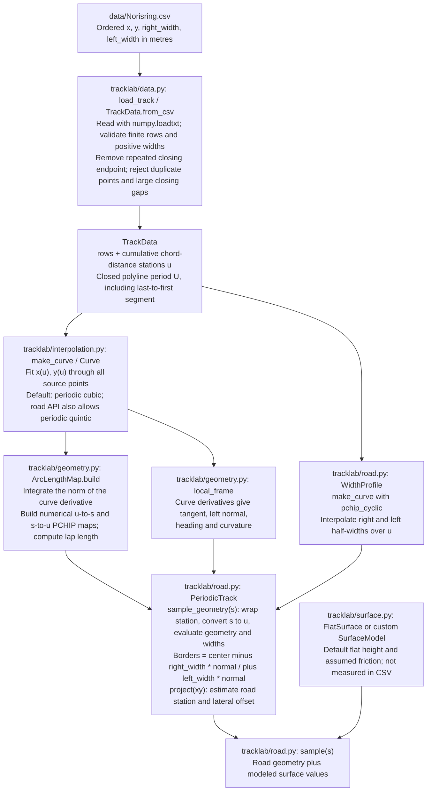
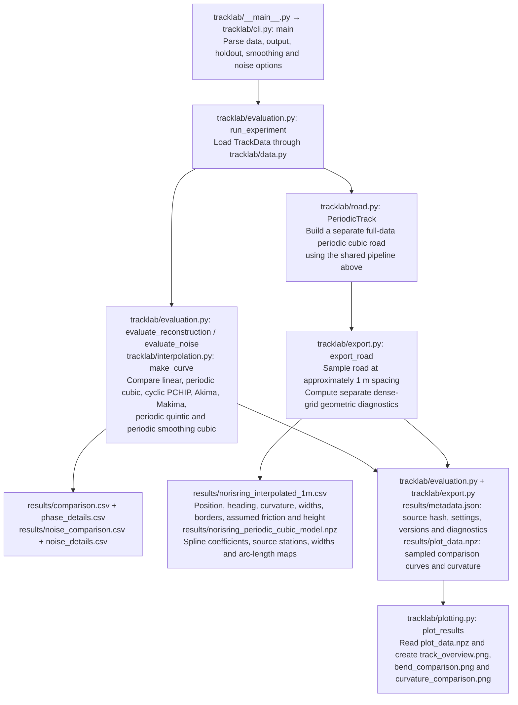

# Modular Norisring road/interpolation study

This package decomposes the previously delivered `racetrack_interpolation_demo.py` into separate data, interpolation, geometry, surface, road, evaluation, export and adapter components. The original 428-line file is preserved in `original/`.

**The offline interpolation study and adapter are separate from the optional driving simulation.** The adapter demonstrates coordinate and per-wheel surface interfaces only. The driving path uses a Python dynamic single-track model and tracking NMPC; it is not a native Open-Car-Dynamics simulation. All interpolation/road benchmark formulas and default numerical outputs are preserved. New input checks and optional custom surface behavior are documented in the modules.

## Run

Python 3.10 or later; numerical tests in this session used Python 3.13.5, NumPy 2.3.5 and SciPy 1.17.0.

```bash
python -m pip install -r requirements.txt
python -m tracklab --data data/Norisring.csv --output results
python examples/query_and_adapter.py
python -m unittest discover -s tests -v
```

`python -m tracklab` runs the offline interpolation comparisons; it is not a car simulation. Add `--no-plots` to omit plotting. To rerun both versions and verify non-timing numerical agreement:

```bash
python validation/check_regression.py
```

The recorded run is in `validation/regression_results.json`, with unit-test output in `validation/component_tests.txt`. Timing measurements are intentionally excluded from equivalence assertions. Scripts need no internet access after downloading this package.

## Import only the road

```python
from tracklab import PeriodicTrack

road = PeriodicTrack("data/Norisring.csv")
query = road.sample(100.0)
print(query["center"], query["curvature_1pm"])

# Position 0.25 m to the left of the reference at 100 m:
point = query["center"] + 0.25 * query["normal_left"]
projection = road.project(point, hint_s=100.0)
print(projection)
```

Construction fits the source and prepares the arc-length maps once. Repeated sampling reuses the objects. Importing `tracklab` does not run the benchmark or import Matplotlib.

## CSV to interpolation, modeling, and output

The shared road-building pipeline below is used by both entry points. Paths are relative to the repository root; arrows show the data passed between stages.



Here `u` is distance along the source polyline, while `s` is numerically integrated distance along the fitted curve. The road object fits and caches its interpolants and maps once, then reuses them for sampling. Road modeling here means constructing continuous geometry, boundaries, and a surface interface; the vehicle dynamics model is a later stage in the driving path.

### Offline interpolation study and road export

Run `python -m tracklab --data data/Norisring.csv --output results`.



Benchmark fits use withheld positions and synthetic noise to compare methods. Their scores do not select or modify the exported road: `PeriodicTrack` independently fits every source point. `--no-plots` skips the PNGs.

### Driving model, closed-loop simulation, and replay

Install `requirements-driving.txt`, then run `python run_drive.py --output drive_results`. To load the supplied configuration explicitly, add `--config configs/default_drive.json`; without `--config`, the dataclass defaults are used.

```mermaid
flowchart TD
    RUN["run_drive.py: main<br/>Parse track, output, configuration and driving overrides"]
    CONFIG["tracklab/driving/config.py: load_config<br/>VehicleConfig + DrivingConfig<br/>Optional configs/default_drive.json or another JSON file"]
    ROAD["tracklab/road.py: PeriodicTrack<br/>CSV → interpolated continuous road<br/>Shared road-building pipeline above"]
    SIM["tracklab/driving/simulation.py: simulate<br/>Initialize vehicle state, plan and controller"]
    PLAN["tracklab/driving/planning.py: CurvatureSpeedPlan<br/>Sample road curvature; build speed envelope<br/>Apply speed, lateral-acceleration, acceleration and braking limits"]
    CTRL["tracklab/driving/controller.py: TrackingMPC.solve<br/>Sample numeric road preview and speed references<br/>CasADi / IPOPT optimize steering target and acceleration command<br/>Keep predicted trajectories; apply first command"]
    PLANT["tracklab/driving/vehicle.py: DynamicBicycle<br/>Tire forces, body dynamics and steering actuation<br/>Integrate actual state over time with plant.step"]
    FEEDBACK["tracklab/driving/simulation.py<br/>Sample surface friction at axles; project actual position onto road<br/>Update progress and pass new state to next controller solve"]
    RESULT["Simulation result<br/>Time, states, applied inputs, progress, solver logs,<br/>predictions, speed plan and configuration"]
    SAVE["tracklab/driving/artifacts.py: save_results"]
    CHECK["tracklab/driving/validation.py<br/>diagnose: tracking, grip and footprint diagnostics<br/>check_recorded_input_replay: independent integration check"]
    FILES["drive_results/<br/>run_raw.npz, diagnostics.npz, trajectory.csv<br/>solver_log.csv, speed_schedule.csv, metrics.json<br/>solves.json, predictions.json, vehicle_config.json, driving_config.json<br/>independent_integration_check.json when enabled"]
    REPLAY["tracklab/driving/replay.py: build_replay<br/>Combine road geometry, sampled states, diagnostics and predictions<br/>Embed JSON into tracklab/driving/replay_template.html"]
    HTML["drive_results/norisring_replay.html<br/>Standalone interactive browser replay"]
    PLOTS["tracklab/driving/plots.py: make_plots<br/>drive_results/trajectory.png, speed.png,<br/>angles.png and tracking_error.png"]
    RUN --> CONFIG
    RUN --> ROAD
    CONFIG --> SIM
    ROAD --> SIM
    SIM --> PLAN --> CTRL
    CTRL --> PLANT --> FEEDBACK
    ROAD --> FEEDBACK
    FEEDBACK -->|next control period| CTRL
    FEEDBACK -->|lap target reached| RESULT
    RESULT --> SAVE --> CHECK --> FILES
    SAVE --> REPLAY --> HTML
    ROAD --> REPLAY
    FILES --> PLOTS
```



The controller tracks the road and planned speed using a dynamic single-track vehicle model; its objective is trajectory tracking. Vehicle states come from time integration of the dynamics. The replay displays those recorded states and controller predictions. `--no-independent-check` skips the independent integration check, and `--no-plots` skips the driving PNGs; the HTML replay is still produced.

## Components

| Module | Role |
|---|---|
| `data.py` | Validate ordered `x,y,right_width,left_width` rows; assign source chord-distance labels. |
| `interpolation.py` | `Curve` common wrapper; `make_curve` factory; seven fitting strategies; smoothing matrix. |
| `geometry.py` | Geometric local frame and `ArcLengthMap`; no tire or controller dependency. |
| `surface.py` | `SurfaceModel` interface and explicit `FlatSurface` assumptions. |
| `road.py` | `WidthProfile` and `PeriodicTrack`; compose the above into queries and projection. |
| `evaluation.py` | Withheld-position test, synthetic-noise test, knot/seam metrics, benchmark orchestration. |
| `export.py` | JSON/CSV helpers and legacy road/coefficients export with geometric diagnostics. |
| `plotting.py` | Plot saved results; not used by the numerical road API. |
| `adapter.py` | NEW planar-car observation, Frenet-coordinate rates and wheel-environment mapping. |
| `cli.py` / `__main__.py` | Parse command-line options and run the offline study. |

See `WALKTHROUGH.md` for equations, original line references, evaluation details and the car-interface limitations. `SOURCE_BROWSER.html` shows numbered source lines; `SOURCE_MAP.json` contains machine-readable definition ranges.

## Preserved behavior and deliberate additions

The two original classes are `Curve` and `PeriodicTrack`. Their default evaluations are preserved. They were not originally one class per interpolation algorithm: `make_curve()` selected a SciPy object and wrapped it in `Curve`.

New components are `TrackData`, `ArcLengthMap`, `WidthProfile`, `FlatSurface`, `PlanarState`, `WheelGeometry`, and `RoadCarAdapter`. The numerical core is extracted rather than rewritten. `PeriodicTrack.sample_geometry()` separates geometry from surface assumptions; `sample()` retains the legacy dictionary keys.

The new code rejects nonfinite stations and invalid modeled surface values. Those extra checks change invalid-input behavior, not the original valid-data results. The old `PeriodicTrack` attributes remain as aliases for compatibility. Some filenames and steering diagnostics still say Norisring and use a 3.2 m wheelbase/0.30 rad limit: these are inherited demonstration settings, not a generic vehicle validation.

## Important limitations

The data is the previously downloaded snapshot with SHA-256 `8857d3c362ad2923c1f93c8d257498f50459770b9021adcc7969b71085c31d9a`. There was no new download or new verification of the physical circuit. It contains no measured friction or elevation.

The benchmark uses station labels calculated from the full source before holding out positions. It tests reconstruction at known stations. Its curvature-noise target is a chosen full-data cubic, not ground truth. The delivered `PeriodicTrack` fits every source point independently of benchmark winners; smoothing remains disallowed there until original boundaries are correctly preserved/reprojected.

The closest-point projection is a grid-seeded local scalar minimization. It does not establish a global minimum or unique road coordinates. A positive `1-curvature*offset` is a local regularity condition, not a global injectivity certificate. Point margins do not imply clearance of a finite car footprint.

Arc length and its inverse are numerical approximations; the inverse is PCHIP (C1). Therefore a quintic centerline alone does not make every `sample(s)` field C2 in s. Headings are principal angles and may wrap at +/-pi. Cyclic station labels may numerically represent a seam as zero or length minus a tiny rounding error.

The adapter's native-named payload is a plain dictionary, not a native binding object. Native construction/copying/stepping and tire-force calculations are not performed. These functions are numerical NumPy/SciPy functions, not CasADi symbolic expressions. The older `X`-monotone graph-road MPC cannot use this closed course by a class-name substitution alone.

## Attribution

The raw track snapshot, attribution and license notices from the prior package are retained. See `NOTICE.txt`, `SOURCES.md`, and `licenses/`. This package and its numerical results are not official TUM simulator output. No physical track accuracy, vehicle safety, global lap-time optimum, or feedback stability guarantee is asserted.
