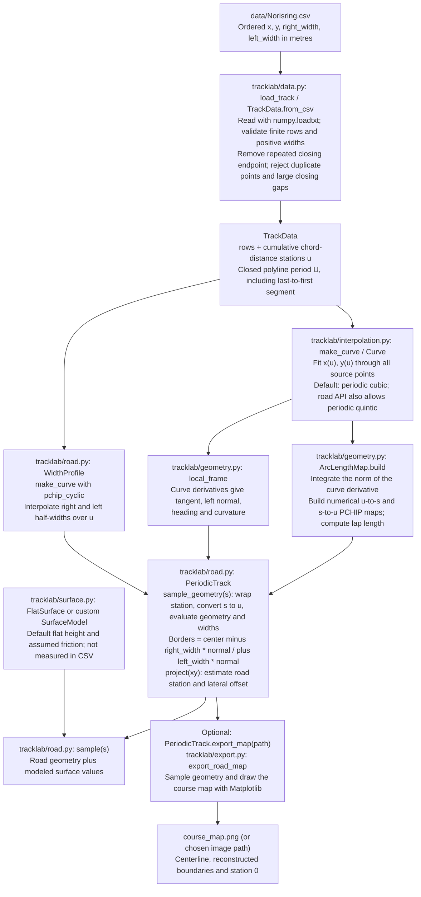
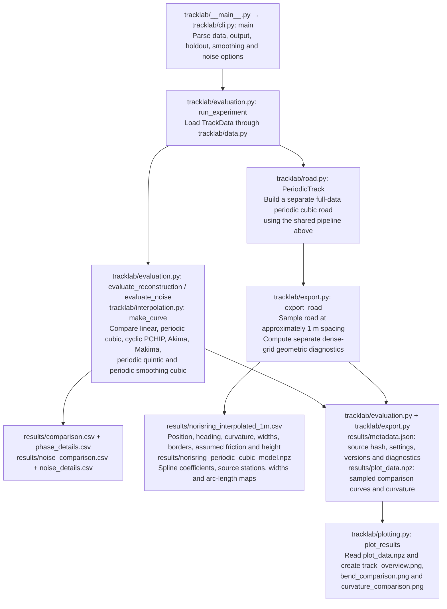

# Modular Norisring road/interpolation study

This package decomposes the previously delivered `racetrack_interpolation_demo.py` into separate data, interpolation, geometry, surface, road, evaluation, export and adapter components. The original 428-line file is preserved in `original/`.

**The road study and the two driving models are separate entry points.**
`tracklab.driving` uses the local Python dynamic single-track model and tracking
NMPC. `tracklab.driving_OCD` uses compiled TUM Open Car Dynamics single-track and
linear-tire components. Both use the same interpolation and road geometry.

See [the model and interpolation equations](#mathematical-models-and-interpolation)
and [the OCD file-by-file integration walkthrough](tracklab/driving_OCD/README.md#file-by-file-integration-walkthrough)
for the implementation details and original-versus-local code comparisons.

## Step-by-step setup from a fresh clone

Use **Python 3.12** for these instructions; `.python-version` already selects it.
The driving requirements pin `casadi==3.7.2`, which has a Python 3.12 wheel but no
Python 3.15 wheel. Creating a 3.15 environment makes uv attempt a source build.
See the [CasADi release files](https://pypi.org/project/casadi/3.7.2/#files).

Choose the environment for what you want to run:

| Workflow | Entry point | Environment used in this guide |
| --- | --- | --- |
| Road/interpolation study and course map | `python -m tracklab` | Windows, Linux, or WSL; Python 3.12 |
| Existing Python vehicle | `python run_drive.py` | Windows, Linux, or WSL; Python 3.12 + CasADi |
| Native TUM single-track + linear tires | `python run_drive_OCD.py` | Ubuntu 24.04 / WSL; Python 3.12 + compiled `.so` |

For native OCD on Windows, you can go directly to **Step 3**. That route also
runs the road study and the existing Python model. Git Bash is a Windows shell;
activating a Windows environment there still uses Windows Python.

### 1. Clone the project

Install [Git](https://git-scm.com/downloads) and
[uv](https://docs.astral.sh/uv/getting-started/installation/) first. On Windows
with WinGet available, run these in PowerShell, then open a new terminal:

```powershell
winget install --id Git.Git -e
winget install --id astral-sh.uv -e
```

Clone in PowerShell, Git Bash, or a Linux shell:

```bash
git clone https://github.com/qdb048sta/racetrack_components.git
cd racetrack_components
```

Run the remaining project commands from the directory containing `README.md`
and `requirements-driving.txt`. Environments, downloaded TUM sources, and native
binaries are created during setup; a fresh clone does not supply a ready-made
environment or compiled library.

### 2. Set up Windows Python for the road study and existing vehicle

In **PowerShell**:

```powershell
uv venv --python 3.12 dev312
.\dev312\Scripts\Activate.ps1
uv pip install -r requirements-driving.txt
python --version
python -c "import casadi; print(casadi.__version__)"
```

In **Git Bash**, use the Bash activation script instead:

```bash
uv venv --python 3.12 dev312
source dev312/Scripts/activate
uv pip install -r requirements-driving.txt
python --version
python -c "import casadi; print(casadi.__version__)"
```

Choose one block; run `uv venv` only when first creating the environment. If an
older environment is active, run `deactivate` first. uv downloads Python 3.12
when needed. The version checks should show `Python 3.12.x` and `3.7.2`.
See [uv's environment guide](https://docs.astral.sh/uv/pip/environments/).

If PowerShell blocks activation, you can use the environment without changing
execution policy:

```powershell
uv pip install --python .\dev312\Scripts\python.exe -r requirements-driving.txt
.\dev312\Scripts\python.exe run_drive.py --laps 0.01 --output drive_smoke
```

If activation remains blocked, replace `python` in all later Windows commands
with `.\dev312\Scripts\python.exe`.

For only the road study, `requirements.txt` is sufficient. The driving
requirements include those base packages plus CasADi. In VS Code, select
`dev312\Scripts\python.exe` using **Python: Select Interpreter**. Keep this
environment separate from `dev/Open-Car-Dynamics`, which is the native source
cache.

Try the road study and then a short Python-model drive:

```bash
python -m tracklab --data data/Norisring.csv --output results
python examples/query_and_adapter.py
python run_drive.py --laps 0.01 --output drive_smoke
```

Open `drive_smoke/norisring_replay.html` in your browser. For a complete lap:

```bash
python run_drive.py --output drive_results
```

This Windows environment runs the existing Python vehicle. Follow Step 3 to
build and run the native TUM vehicle.

### 3. Set up native TUM OCD in Ubuntu / WSL

On Windows, open **PowerShell as administrator** and install Ubuntu under WSL:

```powershell
wsl --install -d Ubuntu-24.04
```

Restart if requested, launch Ubuntu, and finish creating your Linux username
and password. If Ubuntu 24.04 is already installed, just enter it:

```powershell
wsl -d Ubuntu-24.04
```

These are one-time machine setup steps; see
[Microsoft's WSL instructions](https://learn.microsoft.com/en-us/windows/wsl/install).
On native Ubuntu 24.04, start with the Linux commands below.

Run the following **inside Ubuntu**, rather than in the Windows `dev312`
environment:

```bash
sudo apt-get update
sudo apt-get install -y git cmake g++ libeigen3-dev curl ca-certificates
curl -LsSf https://astral.sh/uv/install.sh | sh
export PATH="$HOME/.local/bin:$PATH"

mkdir -p "$HOME/src"
cd "$HOME/src"
git clone https://github.com/qdb048sta/racetrack_components.git
cd racetrack_components

mkdir -p "$HOME/.venvs"
uv venv --python 3.12 "$HOME/.venvs/tracklab-ocd"
source "$HOME/.venvs/tracklab-ocd/bin/activate"
uv pip install -r requirements-driving.txt
python --version
```

This creates a Linux clone at `~/src/racetrack_components` and a persistent
Linux environment at `~/.venvs/tracklab-ocd`. It is separate from any Windows
clone or Windows environment. Install uv inside Linux even if you already have
Windows uv. Do not place the environment in `/tmp`, whose contents can be
cleared. The installer command is from the
[official uv installation guide](https://docs.astral.sh/uv/getting-started/installation/).

If you already cloned the project inside Linux, enter that clone and skip the
`git clone` line. You can also use a Windows clone mounted under `/mnt/c/...`;
change to its actual Linux path instead. The build supports that layout, but a
clone in the Linux filesystem avoids repeated Windows/Linux filesystem access.

Build the native library, then confirm it loads:

```bash
python -m tracklab.driving_OCD.build_native
python -c "from tracklab.driving_OCD.native import NativeVehicle; v = NativeVehicle(); print(v.library_path); v.close()"
```

The build helper downloads the pinned TUM source into `dev/Open-Car-Dynamics`,
fetches its required submodules, verifies their revisions and source hashes,
and compiles `tracklab/driving_OCD/native/tracklab_ocd.so`. You do not need a
separate TUM OCD or ROS installation. Internet access is required for the first
Python/dependency/source downloads. For later builds from the downloaded
source, use `python -m tracklab.driving_OCD.build_native --no-fetch`.

Run a short native smoke test before a complete lap:

```bash
python run_drive_OCD.py --laps 0.01 --output drive_OCD_smoke
python run_drive_OCD.py --config configs/default_drive_OCD.json --output drive_OCD_results
```

Open `drive_OCD_smoke/norisring_replay.html` or
`drive_OCD_results/norisring_replay.html` in a browser. From WSL you can open the
current project folder in Windows Explorer with `explorer.exe .`, then open the
output directory. The replay
embeds its data and does not need a server. `--no-plots` skips PNGs while still
creating the HTML; `--no-independent-check` skips native timestep refinement.

The [native model README](tracklab/driving_OCD/README.md) explains the TUM
components, parameter overrides, and comparison with the existing Python model.

### 4. Run again after opening a new terminal

For the **Windows Python model**, enter the Windows clone and reactivate
`dev312` using the PowerShell or Git Bash activation command from Step 2.

For **native OCD**, open Ubuntu and run:

```bash
cd "$HOME/src/racetrack_components"
source "$HOME/.venvs/tracklab-ocd/bin/activate"
python run_drive_OCD.py --output drive_OCD_results
```

After completing Step 3 with its default paths, you can also launch the Linux
run directly from **PowerShell**:

```powershell
wsl -d Ubuntu-24.04 -- bash -lc 'cd ~/src/racetrack_components && ~/.venvs/tracklab-ocd/bin/python run_drive_OCD.py'
```

Or directly from **Git Bash**:

```bash
MSYS_NO_PATHCONV=1 wsl.exe -d Ubuntu-24.04 -- bash -lc \
  'cd ~/src/racetrack_components && ~/.venvs/tracklab-ocd/bin/python run_drive_OCD.py'
```

The prefix prevents Git Bash from rewriting Linux paths. Both commands select
Linux Python explicitly; a Windows environment cannot load the Linux `.so`.
If you chose another clone or environment location, substitute those paths.

### 5. Run the tests

After the native build, run the complete suite **inside the Linux environment**:

```bash
OPENBLAS_NUM_THREADS=1 OMP_NUM_THREADS=1 MKL_NUM_THREADS=1 \
  python -m unittest discover -s tests -v
```

This includes the native source/force-law checks and a short closed-loop run.
The recorded integration run passed 49 tests. Test output is printed to the
terminal; generated validation reports are local artifacts and are not committed.

If you only set up Windows Python, run the two non-native suites instead:

```bash
python -m unittest discover -s tests -p test_components.py -v
python -m unittest discover -s tests -p test_driving.py -v
```

Running all tests under Windows also selects the native OCD tests and requires
a Windows `tracklab_ocd.dll`, which this WSL setup does not build. To rerun the
offline interpolation regression comparison, use:

```bash
python validation/check_regression.py
```

That regression command rewrites its recorded outputs under `validation/`.
Timing measurements are excluded from equivalence assertions. Once the Python
dependencies and native sources are installed, the study and simulations run
without internet access.

### 6. Common setup errors

| Symptom | Cause and correction |
| --- | --- |
| `Failed to build casadi==3.7.2` / CMake error with Python 3.15 | Use `uv venv --python 3.12` and install the requirements into that environment. Confirm `python --version`. |
| `tracklab_ocd.dll` is missing | The script is using Windows Python. Run the native vehicle through the Linux environment in Step 3 or 4. |
| `tracklab_ocd.so` is missing | In Linux, install the C++ prerequisites and run the native build helper. Compiled libraries are not included in a fresh clone. |
| `uv: command not found` in WSL | Install Linux uv and add `$HOME/.local/bin` to the Linux `PATH`; Windows uv and Linux uv are separate installations. |
| `/tmp/tracklab-ocd-venv/bin/python` no longer exists | That path belonged to the original temporary test environment. Create the persistent environment in Step 3. |
| WSL receives a Git/Windows path instead of a Linux path | Use the `MSYS_NO_PATHCONV=1` prefix shown for Git Bash. |
| VS Code uses the wrong Python | Select `dev312\Scripts\python.exe` for Windows, or open the Linux clone in VS Code's WSL mode and select `~/.venvs/tracklab-ocd/bin/python`. |

Before sharing a new repository revision, commit and push the application
source, `run_drive_OCD.py`, `tests/test_driving_OCD.py`,
`configs/default_drive_OCD.json`, `.gitignore`, and both READMEs. The native source manifest,
bridge, CMake files, and license notices must be included. Virtual environments,
downloaded upstream checkouts, and compiled libraries are recreated by these
steps and should not be copied between machines.

The root `.gitignore` excludes simulation outputs, interpolation exports,
validation reports, Python environments/caches, downloaded TUM sources, and
native build products. Put custom output folders and map exports under
`results/` or `outputs/` so they are also excluded, for example
`python run_drive_OCD.py --output outputs/ocd`. Keep source data in `data/` and
configuration files in `configs/`; those remain version-controlled. Generated
HTML replays are local outputs, while `replay_template.html` is application source.

## Import only the road

```python
from tracklab import PeriodicTrack

road = PeriodicTrack("data/Norisring.csv")
query = road.sample(100.0)
print(query["center"], query["curvature_1pm"])

# Position 0.25 m to the left of the reference at 100 m:
point = query["center"] + 0.25 * query["normal_left"]
projection = road.project(point, hint_s=100.0)
print(projection)

# Save a course map without running the interpolation benchmark:
road.export_map("course_map.png")
```

Construction fits the source and prepares the arc-length maps once. Repeated sampling reuses the objects. Importing `tracklab` does not run the benchmark or import Matplotlib.

`road.export_map(path, spacing_m=1.0)` saves an equal-scale map of the centerline, both reconstructed boundaries, and station 0. The filename extension selects the image format (for example, PNG or SVG); the map uses local coordinates in metres.

## CSV to interpolation, modeling, and output

The shared road-building pipeline below is used by both entry points. Paths are relative to the repository root; arrows show the data passed between stages.



Here `u` is distance along the source polyline, while `s` is numerically integrated distance along the fitted curve. The road object fits and caches its interpolants and maps once, then reuses them for sampling. Road modeling here means constructing continuous geometry, boundaries, and a surface interface; the vehicle dynamics model is a later stage in the driving path.

### Offline interpolation study and road export

Run `python -m tracklab --data data/Norisring.csv --output results`.



Benchmark fits use withheld positions and synthetic noise to compare methods. Their scores do not select or modify the exported road: `PeriodicTrack` independently fits every source point. `--no-plots` skips the PNGs.

### Driving model, closed-loop simulation, and replay

Install `requirements-driving.txt`, then run `python run_drive.py --output drive_results`. To load the supplied configuration explicitly, add `--config configs/default_drive.json`; without `--config`, the dataclass defaults are used.

```mermaid
flowchart TD
    RUN["run_drive.py: main<br/>Parse track, output, configuration and driving overrides"]
    CONFIG["tracklab/driving/config.py: load_config<br/>VehicleConfig + DrivingConfig<br/>Optional configs/default_drive.json or another JSON file"]
    ROAD["tracklab/road.py: PeriodicTrack<br/>CSV → interpolated continuous road<br/>Shared road-building pipeline above"]
    SIM["tracklab/driving/simulation.py: simulate<br/>Initialize vehicle state, plan and controller"]
    PLAN["tracklab/driving/planning.py: CurvatureSpeedPlan<br/>Sample road curvature; build speed envelope<br/>Apply speed, lateral-acceleration, acceleration and braking limits"]
    CTRL["tracklab/driving/controller.py: TrackingMPC.solve<br/>Sample numeric road preview and speed references<br/>CasADi / IPOPT optimize steering target and acceleration command<br/>Keep predicted trajectories; apply first command"]
    PLANT["tracklab/driving/vehicle.py: DynamicBicycle<br/>Tire forces, body dynamics and steering actuation<br/>Integrate actual state over time with plant.step"]
    FEEDBACK["tracklab/driving/simulation.py<br/>Sample surface friction at axles; project actual position onto road<br/>Update progress and pass new state to next controller solve"]
    RESULT["Simulation result<br/>Time, states, applied inputs, progress, solver logs,<br/>predictions, speed plan and configuration"]
    SAVE["tracklab/driving/artifacts.py: save_results"]
    CHECK["tracklab/driving/validation.py<br/>diagnose: tracking, grip and footprint diagnostics<br/>check_recorded_input_replay: independent integration check"]
    FILES["drive_results/<br/>run_raw.npz, diagnostics.npz, trajectory.csv<br/>solver_log.csv, speed_schedule.csv, metrics.json<br/>solves.json, predictions.json, vehicle_config.json, driving_config.json<br/>independent_integration_check.json when enabled"]
    REPLAY["tracklab/driving/replay.py: build_replay<br/>Combine road geometry, sampled states, diagnostics and predictions<br/>Embed JSON into tracklab/driving/replay_template.html"]
    HTML["drive_results/norisring_replay.html<br/>Standalone interactive browser replay"]
    PLOTS["tracklab/driving/plots.py: make_plots<br/>drive_results/trajectory.png, speed.png,<br/>angles.png and tracking_error.png"]
    RUN --> CONFIG
    RUN --> ROAD
    CONFIG --> SIM
    ROAD --> SIM
    SIM --> PLAN --> CTRL
    CTRL --> PLANT --> FEEDBACK
    ROAD --> FEEDBACK
    FEEDBACK -->|next control period| CTRL
    FEEDBACK -->|lap target reached| RESULT
    RESULT --> SAVE --> CHECK --> FILES
    SAVE --> REPLAY --> HTML
    ROAD --> REPLAY
    FILES --> PLOTS
```



The controller tracks the road and planned speed using a dynamic single-track vehicle model; its objective is trajectory tracking. Vehicle states come from time integration of the dynamics. The replay displays those recorded states and controller predictions. `--no-independent-check` skips the independent integration check, and `--no-plots` skips the driving PNGs; the HTML replay is still produced.

## Mathematical models and interpolation

### Shared interpolation and road geometry

Both driving packages use the same [data loader](tracklab/data.py), [interpolants](tracklab/interpolation.py), [geometry](tracklab/geometry.py), and [road API](tracklab/road.py). Neither vehicle model changes the track coordinates. Both run scripts construct `PeriodicTrack(args.track)`, whose centerline defaults to `periodic_cubic`; the road API also accepts `periodic_quintic`. The other methods below belong to the offline comparison, with cyclic PCHIP additionally used for road widths.

**Source distance and curve parameter.** For ordered points $p_i=(x_i,y_i)$, interpret indices cyclically, including the segment from the last point back to the first. [The loader](tracklab/data.py#L15) removes a repeated final endpoint and computes

$$
d_i=\lVert p_{i+1}-p_i\rVert,\qquad u_0=0,\qquad
u_i=\sum_{j=0}^{i-1}d_j,\qquad U=\sum_{i=0}^{n-1}d_i.
$$

Thus $u$ measures distance along the source polyline. It is neither simulation time nor exact distance along the fitted centerline $C(u)=(x(u),y(u))$. Coordinates are fitted independently against these stations. Every `Curve` query wraps its argument to $u_0+((u-u_0)\bmod U)$.

**Seven fitted-curve methods.** For one coordinate $z$, write $h_i=u_{i+1}-u_i$, $q_i=(z_{i+1}-z_i)/h_i$, and $\tau=(u-u_i)/h_i$. The closing sample is $(u_n,z_n)=(U,z_0)$.

| Method | Construction | Continuity in $u$ |
|---|---|---|
| `linear` | Straight segments through every source point | $C^0$ |
| `periodic_cubic` | Exact periodic piecewise cubic | $C^2$ |
| `pchip_cyclic` | Cubic Hermite pieces with PCHIP slopes | $C^1$ |
| `akima_cyclic` | Cubic Hermite pieces with Akima slopes | $C^1$ |
| `makima_cyclic` | Cubic Hermite pieces with modified Akima slopes | $C^1$ |
| `periodic_quintic` | Exact periodic piecewise quintic | $C^4$ |
| `periodic_smoothing_cubic` | Regularized periodic cubic fit | $C^2$ |

Linear interpolation is $z(u)=(1-\tau)z_i+\tau z_{i+1}$. Its tangent jumps at corners; the API deliberately returns undefined curvature (`NaN`) rather than interpreting zero segment curvature as valid corner curvature.

The cubic and quintic splines have interval polynomials

$$
z_i(u)=\sum_{j=0}^{k}a_{ij}(u-u_i)^j,\qquad k\in\{3,5\}.
$$

They interpolate the supplied coordinates. Derivatives through order $k-1$ match between pieces and across the lap seam. [The implementation](tracklab/interpolation.py#L70) delegates the coefficient solve to SciPy `CubicSpline(..., bc_type='periodic')` or `make_interp_spline(..., k=5, bc_type='periodic')`.

PCHIP, Akima, and Makima use the same cubic Hermite polynomial, with different knot slopes $m_i$:

$$
\begin{aligned}
z(u)={}&(2\tau^3-3\tau^2+1)z_i+(\tau^3-2\tau^2+\tau)h_i m_i\\
&+(-2\tau^3+3\tau^2)z_{i+1}+(\tau^3-\tau^2)h_i m_{i+1}.
\end{aligned}
$$

PCHIP sets $m_i=0$ when $q_{i-1}q_i\leq0$; otherwise it uses the weighted harmonic mean

$$
\frac{w_1+w_2}{m_i}=\frac{w_1}{q_{i-1}}+\frac{w_2}{q_i},\qquad
w_1=2h_i+h_{i-1},\quad w_2=h_i+2h_{i-1}.
$$

This preserves each scalar coordinate's local monotonicity; it does not establish that the planar curve has no intersections. See the [SciPy PCHIP slope definition](https://docs.scipy.org/doc/scipy/reference/generated/scipy.interpolate.PchipInterpolator.html).

Akima uses

$$
m_i=\frac{w_1q_{i-1}+w_2q_i}{w_1+w_2},\qquad
w_1=|q_{i+1}-q_i|,\quad w_2=|q_{i-1}-q_{i-2}|.
$$

Makima uses the same slope formula with

$$
w_1=|q_{i+1}-q_i|+\tfrac12|q_{i+1}+q_i|,\qquad
w_2=|q_{i-1}-q_{i-2}|+\tfrac12|q_{i-1}+q_{i-2}|.
$$

SciPy supplies fallback slopes when the weights are degenerate or too small; see its [Akima/Makima definitions](https://docs.scipy.org/doc/scipy/reference/generated/scipy.interpolate.Akima1DInterpolator.html). For these three cyclic methods, the repo prepends the last three samples shifted by $-U$ and appends the first three shifted by $+U$. This gives the seam the correct neighboring slopes; wrapping query positions alone would not do that. Their second derivatives, and therefore curvature, may jump at knots.

The smoothing method solves for fitted nodal positions $V=(v_i)$:

$$
\min_V\left[\sum_i\lVert v_i-p_i\rVert^2+
\lambda\int_0^U\lVert C_V''(u)\rVert^2\,du\right],\qquad
(I+\lambda K)V=P,\quad K_{jk}=\int_0^U B_j''(u)B_k''(u)\,du.
$$

Here $C_V$ is the periodic cubic through $V$ and $B_j$ are its cardinal basis functions. [The smoothing matrix](tracklab/interpolation.py#L48) integrates the products exactly with two Gauss nodes per source interval, then uses a Cholesky solve. The parameter $\lambda$ has units $\mathrm m^3$ with these coordinates; it is a second-derivative penalty in $u$, rather than the geometric curvature energy $\int\kappa^2ds$ or a FITPACK residual budget. Smoothing is confined to the benchmark: moving the driving centerline would require preserving or reprojecting the original road borders.

**Arc length and local geometry.** [ArcLengthMap](tracklab/geometry.py#L36) builds

$$
s(u)=\int_0^u\lVert C'(q)\rVert\,dq,\qquad L=s(U).
$$

The implementation uses eight subintervals per source segment and five-point Gauss quadrature per subinterval. Forward and inverse PCHIP maps approximate $s(u)$ and $u(s)$. Road queries first wrap $s$ modulo $L$, then evaluate the curve at the numerically inverted parameter. The inversion is not an analytic arc-length reparameterization: its $C^1$ interpolation means a quintic centerline alone does not make every sampled field $C^2$ in $s$.

For nonzero $\lVert C'(u)\rVert$, the [local frame](tracklab/geometry.py#L14) is

$$
t=\frac{C'}{\lVert C'\rVert},\qquad n=(-t_y,t_x),\qquad
\psi_{\mathrm{road}}=\operatorname{atan2}(t_y,t_x),\qquad
\kappa=\frac{x'y''-y'x''}{(x'^2+y'^2)^{3/2}}.
$$

Primes here mean derivatives with respect to $u$; the curvature formula remains valid even though $u$ is not fitted-curve arc length. Positive curvature turns left. Heading is a principal angle and may wrap at $\pm\pi$.

The CSV widths are ordered **right, left**. [WidthProfile](tracklab/road.py#L20) fits a cyclic scalar PCHIP to each, giving $w_R(u)$ and $w_L(u)$. The sampled road borders are

$$
b_R=C-w_Rn,\qquad b_L=C+w_Ln.
$$

The course map exported by `PeriodicTrack.export_map()` plots these sampled borders and centerline. The approximately one-metre export grid is a visualization/inspection grid, rather than the dynamics integration step or a clearance guarantee.

**Projection and vehicle coordinates.** `road.project()` estimates the closest station using a grid seed and bounded local minimization of $\lVert p-C(u(s))\rVert^2$. For the selected projection, the adapter defines $e=(p-C)\cdot n$ and $e_\psi=\operatorname{wrap}(\psi-\psi_{\mathrm{road}})$. With body-frame velocities $v_x,v_y$ and yaw rate $r$, its local geometric rate formulas are

$$
\dot s=\frac{v_x\cos e_\psi-v_y\sin e_\psi}{1-\kappa e},\qquad
\dot e=v_x\sin e_\psi+v_y\cos e_\psi,\qquad
\dot e_\psi=r-\kappa\dot s.
$$

These [adapter formulas](tracklab/adapter.py#L96) assume a regular local road tube and the arc-length interpretation of $s$; they do not exactly differentiate the approximate inverse map. A positive $1-\kappa e$ does not establish global projection uniqueness. Point margins $w_L-e$ and $w_R+e$ do not guarantee clearance of a finite car footprint.

[FlatSurface](tracklab/surface.py) supplies the explicit assumptions $\lambda_\mu=1$ and $z_{\mathrm{road}}=0$ by default. The CSV has no measured friction or elevation. The multiplier $\lambda_\mu$ scales a tire model's friction/force parameters; it is not itself a measured tire friction coefficient. `RoadCarAdapter` only maps road observations and wheel environments; the separate driving packages perform vehicle integration and tire-force calculations.

### Coordinates and body equations shared by both cars

The package names are `tracklab/driving` and `tracklab/driving_OCD`. The formulas
below describe their current configured models, including numerical guards.
Use SI units, positive body lateral velocity to the left, and positive yaw and
steering counterclockwise. Let $l_f$ and $l_r$ be the distances from the center
of gravity to the front and rear axles, $L_v=l_f+l_r$, $m$ the mass, $I_z$ the yaw
inertia, and $r$ the yaw rate. $X,Y,\psi$ are global position and heading;
$v_x,v_y$ are body-frame velocities. Both cars use

$$
\begin{aligned}
\dot X&=v_x\cos\psi-v_y\sin\psi,&
\dot Y&=v_x\sin\psi+v_y\cos\psi,& \dot\psi&=r,\\
\dot v_x&=F_x^b/m+rv_y,&
\dot v_y&=F_y^b/m-rv_x,& \dot r&=M_z/I_z.
\end{aligned}
$$

Here $F_x^b,F_y^b$ are the total physical forces in the body frame.
The logged `ax_body_mps2` and `ay_body_mps2` are $F_x^b/m,F_y^b/m$; the
rotating-frame terms make these different from $\dot v_x,\dot v_y$.
Both command vectors are $u=[\delta_{cmd},a_{cmd}]$, where $a_{cmd}$ means
requested tire force divided by mass. It does not prescribe achieved acceleration.

### Existing Python car: `driving/vehicle.py`

[DynamicBicycle and SaturatingAxleTire](tracklab/driving/vehicle.py) are local
Python models. Their seven states are
$z=[X,Y,\psi,v_x,v_y,r,\delta]$. For axle $i\in\{f,r\}$, let
$\lambda_i$ be the road multiplier and $\mu_i=\mu_0\lambda_i$.
The static loads, regularized slip angles, and direct longitudinal allocation are

$$
\begin{gathered}
F_{zf}=mg\frac{l_r}{L_v},\qquad F_{zr}=mg\frac{l_f}{L_v},\qquad
d_v=\sqrt{v_x^2+v_{reg}^2},\\
\alpha_f=\delta-\operatorname{atan2}(v_y+l_fr,d_v),\qquad
\alpha_r=-\operatorname{atan2}(v_y-l_rr,d_v),\\
F_{xi}=\operatorname{clip}\left(F_{zi}\frac{a_{cmd}}{g},
-0.9\mu_iF_{zi},\;0.9\mu_iF_{zi}\right).
\end{gathered}
$$

The axle tire law reserves lateral capacity after longitudinal force:

$$
Q_i=\sqrt{\max\left((\mu_iF_{zi})^2-F_{xi}^2,
0.0025(\mu_iF_{zi})^2\right)},\qquad
F_{yi}=Q_i\tanh\left(\frac{C_\alpha F_{zi}\alpha_i}{Q_i}\right).
$$

Thus $F_{yi}\simeq C_\alpha F_{zi}\alpha_i$ near zero slip and saturates
at $\pm Q_i$. $C_\alpha$ is load-normalized stiffness, rather than an axle
stiffness in N/rad. The square-root floor is part of the implementation; the
longitudinal clipping keeps it inactive in the supported range. These tires
are a Tracklab approximation, rather than TUM's `Linear` tire class.

With $c=\cos\delta$, $s_\delta=\sin\delta$, body forces and yaw moment are

$$
\begin{aligned}
F_x^b&=cF_{xf}-s_\delta F_{yf}+F_{xr}
-\tfrac12\rho(C_dA)v_x|v_x|,\\
F_y^b&=s_\delta F_{xf}+cF_{yf}+F_{yr},\\
M_z&=l_f(s_\delta F_{xf}+cF_{yf})-l_rF_{yr},\\
\dot\delta&=\dot\delta_{max}\tanh\left(
\frac{\delta_{cmd}-\delta}{T_\delta\dot\delta_{max}}\right).
\end{aligned}
$$

The last equation gives a smooth steering lag and bounded rate; steering
commands are also bounded. There are no wheel-speed states, longitudinal slip
dynamics, rolling resistance, aerodynamic lift, or lateral aerodynamic drag.
The plant and CasADi predictor share `evaluate()` as their equation builder.

### Native TUM car: `driving_OCD`

The actual plant compiles pinned TUM C++ components. The separate CasADi
`symbolic_rhs()` in [vehicle.py](tracklab/driving_OCD/vehicle.py) transcribes
their continuous equations for prediction. See the
[file-by-file integration and source comparisons](tracklab/driving_OCD/README.md)
for the original upstream files and the adapter code.

The native state is
$z=[X,Y,\psi,v_x,v_y,r,\omega_{FL},\omega_{FR},\omega_{RL},\omega_{RR},\delta_s]$.
Wheel order is front-left, front-right, rear-left, rear-right. Physical wheel
steering is $\delta=\delta_s+\delta_{offset}$. Left and right wheels on an axle
share contact kinematics; four wheel rotations remain in this single-track
body model. Track width does not enter these body equations.

#### Torque allocation and tire contact kinematics

Tracklab converts the force request to native wheel torque inputs outside the
TUM model, using static load proportions:

$$
T_{FL}=T_{FR}=\frac{ma_{cmd}R}{2}\frac{l_r}{L_v},\qquad
T_{RL}=T_{RR}=\frac{ma_{cmd}R}{2}\frac{l_f}{L_v}.
$$

For the configured common rolling radius $R$, tire-frame velocities are

$$
\begin{aligned}
v_{xf}^t&=v_x\cos\delta+(v_y+l_fr)\sin\delta,&
v_{yf}^t&=-v_x\sin\delta+(v_y+l_fr)\cos\delta,\\
v_{xr}^t&=v_x,&v_{yr}^t&=v_y-l_rr.
\end{aligned}
$$

The pinned [single-track implementation](https://github.com/TUMFTM/Open-Car-Dynamics/blob/94f8fb187fb0ed22bba1d809bd74f66d1ff75af4/lib/ocd_vehicle_dynamics_single_track_cpp/include/ocd_vehicle_dynamics_single_track_cpp/vehicle_dynamics_equations_impl.hpp)
computes each wheel's slip angle and longitudinal slip $\sigma_j$ as

$$
\alpha_j=-\operatorname{atan2}(v_{yj}^t,\max(1,v_{xj}^t)),\qquad
\sigma_j=\operatorname{clip}\left(
\frac{R\omega_j-v_{xj}^t}{\max(3,v_{xj}^t)},-1,1\right).
$$

The denominators use the upstream hard guards, with velocity thresholds in m/s.
They differ from the smooth denominator in the Python model.

#### Linear tires, aerodynamics, and vertical loads

The upstream [linear tire](https://github.com/TUMFTM/Open-Car-Dynamics/blob/94f8fb187fb0ed22bba1d809bd74f66d1ff75af4/lib/ocd_tire_models_cpp/src/linear.cpp),
followed by the body's road scaling, gives per-wheel forces

$$
F_{xj}^t=\lambda_j C_s\sigma_jF_{zj},\qquad
F_{yj}^t=\lambda_j C_\alpha\alpha_jF_{zj},\qquad M_{zj}^{tire}=0.
$$

Both tire forces are set to zero when $v_x^2<0.001$, $v_y^2<0.001$, and
$\omega_j^2<0.001$ for all four wheels. These numerical thresholds are taken
literally from upstream. There is no added force saturation or friction circle;
longitudinal slip clipping does not create a combined-force grip limit.
`nominal_friction` only normalizes OCD utilization diagnostics. The road's
$\lambda_j$ scales both actual native tire forces.

For zero wind, no other external loads, and the retained default lookup-table
corrections, the configured aero model and quasi-static vertical loads are

$$
\begin{gathered}
A_x=-\tfrac12\rho A C_dv_x|v_x|,\quad
A_y=-\tfrac12\rho A C_dv_y|v_y|,\quad
A_z=\tfrac12\rho A C_lv_x^2,\\
W=mg-A_z,\qquad N_f=\frac{Wl_r-A_zd_a}{L_v},\qquad N_r=W-N_f,\\
F_{zFL}=F_{zFR}=\max(0.001,N_f/2),\quad
F_{zRL}=F_{zRR}=\max(0.001,N_r/2).
\end{gathered}
$$

Here $d_a$ is the aerodynamic center offset from the center of gravity.
Negative $C_l$ produces downforce. There is no suspension state or acceleration
load-transfer equation. Summing front and rear tire-frame forces into
$F_{xf}^t,F_{yf}^t,F_{xr}^t,F_{yr}^t$ gives

$$
\begin{aligned}
F_x^b&=\cos\delta F_{xf}^t-\sin\delta F_{yf}^t+F_{xr}^t+A_x,\\
F_y^b&=\sin\delta F_{xf}^t+\cos\delta F_{yf}^t+F_{yr}^t+A_y,\\
M_z&=l_f(\sin\delta F_{xf}^t+\cos\delta F_{yf}^t)-l_rF_{yr}^t.
\end{aligned}
$$

These totals enter the shared planar body equations above.

#### Wheel rotation and hard-limited PT1 steering

The native wheel-torque drivetrain includes the upstream low-speed extra
inertia, rolling resistance, and one-sided wheel-speed derivative guard:

$$
\begin{gathered}
J_{extra}=\max\left(0,15J_r\left(1-\frac{\sum_j\omega_j}{80}\right)\right),\\
q_j=\frac{T_j-(F_{xj}^t+c_{rr}F_{zj})R}{J_{f/r}+J_{extra}},\qquad
\dot\omega_j=\begin{cases}\max(0,q_j),&\omega_j<10^{-5},\\q_j,&\text{otherwise}.\end{cases}
\end{gathered}
$$

$J_f,J_r$ are individual front/rear wheel inertias. The constants and forward
rotation guard are preserved from TUM; this workflow is for forward driving.
For the PT1 actuator,

$$
q_\delta=\operatorname{clip}\left(
\frac{\delta_{cmd}-\delta_s}{T_\delta},-\dot\delta_{max},\dot\delta_{max}\right),\qquad
\dot\delta_s=\begin{cases}
\max(0,q_\delta),&\delta_s\le-\delta_{max},\\
\min(0,q_\delta),&\delta_s\ge\delta_{max},\\
q_\delta,&\text{otherwise}.
\end{cases}
$$

The wheel and steering source comparisons are in the
[OCD README](tracklab/driving_OCD/README.md). The angle guard acts on actuator
position; the configured static offset is applied to the wheel angle afterward.

### Parameters, prediction, and the shared speed plan

These values come from the two [Python](tracklab/driving/config.py) and
[OCD](tracklab/driving_OCD/config.py) configuration dataclasses. They are
demonstration settings, rather than a measured tire/vehicle calibration.

| Quantity | `driving` default | `driving_OCD` default |
| --- | --- | --- |
| $m,I_z,L_v,l_f$ | $800\;kg,1000\;kg\,m^2,3.2\;m,1.724\;m$ | Same |
| $C_\alpha$ | $14\;rad^{-1}$, saturating axle law | $14\;rad^{-1}$, linear per-wheel law |
| $C_s$ and $R$ | No wheel-slip model | $100$ and $0.3\;m$ |
| $T_\delta,\dot\delta_{max},\delta_{max}$ | $0.12\;s,0.9\;rad/s,0.5\;rad$ | $0.06\;s,0.5\;rad/s,0.5\;rad$ |
| Aerodynamics | $C_dA=0.75\;m^2$; longitudinal drag | $A=1\;m^2,C_d=1,C_l=-1.5,d_a=0$ |
| Plant time step | RK4, $0.01\;s$ | Native DoPri, at most $0.0002\;s$ |
| MPC prediction per $0.1\;s$ interval | Four RK4 substeps | One two-stage Radau IIA step |

OCD explicitly replaces upstream tire defaults $C_\alpha=-0.1,C_s=3000$ with
$14,100$ through parameter names; the compiled force equations remain original.
The steering limit also changes from the upstream $0.30$ to $0.50\;rad$.
The [OCD README](tracklab/driving_OCD/README.md#tire-equations-and-parameter-choices)
records the reasons and remaining native defaults.

For an ODE $\dot z=f(z,u)$, the baseline uses classical RK4 for both plant and
prediction. OCD's predictor solves the following implicit Radau equations,
holding the command and road multipliers fixed over prediction substep $h$:

$$
Z_1=z_n+h\left(\tfrac5{12}f(Z_1,u)-\tfrac1{12}f(Z_2,u)\right),\qquad
z_{n+1}=Z_2=z_n+h\left(\tfrac34f(Z_1,u)+\tfrac14f(Z_2,u)\right).
$$

Actual OCD motion calls upstream `VehicleModel::step()` with small native
substeps, with zero-duration output/cache synchronization at adapter boundaries.
The upstream composition retains cached wheel outputs between internal stages.
Continuous symbolic/native derivative agreement therefore does not mean the
predictor and native finite steps are identical. The simulation samples axle
friction every $0.01\;s$ logging interval and holds it during that interval.

Both paths import the same [CurvatureSpeedPlan](tracklab/driving/planning.py).
For a cyclic approximately $\pm1\;m$ maximum envelope $\bar\kappa_i$ of absolute
road curvature, the initial speed cap and cyclic acceleration/braking limits are

$$
v_i^2=\min\left(v_{max}^2,\frac{a_{y,budget}}{\max(\bar\kappa_i,10^{-8})}\right),\quad
v_{i+1}^2\le v_i^2+2a_{plan}\Delta s,\quad
v_i^2\le v_{i+1}^2+2b_{plan}\Delta s.
$$

Defaults are $v_{max}=18\;m/s$, $a_{y,budget}=2\;m/s^2$,
$a_{plan}=1.5\;m/s^2$, and $b_{plan}=2\;m/s^2$.
This reference does not enforce a tire-force limit in the OCD plant. Both MPCs
track position, heading, velocity, yaw rate, and steering while penalizing
commands and command changes. Their approximate reference uses
$\beta_{ref}=\arctan(l_r\kappa)-v^2\kappa/(gC_\alpha)$ and
$\delta_{ref}=\operatorname{clip}(\arctan(L_v\kappa),-\delta_{max},\delta_{max})$;
these are tracking targets, rather than exact equilibria of the complete models.
The road corridor is constrained at prediction knots. Progress is updated by
projecting the integrated position; projection does not reposition the car.

## Components

For the native TUM single-track car with linear tires, use the separate
[`tracklab/driving_OCD`](tracklab/driving_OCD/README.md) package. It builds pinned,
unmodified Open Car Dynamics C++ components, retains this road/interpolation
pipeline, and produces a comparable standalone replay with
`python run_drive_OCD.py --output drive_OCD_results` inside the Linux environment
created above. Its README covers the native
build, parameter overrides, comparison with `driving`, and validation results.

| Module | Role |
|---|---|
| `data.py` | Validate ordered `x,y,right_width,left_width` rows; assign source chord-distance labels. |
| `interpolation.py` | `Curve` common wrapper; `make_curve` factory; seven fitting strategies; smoothing matrix. |
| `geometry.py` | Geometric local frame and `ArcLengthMap`; no tire or controller dependency. |
| `surface.py` | `SurfaceModel` interface and explicit `FlatSurface` assumptions. |
| `road.py` | `WidthProfile` and `PeriodicTrack`; compose the above into queries and projection. |
| `evaluation.py` | Withheld-position test, synthetic-noise test, knot/seam metrics, benchmark orchestration. |
| `export.py` | JSON/CSV helpers, road/coefficients export with geometric diagnostics, and standalone course-map images. |
| `plotting.py` | Plot saved results; not used by the numerical road API. |
| `adapter.py` | NEW planar-car observation, Frenet-coordinate rates and wheel-environment mapping. |
| `cli.py` / `__main__.py` | Parse command-line options and run the offline study. |

See `WALKTHROUGH.md` for equations, original line references, evaluation details and the car-interface limitations. `SOURCE_BROWSER.html` shows numbered source lines; `SOURCE_MAP.json` contains machine-readable definition ranges.

## Preserved behavior and deliberate additions

The two original classes are `Curve` and `PeriodicTrack`. Their default evaluations are preserved. They were not originally one class per interpolation algorithm: `make_curve()` selected a SciPy object and wrapped it in `Curve`.

New components are `TrackData`, `ArcLengthMap`, `WidthProfile`, `FlatSurface`, `PlanarState`, `WheelGeometry`, and `RoadCarAdapter`. The numerical core is extracted rather than rewritten. `PeriodicTrack.sample_geometry()` separates geometry from surface assumptions; `sample()` retains the legacy dictionary keys.

The new code rejects nonfinite stations and invalid modeled surface values. Those extra checks change invalid-input behavior, not the original valid-data results. The old `PeriodicTrack` attributes remain as aliases for compatibility. Some filenames and steering diagnostics still say Norisring and use a 3.2 m wheelbase/0.30 rad limit: these are inherited demonstration settings, not a generic vehicle validation.

## Important limitations

The data is the previously downloaded snapshot with SHA-256 `8857d3c362ad2923c1f93c8d257498f50459770b9021adcc7969b71085c31d9a`. There was no new download or new verification of the physical circuit. It contains no measured friction or elevation.

The benchmark uses station labels calculated from the full source before holding out positions. It tests reconstruction at known stations. Its curvature-noise target is a chosen full-data cubic, not ground truth. The delivered `PeriodicTrack` fits every source point independently of benchmark winners; smoothing remains disallowed there until original boundaries are correctly preserved/reprojected.

The closest-point projection is a grid-seeded local scalar minimization. It does not establish a global minimum or unique road coordinates. A positive `1-curvature*offset` is a local regularity condition, not a global injectivity certificate. Point margins do not imply clearance of a finite car footprint.

Arc length and its inverse are numerical approximations; the inverse is PCHIP (C1). Therefore a quintic centerline alone does not make every `sample(s)` field C2 in s. Headings are principal angles and may wrap at +/-pi. Cyclic station labels may numerically represent a seam as zero or length minus a tiny rounding error.

The `RoadCarAdapter` in `tracklab/adapter.py` returns a plain dictionary for its native-named payload. That road adapter performs no native vehicle construction, stepping, or tire-force calculation; the separate `tracklab.driving_OCD` package performs those operations through its compiled bridge. Road adapter functions use NumPy/SciPy rather than CasADi symbolic expressions. The older `X`-monotone graph-road MPC cannot use this closed course by a class-name substitution alone.

## Attribution

The raw track snapshot, attribution and license notices from the prior package are retained. See `NOTICE.txt`, `SOURCES.md`, and `licenses/`. This package and its numerical results are not official TUM simulator output. No physical track accuracy, vehicle safety, global lap-time optimum, or feedback stability guarantee is asserted.
