# Driving models and tracking control

[Project overview](../README.md) · [Setup](SETUP.md) · [Road workflow](ROAD.md) · [Interpolation equations](INTERPOLATION.md)

This guide covers the existing Python car, shared planar body equations, speed planning, and prediction methods. For the native car's wheel, tire, aerodynamic, and steering equations, see the [OCD model reference](../tracklab/driving_OCD/MODEL.md). Its [integration guide](../tracklab/driving_OCD/INTEGRATION.md) compares upstream and local code file by file.

Run commands from the repository root.

## Coordinates and body equations shared by both cars

The package names are `tracklab/driving` and `tracklab/driving_OCD`. The formulas
below describe their current configured models, including numerical guards.
Use SI units, positive body lateral velocity to the left, and positive yaw and
steering counterclockwise. Let $l_f$ and $l_r$ be the distances from the center
of gravity to the front and rear axles, $L_v=l_f+l_r$, $m$ the mass, $I_z$ the yaw
inertia, and $r$ the yaw rate. $X,Y,\psi$ are global position and heading;
$v_x,v_y$ are body-frame velocities. Both cars use

$$
\begin{aligned}
\dot X&=v_x\cos\psi-v_y\sin\psi,&
\dot Y&=v_x\sin\psi+v_y\cos\psi,& \dot\psi&=r,\\
\dot v_x&=F_x^b/m+rv_y,&
\dot v_y&=F_y^b/m-rv_x,& \dot r&=M_z/I_z.
\end{aligned}
$$

Here $F_x^b,F_y^b$ are the total physical forces in the body frame.
The logged `ax_body_mps2` and `ay_body_mps2` are $F_x^b/m,F_y^b/m$; the
rotating-frame terms make these different from $\dot v_x,\dot v_y$.
Both command vectors are $u=[\delta_{cmd},a_{cmd}]$, where $a_{cmd}$ means
requested tire force divided by mass. It does not prescribe achieved acceleration.

## Python car: `driving/vehicle.py`

[DynamicBicycle and SaturatingAxleTire](../tracklab/driving/vehicle.py) are local
Python models. Their seven states are
$z=[X,Y,\psi,v_x,v_y,r,\delta]$. For axle $i\in\{f,r\}$, let
$\lambda_i$ be the road multiplier and $\mu_i=\mu_0\lambda_i$.
The static loads, regularized slip angles, and direct longitudinal allocation are

$$
\begin{gathered}
F_{zf}=mg\frac{l_r}{L_v},\qquad F_{zr}=mg\frac{l_f}{L_v},\qquad
d_v=\sqrt{v_x^2+v_{reg}^2},\\
\alpha_f=\delta-\operatorname{atan2}(v_y+l_fr,d_v),\qquad
\alpha_r=-\operatorname{atan2}(v_y-l_rr,d_v),\\
F_{xi}=\operatorname{clip}\left(F_{zi}\frac{a_{cmd}}{g},
-0.9\mu_iF_{zi},\;0.9\mu_iF_{zi}\right).
\end{gathered}
$$

The axle tire law reserves lateral capacity after longitudinal force:

$$
Q_i=\sqrt{\max\left((\mu_iF_{zi})^2-F_{xi}^2,
0.0025(\mu_iF_{zi})^2\right)},\qquad
F_{yi}=Q_i\tanh\left(\frac{C_\alpha F_{zi}\alpha_i}{Q_i}\right).
$$

Thus $F_{yi}\simeq C_\alpha F_{zi}\alpha_i$ near zero slip and saturates
at $\pm Q_i$. $C_\alpha$ is load-normalized stiffness, rather than an axle
stiffness in N/rad. The square-root floor is part of the implementation; the
longitudinal clipping keeps it inactive in the supported range. These tires
are a Tracklab approximation, rather than TUM's `Linear` tire class.

With $c=\cos\delta$, $s_\delta=\sin\delta$, body forces and yaw moment are

$$
\begin{aligned}
F_x^b&=cF_{xf}-s_\delta F_{yf}+F_{xr}
-\tfrac12\rho(C_dA)v_x|v_x|,\\
F_y^b&=s_\delta F_{xf}+cF_{yf}+F_{yr},\\
M_z&=l_f(s_\delta F_{xf}+cF_{yf})-l_rF_{yr},\\
\dot\delta&=\dot\delta_{max}\tanh\left(
\frac{\delta_{cmd}-\delta}{T_\delta\dot\delta_{max}}\right).
\end{aligned}
$$

The last equation gives a smooth steering lag and bounded rate; steering
commands are also bounded. There are no wheel-speed states, longitudinal slip
dynamics, rolling resistance, aerodynamic lift, or lateral aerodynamic drag.
The plant and CasADi predictor share `evaluate()` as their equation builder.

## Parameters, prediction, and the shared speed plan

These values come from the two [Python](../tracklab/driving/config.py) and
[OCD](../tracklab/driving_OCD/config.py) configuration dataclasses. They are
demonstration settings, rather than a measured tire/vehicle calibration.

| Quantity | `driving` default | `driving_OCD` default |
| --- | --- | --- |
| $m,I_z,L_v,l_f$ | $800\;kg,1000\;kg\,m^2,3.2\;m,1.724\;m$ | Same |
| $C_\alpha$ | $14\;rad^{-1}$, saturating axle law | $14\;rad^{-1}$, linear per-wheel law |
| $C_s$ and $R$ | No wheel-slip model | $100$ and $0.3\;m$ |
| $T_\delta,\dot\delta_{max},\delta_{max}$ | $0.12\;s,0.9\;rad/s,0.5\;rad$ | $0.06\;s,0.5\;rad/s,0.5\;rad$ |
| Aerodynamics | $C_dA=0.75\;m^2$; longitudinal drag | $A=1\;m^2,C_d=1,C_l=-1.5,d_a=0$ |
| Plant time step | RK4, $0.01\;s$ | Native DoPri, at most $0.0002\;s$ |
| MPC prediction per $0.1\;s$ interval | Four RK4 substeps | One two-stage Radau IIA step |

OCD explicitly replaces upstream tire defaults $C_\alpha=-0.1,C_s=3000$ with
$14,100$ through parameter names; the compiled force equations remain original.
The steering limit also changes from the upstream $0.30$ to $0.50\;rad$.
The [OCD model reference](../tracklab/driving_OCD/MODEL.md#tire-equations-and-parameter-choices)
records the reasons and remaining native defaults.

For an ODE $\dot z=f(z,u)$, the baseline uses classical RK4 for both plant and
prediction. OCD's predictor solves the following implicit Radau equations,
holding the command and road multipliers fixed over prediction substep $h$:

$$
Z_1=z_n+h\left(\tfrac5{12}f(Z_1,u)-\tfrac1{12}f(Z_2,u)\right),\qquad
z_{n+1}=Z_2=z_n+h\left(\tfrac34f(Z_1,u)+\tfrac14f(Z_2,u)\right).
$$

Actual OCD motion calls upstream `VehicleModel::step()` with small native
substeps, with zero-duration output/cache synchronization at adapter boundaries.
The upstream composition retains cached wheel outputs between internal stages.
Continuous symbolic/native derivative agreement therefore does not mean the
predictor and native finite steps are identical. The simulation samples axle
friction every $0.01\;s$ logging interval and holds it during that interval.

Both paths import the same [CurvatureSpeedPlan](../tracklab/driving/planning.py).
For a cyclic approximately $\pm1\;m$ maximum envelope $\bar\kappa_i$ of absolute
road curvature, the initial speed cap and cyclic acceleration/braking limits are

$$
v_i^2=\min\left(v_{max}^2,\frac{a_{y,budget}}{\max(\bar\kappa_i,10^{-8})}\right),\quad
v_{i+1}^2\le v_i^2+2a_{plan}\Delta s,\quad
v_i^2\le v_{i+1}^2+2b_{plan}\Delta s.
$$

Defaults are $v_{max}=18\;m/s$, $a_{y,budget}=2\;m/s^2$,
$a_{plan}=1.5\;m/s^2$, and $b_{plan}=2\;m/s^2$.
This reference does not enforce a tire-force limit in the OCD plant. Both MPCs
track position, heading, velocity, yaw rate, and steering while penalizing
commands and command changes. Their approximate reference uses
$\beta_{ref}=\arctan(l_r\kappa)-v^2\kappa/(gC_\alpha)$ and
$\delta_{ref}=\operatorname{clip}(\arctan(L_v\kappa),-\delta_{max},\delta_{max})$;
these are tracking targets, rather than exact equilibria of the complete models.
The road corridor is constrained at prediction knots. Progress is updated by
projecting the integrated position; projection does not reposition the car.

## Closed-loop simulation and replay

Install `requirements-driving.txt`, then run `python run_drive.py --output drive_results`. To load the supplied configuration explicitly, add `--config configs/default_drive.json`; without `--config`, the dataclass defaults are used.

```mermaid
flowchart TD
    RUN["run_drive.py: main<br/>Parse track, output, configuration and driving overrides"]
    CONFIG["tracklab/driving/config.py: load_config<br/>VehicleConfig + DrivingConfig<br/>Optional configs/default_drive.json or another JSON file"]
    ROAD["tracklab/road.py: PeriodicTrack<br/>CSV → interpolated continuous road<br/>Shared road pipeline: docs/ROAD.md"]
    SIM["tracklab/driving/simulation.py: simulate<br/>Initialize vehicle state, plan and controller"]
    PLAN["tracklab/driving/planning.py: CurvatureSpeedPlan<br/>Sample road curvature; build speed envelope<br/>Apply speed, lateral-acceleration, acceleration and braking limits"]
    CTRL["tracklab/driving/controller.py: TrackingMPC.solve<br/>Sample numeric road preview and speed references<br/>CasADi / IPOPT optimize steering target and acceleration command<br/>Keep predicted trajectories; apply first command"]
    PLANT["tracklab/driving/vehicle.py: DynamicBicycle<br/>Tire forces, body dynamics and steering actuation<br/>Integrate actual state over time with plant.step"]
    FEEDBACK["tracklab/driving/simulation.py<br/>Sample surface friction at axles; project actual position onto road<br/>Update progress and pass new state to next controller solve"]
    RESULT["Simulation result<br/>Time, states, applied inputs, progress, solver logs,<br/>predictions, speed plan and configuration"]
    SAVE["tracklab/driving/artifacts.py: save_results"]
    CHECK["tracklab/driving/validation.py<br/>diagnose: tracking, grip and footprint diagnostics<br/>check_recorded_input_replay: independent integration check"]
    FILES["drive_results/<br/>run_raw.npz, diagnostics.npz, trajectory.csv<br/>solver_log.csv, speed_schedule.csv, metrics.json<br/>solves.json, predictions.json, vehicle_config.json, driving_config.json<br/>independent_integration_check.json when enabled"]
    REPLAY["tracklab/driving/replay.py: build_replay<br/>Combine road geometry, sampled states, diagnostics and predictions<br/>Embed JSON into tracklab/driving/replay_template.html"]
    HTML["drive_results/norisring_replay.html<br/>Standalone interactive browser replay"]
    PLOTS["tracklab/driving/plots.py: make_plots<br/>drive_results/trajectory.png, speed.png,<br/>angles.png and tracking_error.png"]
    RUN --> CONFIG
    RUN --> ROAD
    CONFIG --> SIM
    ROAD --> SIM
    SIM --> PLAN --> CTRL
    CTRL --> PLANT --> FEEDBACK
    ROAD --> FEEDBACK
    FEEDBACK -->|next control period| CTRL
    FEEDBACK -->|lap target reached| RESULT
    RESULT --> SAVE --> CHECK --> FILES
    SAVE --> REPLAY --> HTML
    ROAD --> REPLAY
    FILES --> PLOTS
```

The controller tracks the road and planned speed using a dynamic single-track vehicle model; its objective is trajectory tracking. Vehicle states come from time integration of the dynamics. The replay displays those recorded states and controller predictions. `--no-independent-check` skips the independent integration check, and `--no-plots` skips the driving PNGs; the HTML replay is still produced.
