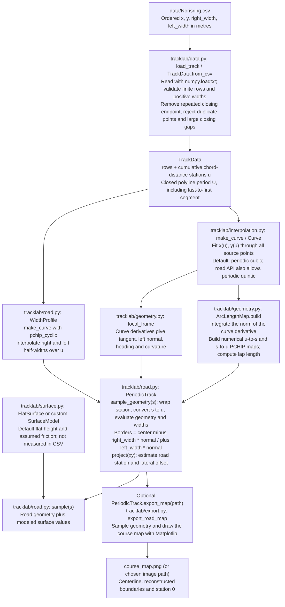
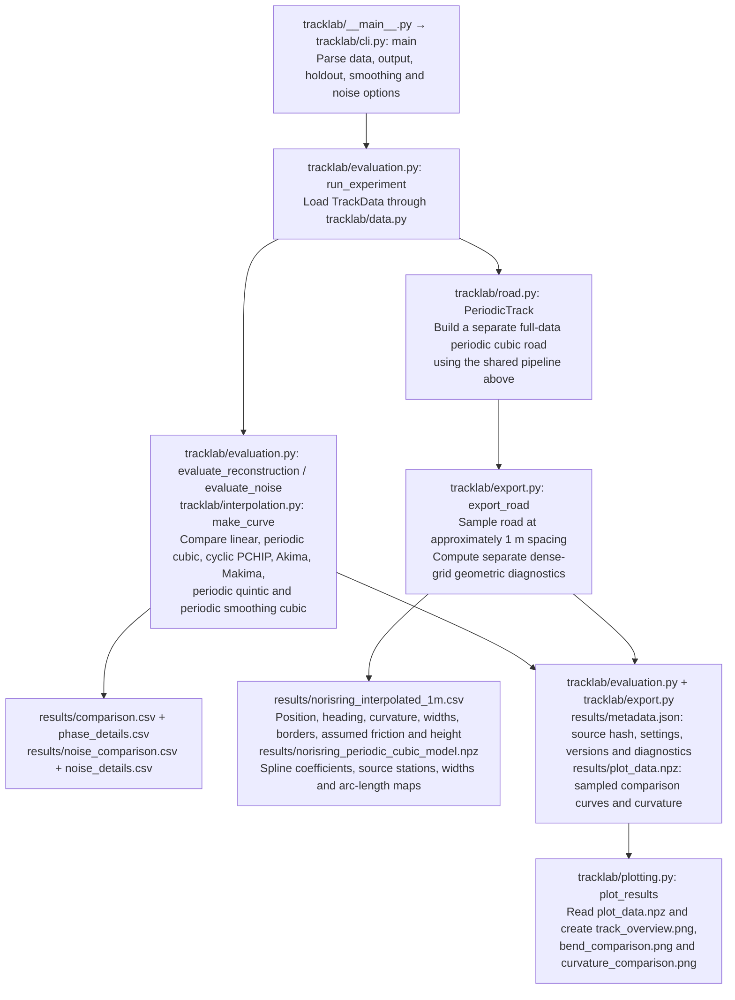

# Road API, exports, and component workflow

[Project overview](../README.md) · [Setup](SETUP.md) · [Interpolation equations](INTERPOLATION.md) · [Driving and control](DRIVING.md)

Run commands and examples from the repository root. Both vehicle packages use this road pipeline.

## Import only the road

```python
from tracklab import PeriodicTrack

road = PeriodicTrack("data/Norisring.csv")
query = road.sample(100.0)
print(query["center"], query["curvature_1pm"])

# Position 0.25 m to the left of the reference at 100 m:
point = query["center"] + 0.25 * query["normal_left"]
projection = road.project(point, hint_s=100.0)
print(projection)

# Save a course map without running the interpolation benchmark:
road.export_map("course_map.png")
```

Construction fits the source and prepares the arc-length maps once. Repeated sampling reuses the objects. Importing `tracklab` does not run the benchmark or import Matplotlib.

`road.export_map(path, spacing_m=1.0)` saves an equal-scale map of the centerline, both reconstructed boundaries, and station 0. The filename extension selects the image format (for example, PNG or SVG); the map uses local coordinates in metres.

## CSV to interpolation, modeling, and output

The shared road-building pipeline below is used by the road study and both driving models. Paths are relative to the repository root; arrows show the data passed between stages.



Here `u` is distance along the source polyline, while `s` is numerically integrated distance along the fitted curve. The road object fits and caches its interpolants and maps once, then reuses them for sampling. Road modeling here means constructing continuous geometry, boundaries, and a surface interface; the vehicle dynamics model is a later stage in the driving path.

### Offline interpolation study and road export

Run `python -m tracklab --data data/Norisring.csv --output results`.



Benchmark fits use withheld positions and synthetic noise to compare methods. Their scores do not select or modify the exported road: `PeriodicTrack` independently fits every source point. `--no-plots` skips the PNGs.

## Components

For the native TUM single-track car with linear tires, use the separate
[`tracklab/driving_OCD`](../tracklab/driving_OCD/README.md) package. It builds pinned,
unmodified Open Car Dynamics C++ components, retains this road/interpolation
pipeline, and produces a comparable standalone replay with
`python run_drive_OCD.py --output drive_OCD_results` inside the Linux environment
described in the [setup guide](SETUP.md). Its component guides cover the native build, parameter overrides, model comparison, and validation results.

| Module | Role |
|---|---|
| [`data.py`](../tracklab/data.py) | Validate ordered `x,y,right_width,left_width` rows; assign source chord-distance labels. |
| [`interpolation.py`](../tracklab/interpolation.py) | `Curve` common wrapper; `make_curve` factory; seven fitting strategies; smoothing matrix. |
| [`geometry.py`](../tracklab/geometry.py) | Geometric local frame and `ArcLengthMap`; no tire or controller dependency. |
| [`surface.py`](../tracklab/surface.py) | `SurfaceModel` interface and explicit `FlatSurface` assumptions. |
| [`road.py`](../tracklab/road.py) | `WidthProfile` and `PeriodicTrack`; compose the above into queries and projection. |
| [`evaluation.py`](../tracklab/evaluation.py) | Withheld-position test, synthetic-noise test, knot/seam metrics, benchmark orchestration. |
| [`export.py`](../tracklab/export.py) | JSON/CSV helpers, road/coefficients export with geometric diagnostics, and standalone course-map images. |
| [`plotting.py`](../tracklab/plotting.py) | Plot saved results; not used by the numerical road API. |
| [`adapter.py`](../tracklab/adapter.py) | NEW planar-car observation, Frenet-coordinate rates and wheel-environment mapping. |
| `cli.py` / `__main__.py` | Parse command-line options and run the offline study. |

See [WALKTHROUGH.md](../WALKTHROUGH.md) for equations, original line references, evaluation details and the car-interface limitations. [SOURCE_BROWSER.html](../SOURCE_BROWSER.html) shows numbered source lines; [SOURCE_MAP.json](../SOURCE_MAP.json) contains machine-readable definition ranges.

## Preserved behavior and deliberate additions

The two original classes are `Curve` and `PeriodicTrack`. Their default evaluations are preserved. They were not originally one class per interpolation algorithm: `make_curve()` selected a SciPy object and wrapped it in `Curve`.

New components are `TrackData`, `ArcLengthMap`, `WidthProfile`, `FlatSurface`, `PlanarState`, `WheelGeometry`, and `RoadCarAdapter`. The numerical core is extracted rather than rewritten. `PeriodicTrack.sample_geometry()` separates geometry from surface assumptions; `sample()` retains the legacy dictionary keys.

The new code rejects nonfinite stations and invalid modeled surface values. Those extra checks change invalid-input behavior, not the original valid-data results. The old `PeriodicTrack` attributes remain as aliases for compatibility. Some filenames and steering diagnostics still say Norisring and use a 3.2 m wheelbase/0.30 rad limit: these are inherited demonstration settings, not a generic vehicle validation.

## Important limitations

The data is the previously downloaded snapshot with SHA-256 `8857d3c362ad2923c1f93c8d257498f50459770b9021adcc7969b71085c31d9a`. There was no new download or new verification of the physical circuit. It contains no measured friction or elevation.

The benchmark uses station labels calculated from the full source before holding out positions. It tests reconstruction at known stations. Its curvature-noise target is a chosen full-data cubic, not ground truth. The delivered `PeriodicTrack` fits every source point independently of benchmark winners; smoothing remains disallowed there until original boundaries are correctly preserved/reprojected.

The closest-point projection is a grid-seeded local scalar minimization. It does not establish a global minimum or unique road coordinates. A positive `1-curvature*offset` is a local regularity condition, not a global injectivity certificate. Point margins do not imply clearance of a finite car footprint.

Arc length and its inverse are numerical approximations; the inverse is PCHIP (C1). Therefore a quintic centerline alone does not make every `sample(s)` field C2 in s. Headings are principal angles and may wrap at +/-pi. Cyclic station labels may numerically represent a seam as zero or length minus a tiny rounding error.

The `RoadCarAdapter` in `tracklab/adapter.py` returns a plain dictionary for its native-named payload. That road adapter performs no native vehicle construction, stepping, or tire-force calculation; the separate `tracklab.driving_OCD` package performs those operations through its compiled bridge. Road adapter functions use NumPy/SciPy rather than CasADi symbolic expressions. The older `X`-monotone graph-road MPC cannot use this closed course by a class-name substitution alone.

## Attribution

The raw track snapshot, attribution and license notices from the prior package are retained. See `NOTICE.txt`, `SOURCES.md`, and `licenses/`. This package and its numerical results are not official TUM simulator output. No physical track accuracy, vehicle safety, global lap-time optimum, or feedback stability guarantee is asserted.
