<!-- Generated from canonical equation source by tools/render_vehicle_reference.py -->

Editable equation source: [EQUATIONS.md](EQUATIONS.md). Equations are self-contained SVG images so they also display inside GitHub tables. Each image has a white background for legibility in light and dark themes.

# Vehicle and tire models: equations, source audit, and Norisring comparison

**Case Study - updated 11 November 2026.** This reference checks the exact native TUM Open-Car-Dynamics composition against the supplied internal report, the supplied Lienkamp slides, and the five doctoral theses in the screenshot. It publishes the mathematical equations, initial and operating conditions, executable adaptations, and fresh simulations.

## Direct answers

**The native OCD double-track model is not the same complete model as the internal report.** Both represent four contact patches and share planar Newton-Euler balances. The report has six planar states and an exponential lateral tire characteristic; the selected native OCD composition has 33 continuous states, dynamic suspension and normal loads, four wheel-spin states, eight relaxed slips, PT1 steering, and MF_SIMPLE tires.

**The uploaded Lienkamp excerpt does not establish an identical OCD model.** Its 90 slides cover chapter 2.1: a hierarchy of single-track models. Double-track chapters appear in the agenda but their content is absent. The internal report cites Lienkamp; that is a source relationship, not proof that every state, tire law, load closure, or parameter is identical. Claims about the professor's other implementations would require those implementations.

The native composition is pinned to `94f8fb187fb0ed22bba1d809bd74f66d1ff75af4`:

`WHEEL_TORQUE / PT1 / DOUBLE_TRACK / MF_SIMPLE / DEFAULT`.

This is distinct from the repository's older `run_drive_OCD.py`, which selects a native single-track model with linear tires. To run the double-track/thesis comparison, use `run_thesis_comparison.py`.

## What is compared

| Selected model | Executed states | Car and tire structure | Source fidelity and limits |
| --- | ---: | --- | --- |
| Native OCD reference | 33 | Four wheels, suspension, body heave/roll/pitch, unsprung motion, relaxed slips, MF_SIMPLE | Actual pinned C++ component equations; nine explicit parameter normalizations |
| Liniger 2018 | 7 | Nonlinear bicycle; simplified lateral Pacejka; rear longitudinal force | Six original states plus steering actuator; common full-size calibration replaces RC-car fit |
| Gao 2014 | 11 | Planar four-wheel car; four wheel rates; static loads; published pure-slip MF | Ten original states plus steering actuator; the unprinted combined-slip implementation is not reproduced |
| Beal 2011 | 13 | Nonlinear yaw-roll chassis; coupled brush tires; four wheel rates | Common-car roll/load/drivetrain closures explicitly supplied; not calibrated P1 hardware |
| Sun 2025 | 5 | CG kinematic bicycle with speed and steering states | No lateral tire force or wheel-slip dynamics; original steering-rate control receives a shared actuator map |
| Lienkamp supplied slides | 7 | Scheduled linear bicycle lateral/yaw model | Basic two-state lateral model augmented with pose, longitudinal motion, and steering for laps |
| Liu 2023 | N/A for a whole car | Structural tire-ring PDEs and rigid/flexible contact subsystem | Equations documented; no unsupported whole-car lap or handling-controller runtime |
| Internal report excerpt | N/A for exact reproduction | Planar double-track with linear or exponential lateral tire option | Load closure, sliding definition, calibration, and referenced code are missing |

The comparison changes the **simulation plant** while using one fixed tracking MPC design. Feedback generates different commands for different plants. Separate identical-command prediction windows therefore measure short-horizon model disagreement. Neither test establishes experimental accuracy against a real vehicle.

The earlier three-book comparison concerned different mathematical layers: Gerdts supplies the optimal-control/ODE-DAE framework; Grune and Pannek the receding-horizon formulation and analysis; Nocedal and Wright numerical optimization methods. Here the changing object is chiefly the physical right-hand side and its force closures. The thesis authors' complete controllers, costs, estimators, terminal guarantees, and experimental vehicles are not being compared as implementations of one algorithm.

## Files and reproduction

The repository README uses locally rendered equation images so display math and table formulas do not depend on GitHub math parsing. The exact editable mathematical source is `EQUATIONS.md`; `equations/equation_manifest.json` maps each image to its LaTeX expression. Original comparison material is retained in `PLANAR_COMPARISON.md`, `LITERATURE.md`, and `recorded/`.

```bash
python -m pip install -r requirements-driving.txt
python -m tracklab.comparison_native.build_native
python run_thesis_comparison.py --scenario both
python -m tracklab.model_comparison.thesis_validation --output outputs/thesis_comparison
python -m tracklab.model_comparison.thesis_report --input outputs/thesis_comparison
```

Run on Linux/WSL with a C++20 compiler and Eigen headers. See the repository setup guide for the environment used by the existing project. Raw data, dependencies and compiled binaries are regenerated locally; compact recorded results, CSVs, provenance, figures and replay are versioned. Source PDFs and screenshots are not uploaded to the public repository.


## Fresh performance comparison

The following results were generated from twelve complete laps in this update. Every run completed with zero failed MPC solves and zero sampled body points outside the road. Minimum sampled body clearance over all runs was 3.535 m. All models follow a prescribed speed profile, so small lap-time differences should not be interpreted as minimum-lap-time performance or proof of physical accuracy.

### Nominal: speed cap 18 m/s, lateral planning budget 3 m/s squared

| Model | Lap time (s) | RMS lateral error (m) | Peak lateral error (m) | Peak contact force ratio |
| --- | ---: | ---: | ---: | ---: |
| Native OCD | 156.332 | 0.0214 | 0.2072 | 0.8841 |
| Liniger bicycle | 156.815 | 0.0172 | 0.1235 | N/A |
| Gao four-wheel | 156.246 | 0.0234 | 0.2331 | 0.9431 |
| Beal yaw-roll | 156.359 | 0.0247 | 0.2389 | 0.7945 |
| Sun kinematic | 156.748 | 0.0007 | 0.0094 | N/A |
| Lienkamp linear | 156.654 | 0.0188 | 0.1520 | N/A |

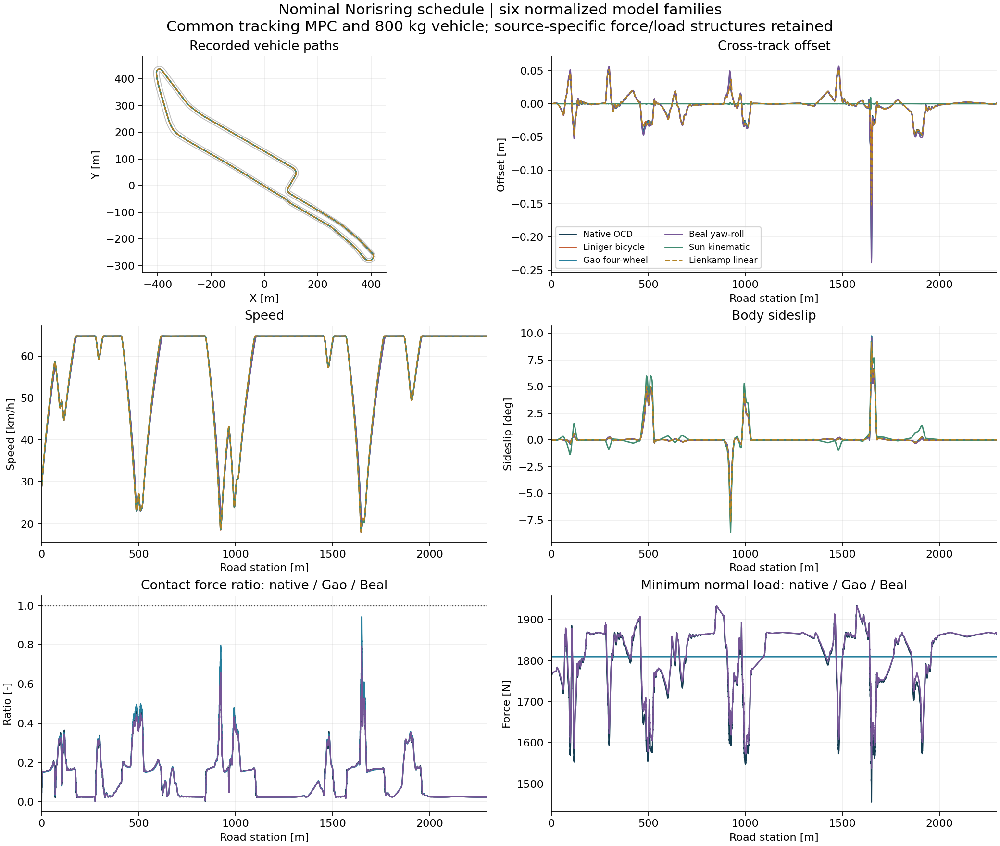

### Demanding: speed cap 30 m/s, lateral planning budget 6 m/s squared

| Model | Lap time (s) | RMS lateral error (m) | Peak lateral error (m) | Peak contact force ratio |
| --- | ---: | ---: | ---: | ---: |
| Native OCD | 120.802 | 0.0658 | 0.4473 | 1.0078 |
| Liniger bicycle | 121.291 | 0.0574 | 0.4128 | N/A |
| Gao four-wheel | 120.568 | 0.0833 | 0.5946 | 1.0138 |
| Beal yaw-roll | 121.030 | 0.0905 | 0.5812 | 0.9694 |
| Sun kinematic | 120.938 | 0.0034 | 0.0454 | N/A |
| Lienkamp linear | 120.957 | 0.0539 | 0.4289 | N/A |

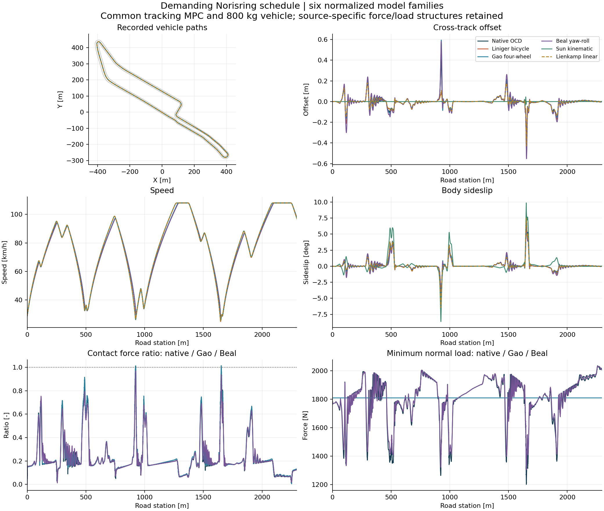

### Identical-command one-second predictions

Twelve predetermined station windows per scenario replay the same native commands without reinitializing within a window. All represented states are copied; Beal converts native CG velocities to its roll-base velocities. Sun necessarily projects the initial motion onto its kinematic manifold. Endpoint position RMSE is the square root of the mean squared Euclidean endpoint error across the twelve windows.

| Model | Nominal endpoint RMSE (m) | Demanding endpoint RMSE (m) | Demanding worst endpoint (m) |
| --- | ---: | ---: | ---: |
| Liniger bicycle | 0.033534 | 0.051566 | 0.061032 |
| Gao four-wheel | 0.009113 | 0.017329 | 0.047456 |
| Beal yaw-roll | 0.011628 | 0.035565 | 0.120858 |
| Sun kinematic | 0.087134 | 0.222911 | 0.572959 |
| Lienkamp linear | 0.094138 | 0.161473 | 0.532203 |

All 120 prediction windows and 36 integration-refinement windows succeeded. Maximum same-step full-state replay position error was 9.342e-12 m. Halving the integration step changed one-second endpoints by at most 9.205e-6 m for native OCD and 5.309e-9 m for the adapters. Refinement includes each model's strongest recorded yaw-rate window. These are local numerical checks, not a global integration-error bound.

### Measured computational cost

The units below are milliseconds of elapsed plant computation per simulated second, including integration. A smaller number is faster in this implementation. The native model is compiled C++; adapters are Python and use a different integrator, so this is not a language-independent complexity ranking. MPC timings use the same predictor/solver and are not the original theses' solver benchmarks.

| Model | Nominal plant ms/s | Demanding plant ms/s | Demanding median MPC solve (ms) |
| --- | ---: | ---: | ---: |
| Native OCD | 9.07 | 8.80 | 9.78 |
| Liniger bicycle | 50.48 | 49.10 | 9.71 |
| Gao four-wheel | 157.52 | 156.39 | 10.35 |
| Beal yaw-roll | 328.33 | 321.62 | 10.43 |
| Sun kinematic | 26.90 | 26.75 | 9.33 |
| Lienkamp linear | 48.60 | 48.21 | 9.77 |

### What the results support

Gao's normalized four-wheel/pure-MF adapter has the smallest short-horizon position mismatch to the selected native OCD reference in these windows. That is consistent with their related planar four-wheel/MF structure, but it is not an experimental accuracy result. Beal explicitly couples longitudinal/lateral force demand; its higher discrepancy includes different tires, load closure and roll assumptions.

Sun has the smallest closed-loop tracking errors because its kinematic equations closely match the common MPC predictor. It cannot establish correct handling-limit tire behavior: it has no tire force or saturation law. Lienkamp's linear tires also have no force saturation. Neither receives a physical contact-force utilization score. Liniger's source-style rear force includes resistance, so its effective net axle-force ratio is retained separately in machine-readable summaries and is N/A in the common contact-force column.

Independent MF_SIMPLE does not enforce a friction circle. The native ratio of 1.0078 and Gao ratio of 1.0138 are therefore expected possible outputs of those independent force closures, not numerical violations of an implemented friction-circle constraint. Beal's normalized brush supplies a coupled peak and stays below it in this run.

For the Case Study architecture, the results support retaining native OCD as the detailed reference plant and using a smaller dynamic model inside MPC when model evaluation cost matters. A Liniger-type dynamic bicycle is a useful starting structure for steering/speed MPC; wheel-specific braking or torque allocation requires separate wheel forces. Choosing a combined-slip law, fitting parameters, and validating against vehicle measurements remain separate requirements before calling any candidate the most accurate physical model.

The [recorded results](recorded_theses/RESULTS.md), [CSV](recorded_theses/summary.csv), [validation](recorded_theses/validation/summary.json), [provenance](recorded_theses/experiment_provenance.json) and [offline replay](recorded_theses/replay.html) make these claims reviewable. Download the HTML replay and open it locally to animate the saved trajectories.


## Conditions and exact benchmark formulation

### Track, initial state, and lap event

All plants use the existing `data/Norisring.csv`, the same periodic cubic centerline, cyclic PCHIP widths, and arc-length parameterization. Track length is 2296.3123672779016 m. The CSV does not measure friction, banking, road height, or tire parameters. The benchmark uses a flat road and unit per-wheel friction multipliers.

The common initial observation is centerline position at station zero, tangent heading, longitudinal speed 8 m/s, zero lateral speed/yaw rate/steering. Four-wheel plants initialize rolling wheel rates; native OCD solves its seven vertical/roll/pitch equilibrium equations. Beal starts with zero roll/rate; its state velocities are converted from the common CG observation. Sun's geometric sideslip is zero at the straight initial steering.

<p align="center">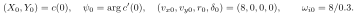</p>

The last equation applies only to models that contain wheel spin. Native initialization and the remaining internal coordinates are defined in its full-equation section.

Road periodicity is a geometric condition. Completing the lap is a first crossing of the unwrapped progress event, linearly interpolated between the last two 20 ms observations:

<p align="center">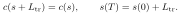</p>

There is no imposed equality of terminal and initial vehicle states, and there is no minimum-time optimization in these runs. A periodic-lap optimal-control problem would require additional endpoint equalities, with yaw understood modulo a full turn.

The Frenet coordinates used for projection satisfy

<p align="center">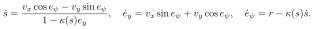</p>

The map requires a locally unique projection and a nonzero denominator. The simulation evolves global Cartesian states; the road-coordinate equations explain the projection geometry and are not extra integrated vehicle states.

### Common speed schedule

The nominal target has an 18 m/s cap and a 3 m/s squared lateral planning budget. The demanding target has a 30 m/s cap and a 6 m/s squared budget. These are reference-generation settings, not enforced physical tire limits or measured speed caps.

On the approximately 0.5 m grid, let 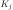 be the maximum absolute curvature in the cyclic approximately plus/minus 1 m neighborhood. Initially,

<p align="center">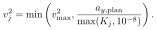</p>

Periodic forward/backward sweeps impose reachability:

<p align="center">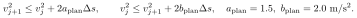</p>

The horizon references advance with the trapezoidal integral of reference speed and the same acceleration/deceleration limits. No individual plant receives a retuned speed schedule.

### Common tracking MPC

Prediction state is 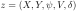; control is 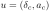. Set

<p align="center">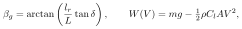</p>

<p align="center">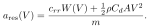</p>

The common predictor is

<p align="center">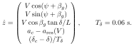</p>

Four RK4 substeps of 0.025 s give the discrete map 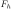 for each 0.1 s control interval. The horizon has 25 intervals, hence 2.5 s. Initial prediction state is the current observed pose, speed magnitude, and steering. At each stage define lateral/along-track errors by projections onto reference normal/tangent. The steering and body-heading references are

<p align="center">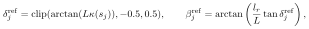</p>

<p align="center">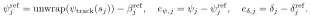</p>

The unwrapped reference heading is aligned to the observed local angle branch. Speed error is relative to the common horizon speed reference. The exact objective is

<p align="center">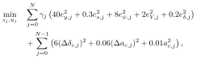</p>

where 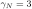 and all other 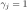. The first input difference uses the last applied control. Constraints are

<p align="center">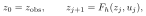</p>

<p align="center">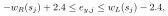</p>

<p align="center">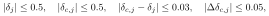</p>

<p align="center">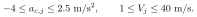</p>

The 0.03 rad target-state difference makes the initial PT1 slope at most 0.5 rad/s. The held target then gives a decaying slope in the predictor. Steering target changes are also bounded by 0.5 rad/s times the 0.1 s sample. The native and adapted plants separately impose their rate-limited actuators. Terminal cost is present; no terminal invariant-set constraint is imposed.

The problem is solved by CasADi/IPOPT with a warm start, tolerance 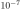 and a maximum of 100 iterations. A failed solve or unacceptable constraint residual stops and records that run; the runner does not silently replace the controller. Identical controller settings do not imply identical realized inputs across feedback experiments.

### Command allocation and physical-domain checks

The acceleration command requests gross force, before resistance. Four equal-left/right wheel torques use static axle weight shares:

<p align="center">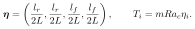</p>

Liniger's adapter sums these into its rear-axle force. Sun and Lienkamp convert the sum into their longitudinal command; those models do not suddenly acquire four independent driven tires by accepting the common interface.

| Condition | Where it belongs | What is actually used |
| --- | --- | --- |
| Initial state | ODE/IVP | Common observation and model-specific internal initialization |
| Closed ring periodicity | Liu PDE spatial boundary | Fields and required spatial derivatives match at zero and a full turn |
| Road corridor | MPC task constraint | Hard predicted center corridor with 2.4 m margin |
| Physical vehicle boundary | Recorded diagnostic | 40 perimeter points of a 4.4 m by 1.9 m rectangle, checked every 20 ms |
| Steering and steering rate | Actuator and MPC | 0.5 rad magnitude; 0.5 rad/s rate |
| Wheel nonreversal | Native derivative clamp / adapter projection | Explicit implementation limits, not a road boundary |
| Normal load | Contact model | Native 0.001 N floor; static or declared algebraic loads in reduced models |
| Friction-circle ratio | Model-dependent diagnostic | Coupled brush has a bounded resultant; native independent MF does not impose a circle |
| Terminal lap event | Experiment stopping condition | One first interpolated crossing, no periodic-state equality |

The sampled rectangle clearance is not a proof of continuous-time collision avoidance. Native integration uses its source DoPri implementation with 0.0005 s substeps; the adapted models use RK4 at 0.001 s with wheel-speed and steering projections. The validation includes smaller-step repeats and identical-command forecast windows. Timings compare these implementations on this host, including Python versus C++, not algorithmic complexity in isolation.


## Complete native OCD33 equations at pinned source

Audit pin: `94f8fb187fb0ed22bba1d809bd74f66d1ff75af4`, composition `WHEEL_TORQUE / PT1 / DOUBLE_TRACK / MF_SIMPLE / DEFAULT`.
This section gives all derivative groups and algebraic force closures for the selected native composition. It retains the signs, state limits, low-speed regularization, and parameter distinctions in the pinned source.

Source files:

1. `lib/ocd_vehicle_dynamics_double_track_cpp/include/ocd_vehicle_dynamics_double_track_cpp/states.hpp`
2. `lib/ocd_vehicle_dynamics_double_track_cpp/include/ocd_vehicle_dynamics_double_track_cpp/vehicle_dynamics_equations_impl.hpp`
3. `lib/ocd_tire_models_cpp/src/mf_simple.cpp`
4. `lib/ocd_aerodynamics_models_cpp/src/default.cpp`
5. `lib/ocd_drivetrain_wheel_torque_cpp/src/drivetrain_direct_torque_eqns.cpp`
6. `lib/ocd_steering_actuator_pt1_cpp/src/steering_actuator_pt1_model.cpp`

### 1. Coordinates, states, inputs

Body  forward, 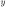 left; yaw  counterclockwise. Heave coordinates positive upward. Roll and pitch use the implemented small-angle suspension geometry. Define 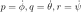.

For wheels 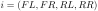, define
<p align="center">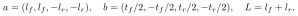</p>
All four-entry vectors below follow that wheel order. Exact native continuous-state storage:
<p align="center">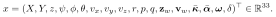</p>
The first 28 entries are the vehicle dynamics model; four 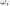 are the wheel-torque drivetrain and one 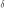 is the PT1 steering actuator. This is 33 **continuous states**, not 33 mechanical degrees of freedom.

Driver input:
<p align="center">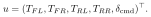</p>
Environment inputs are four nonnegative tire-force scale multipliers 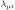, wind 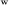, external body force 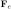, and external torque 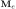. The comparison keeps wind/external force/torque zero. The source logs a road-height input but the selected tire vertical law below does not use it.

### 2. Dependent masses, geometry, preloads

Let  be total vehicle mass, including the four unsprung masses 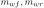 per front/rear wheel:
<p align="center">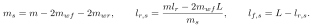</p>
Use 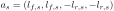.

Tire spring preload compressions:
<p align="center">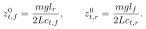</p>
Suspension spring preload compressions:
<p align="center">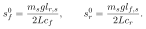</p>
Both sides of an axle use the corresponding same preload. 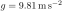. Zero heave states therefore still produce static weight support.

### 3. Effective steering, wheel velocities, slips

Define
<p align="center">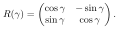</p>
For PT1 state , static steering offset 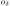, and per-wheel toe-out parameter 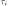,
<p align="center">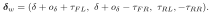</p>
Thus front steering is parallel; rear steering only has configured toe offsets. The comparison has all offsets zero.

Dynamic rolling radius:
<p align="center">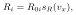</p>
where 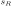 is the source's tabulated linear interpolation. For increasing knots 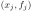, the interpolation is

<p align="center"></p>

The default radius table is , so  throughout the comparison. The aero corrections below use the same endpoint-clamped interpolation.

For each wheel:
<p align="center"></p>
Instantaneous target slips:
<p align="center"></p>
Here 3 and 1 are speeds in ; the denominators do not use absolute speed.

Define , also in . Tire-relaxation time constants are
<p align="center"></p>
The numerators are relaxation lengths in metres.

### 4. Vertical tire loads and MF_SIMPLE

The signed tire spring force is
<p align="center"></p>
Hence . This floor is numerical regularization, not a resolved airborne/contact model. There is no tire vertical damper in this selected closure.

Define
<p align="center"></p>
The selected tire law gives
<p align="center"></p>
<p align="center"></p>
Right tire inputs and lateral outputs are both mirrored in the C++ call; because this particular MF is odd, the displayed law applies on both sides. Camber is passed to the interface but ignored by MF_SIMPLE.

At rest the following override takes precedence:
<p align="center"></p>
Otherwise the MF equations apply, including when relaxed slips are nonzero.

Body-frame forces:
<p align="center"></p>

**No combined-slip constraint is included in MF_SIMPLE.** Longitudinal and lateral forces are evaluated independently. A diagnostic resultant ratio  can occur without violating any implemented force constraint. Do not silently impose a friction-circle projection and still label it native MF_SIMPLE.

### 5. Suspension spring, damper, antiroll, and geometric axle forces

For each wheel:
<p align="center"></p>
Spring and damping forces:
<p align="center"></p>
The damping symbol  here denotes the parameter called `d_f/d_r`, to avoid confusion with displacement .

Antiroll forces:
<p align="center"></p>
<p align="center"></p>

To preserve the exact jacking/anti-squat/anti-dive source branch, define
<p align="center"></p>
Use  and  at the front;  at the rear:
<p align="center"></p>
Then
<p align="center"></p>
The source tests , not body acceleration; at the front  has already been negated before the branch. Its default pitch-center heights are equal, both  m, so this choice does not change the default benchmark coefficients.

### 6. Default aerodynamics and total forces/moments

Let . The default aero source uses:
<p align="center"></p>
<p align="center"></p>
<p align="center"></p>
Both corrections are source interpolation tables. The benchmark defaults make them zero, along with  and wind. Negative  means downforce. Body height is unused by this selected default aero module. The implementation contains no extra drag-height pitching moment.

External-force attenuation:
<p align="center"></p>
Complete totals:
<p align="center"></p>
<p align="center"></p>
<p align="center"></p>
<p align="center"></p>
<p align="center"></p>
The attenuation  applies only to external x/y forces, not tire forces, aero, external vertical force, or external torques. The suspension deflections use sprung-CG distances , while moment totals use whole-vehicle distances , with the gravity correction shown.

### 7. All 33 continuous-state derivatives

#### Body: twelve equations
<p align="center"></p>
<p align="center"></p>
<p align="center"></p>
<p align="center"></p>
This source does not use a general Euler-angle derivative map or gyroscopic cross-coupling. Roll/pitch influence the planar force calculation through suspension/load dynamics.

#### Unsprung vertical motion: eight equations
For each of four wheels:
<p align="center"></p>

#### Slip relaxation: eight equations
For each wheel:
<p align="center"></p>
Only instantaneous target  is clipped; an arbitrary restored relaxed state is not separately projected.

#### Wheel spin: four equations
<p align="center"></p>
<p align="center"></p>
<p align="center"></p>
The thresholds 20 and  are in rad/s.  at the front and  at the rear. Rolling resistance is positive for this forward-motion model and enters wheel torque; it is **not** also subtracted directly in . An engine-inertia parameter is declared but does not enter these selected wheel-torque equations. The wheel boundary is derivative clipping, not exact finite-step state projection.

#### Steering: one equation
<p align="center"></p>
<p align="center"></p>
The physical angle is  before toe correction; measured feedback is . Native steering load torque is zero. No steering rack inertia is present.

### 8. Initialization and numerical/physical boundaries

Upstream zero states, benchmark moving-car trim, and a restored full-state snapshot are distinct operations.

Benchmark initial position is the centerline start, initial yaw is its tangent, , . Four wheel rates start at ; all relaxed slips are zero. Vertical coordinates are solved from:
<p align="center"></p>
The unknowns are . All vertical/roll/pitch rates begin zero. This is a vertical trim, not full longitudinal/cornering equilibrium.

For a general positive-speed common-observation reset, the adapter takes
<p align="center"></p>
under zero-toe/unit-radius-scale comparison assumptions, then performs that vertical trim. A supplied full 33-state snapshot is restored directly.

Source physical domains: positive masses/inertias/stiffnesses, , positive time constants, sensible interpolation tables. Numerical guards: contact floor, slip floors/clipping, rest override, nonnegative-wheel derivative boundary, PT1 steering rate/magnitude derivative boundary.

The native plant has no track corridor, terminal equality, periodic lap condition, wheel torque magnitude/rate bound, engine power/battery bound, or combined tire-friction circle in MF_SIMPLE. Those must be assigned to controller/test setup if used.

The bridge's fixed integration substep is 0.0005 s by default. Native composition caches wheel-speed output between derivative evaluations; the bridge zero-duration synchronization at reset/evaluate/output boundaries preserves upstream physical stepping. Therefore equations above are exact **component derivative laws**; do not claim a mathematically pure explicit-RK assembled evaluation without acknowledging caching.

### 9. Parameter audit

Prior report parameter table matches source declarations:
-  kg; each  kg.
- .
-  m; tracks  m.
-  m.
- .
- ; .
-  m, .
-  in SI.
- MF upstream: ; .
- Comparison explicitly changes all eight MF  peaks to 1.0. Since small-slip stiffness is , this also changes stiffness; it is not only a cap adjustment.
- Steering:  s,  rad/s; native  rad, comparison override  rad.


## Source identity audit  -  internal report, Lienkamp, native OCD

The supplied PDFs and pinned native implementation were checked directly. The page references below distinguish printed page numbers from PDF page indices.

### Source files and pagination

- Internal report: `upload/Car model - internal report partly - check it before use (1)(2).pdf`. Six PDF pages only: PDF 1=printed 2, PDF 2=printed 3, PDF 3=printed 4, PDF 4=printed 5, PDF 5=printed 6, PDF 6=printed 20 (references). The referenced Listings (4)/(5) are absent.
- Lienkamp: `upload/Lienkamp - 2019 - Dynamik der Straßenfahrzeuge (1)(2).pdf`. Ninety PDF pages, mostly printed slide `2.1 - n` matching PDF page n. Only chapter 2.1, including linear/nonlinear single-track and trailer. Slide 2 agenda lists double-track chapters 2.2-2.6, and multi-body/FEM 2.7; those chapters are not in this upload.
- Native source pin: `TUMFTM/Open-Car-Dynamics@94f8fb187fb0ed22bba1d809bd74f66d1ff75af4`.
  - `lib/ocd_vehicle_dynamics_double_track_cpp/include/ocd_vehicle_dynamics_double_track_cpp/states.hpp`
  - `.../vehicle_dynamics_equations_impl.hpp`
  - `lib/ocd_tire_models_cpp/src/mf_simple.cpp`.
  Checked against the pinned source checkout.

### Conclusions

1. **Native OCD is not the internal-report model.** Both are double-track at the geometric level (four contact patches), but the internal report is a planar six-state yaw/sideslip/speed model with zero CG height, a lumped body-axis driving force, no wheel spin, no tire relaxation, no suspension or roll/pitch/heave. Its nonlinear lateral tire law is of Burckhardt form, not MF_SIMPLE.
2. **The supplied Lienkamp document is not native OCD either.** It teaches a hierarchy of single-track models. We cannot identify the absent double-track chapters with native OCD merely from the course title, affiliation, or agenda. The internal report explicitly cites Lienkamp as reference [1], demonstrating pedagogical lineage, not numerical identity.
3. **Do not claim a fully faithful executable internal-report reproduction.** Missing  definition, normal-load equations,  values, vehicle parameters, numerical regularization, and referenced MATLAB code prevent exact reproduction from the provided excerpt.
4. **Do not call every Lienkamp equation exact without correction.** Slide 65 has two visible algebraic inconsistencies compared with slide 64 (see below).
5. Native selected composition has 28 vehicle states plus four wheel angular velocities and one steering state, i.e. 33. A six-state reduction is a separate model.

### Common audited convention

Use body  forward,  left, yaw  counterclockwise, . Let , , speed , . Wheel contact coordinates  are:
<p align="center"></p>
in FL,FR,RL,RR order. The force transform is
<p align="center"></p>

### Internal report  -  supplied equations

#### Planar force balances: printed p.3/PDF 2, Eqs.(1)-(3)

Let , front force sum , rear sum .
<p align="center"></p>
The report prints:
<p align="center"></p>
**Audit:** The four track-width  signs are inconsistent with the forward wheel-velocity/slip denominators printed in Eqs.(10)-(13), when read in one common body convention. A Newton/Euler consistent implementation should use the cross-product equation above, which gives  for left and  for right. Preserve the printed form when quoting, mark corrected form when implementing. The Figure 2 y-axis points page-right while force  points page-left; the illustration is itself convention-confusing.

#### Six-state ODE: printed p.4/PDF 3, Eqs.(4)-(8)

States , inputs :
<p align="center"></p>
<p align="center"></p>
<p align="center"></p>
The paper repeats its printed yaw form as Eq.(7). The  equation is implicit but required to form a first-order system.

#### Slip and linear tire: printed p.5/PDF 4, Eqs.(9)-(13)

<p align="center"></p>
The report explicitly gives all four wheel denominators . It uses plain  of a quotient, not a quadrant-aware . An implementation must either restrict positive wheel-longitudinal speed or state its quadrant/low-speed modification.

#### Nonlinear tire: printed p.6/PDF 5, Eqs.(14)-(17)

<p align="center"></p>
<p align="center"></p>
This is **not Pacejka**. Calling it Burckhardt-type describes the functional form; the excerpt does not name it.
-  is described in words as lateral sliding, but no equation is supplied.
-  is said to depend on , but no load closure is supplied. This could create an algebraic feedback requiring explicit solution, but the excerpt does not say how.
- Setting CG height to zero (p.3) removes ordinary height-induced quasi-static load transfer in the planar mechanics. Its earlier prose about differential wheel load therefore does not by itself supply a valid load-transfer model.
- At ,  and the written force ratio is . A continuous extension must be specified. If one additionally assumes , then the limit is zero and near-zero stiffness is , but that assumption is **not in the excerpt**.
- No combined-slip longitudinal force model, wheel torque equation, or friction ellipse is provided.
- No initial values, boundary conditions, actuator bounds, or optimal-control constraints are supplied in the excerpt.

#### Other factual wording errors

Printed p.4 describes yaw rate as "angular momentum ... also torque." These are different quantities:  is angular velocity,  is angular momentum,  is torque in the planar model. Large yaw rate alone is not a general instability criterion; steady tight turning can have high yaw rate. Large sideslip alone is likewise not a complete stability test.

### Lienkamp  -  audited equations and source map

#### Assumptions and notation

- Slide/PDF 10: combine left/right wheels by axle, CG at road level, no roll/pitch/vertical dynamics, no left/right normal-load difference, constant longitudinal speed in the basic model, small angles.
- Slide/PDF 13: states , inputs vehicle speed  and steering .
- Slide/PDF 14: counterclockwise angles positive; slip angle convention chosen so positive slip induces positive lateral force.
- Slides/PDF 17-18: Newton/Euler planar balances.
- Slide/PDF 20 Eqs.(2-4),(2-5): approximate slips . The footnote says this small-angle slip approximation is used also in the nonlinear single-track treatment, while the exact relation is used later in the double-track model.
- Slides/PDF 23,58,60,63 summarize four variants, not one universal "Lienkamp model."

#### Constant-speed linear bicycle: slide/PDF 24, Eqs.(2-6)-(2-9)

<p align="center"></p>
<p align="center"></p>
Equivalently
<p align="center"></p>
Kinematics , longitudinal control, steering dynamics etc. added for a lap simulator are **benchmark augmentations**, not states of this original two-state lateral model.

#### Nonlinear bicycle families: slides/PDF 59,62,64

Using  from either linear or empirically varying cornering stiffness, the general variable-speed version on p.64 is
<p align="center"></p>
<p align="center"></p>
- p.59 Eqs.(2-21),(2-22): finite trigonometric body dynamics, linear , constant speed.
- p.62 Eqs.(2-23),(2-24): , nonlinear tire characteristic, constant speed.
- p.64: adds drive force/variable speed.
- p.65 Eqs.(2-25)-(2-27): expanded stiffness form, with two apparent errors compared to p.64:
  1. Eq.(2-25) prints ; projection of the body-x drive force onto the velocity normal gives **minus**, as already printed on p.64.
  2. Eq.(2-26) prints ; body-y rear force with unsteered rear wheel has yaw lever , with **no **. p.64 is consistent.
These were checked visually using a page render.
- p.66 uses example parameters , , , frontal area , , . Those are teaching-example values, not native OCD vehicle identification.
- The uploaded slides never define MF_SIMPLE, Burckhardt coefficients, a calibrated load-sensitive tire law, or the native 33-state system.

### Native OCD identity details verified at pin

#### Actual state vector

Vehicle subsystem 28 states:
<p align="center"></p>
Selected full composition adds : total 33. Here .

#### Shared planar skeleton

<p align="center"></p>
<p align="center"></p>
All double-track/bicycle versions may share a Newton/Euler skeleton while differing in closure; that does not make them identical.

#### Native slip and delay

Let wheel ground velocity in body frame be , rotate to tire frame by  to get . Toe-out is added with positive left/negative right sign.
<p align="center"></p>
<p align="center"></p>
<p align="center"></p>
The constants have the source's SI interpretation (velocity m/s, relaxation lengths m, time seconds). Do not substitute an unregularized textbook definition and label it exact OCD.

#### Native MF_SIMPLE

Define
<p align="center"></p>
Then, for symmetric MF_SIMPLE:
<p align="center"></p>
Native evaluates longitudinal and lateral forces independently. **It does not enforce a combined-slip friction circle/ellipse** in MF_SIMPLE. Therefore a resultant force ratio >1 under a circle diagnostic does not prove the simulation is numerically broken; it exposes this tire-law limitation. Native camber argument is supplied but MF_SIMPLE ignores it.
Default declared coefficients: longitudinal , lateral , but benchmark may override them; do not imply these are benchmark values without checking configuration.
At rest the vehicle subsystem sets tire forces to zero when squared body velocities and all squared wheel speeds are individually <0.001.

#### Native vertical closures

Native has sprung mass , roll/pitch/heave, four unsprung vertical oscillators, suspension springs/dampers, antiroll bars, geometric jacking/squat/dive. Its normal load comes from tire spring compression:
<p align="center"></p>
This is materially different from a static or algebraic quasi-static load estimate.

#### Model identity comparison table

| Feature | Internal report excerpt | Supplied Lienkamp | Selected native OCD |
|---|---|---|---|
| Contact patches | Four | Two equivalent axle contacts | Four |
| Core motion | Planar yaw, speed, sideslip | Two-state lateral or nonlinear bicycle family | Planar + roll/pitch/heave + unsprung vertical motion |
| Full state count | 6 after adding yaw state | 2 for basic constant-speed model | 33 selected composition |
| Normal-load law | Mentioned but omitted | No left/right difference in basic model | Tire/suspension/unsprung dynamics |
| Tire law | Linear or exponential Burckhardt-type lateral law | Linear or unspecified varying stiffness curve | MF_SIMPLE pure longitudinal/lateral |
| Wheel rotation | Absent | Absent in shown bicycle | Four wheel spin states |
| Tire relaxation | Absent | Absent | Eight slip-relaxation states |
| Steering | Front/rear angle inputs | Front steering input | One PT1 steering state in selected composition |
| Aerodynamics | Not in provided equations | Discussion/example resistance | DEFAULT aero module |
| Fully specified supplied implementation? | No, excerpt incomplete | Not for all nonlinear tire curves | Yes, pinned C++ source plus parameter configuration |


## Thesis car and tire equations


The symbols below are harmonized for comparison; equation numbers remain those of the original thesis. A harmonized symbol is not a claim that the source vehicle has the common benchmark parameters.

### Liniger: complete selected nonlinear bicycle

Source: §3.1, Eqs3.1-3.2, printed18-19. Let `a=lf`, `b=lr`, yaw `psi`, yaw rate `r`, body longitudinal/lateral velocities `u,v`. Original state is `(X,Y,psi,u,v,r)` and control is `(d,delta)`.

<p align="center"></p>

<p align="center"></p>

The displayed source model is for forward motion `u>0`; `u=0` requires a numerical continuation/another model. It has no explicit vertical-load, wheel-spin, pitch/roll, tire-relaxation or combined-slip state. No terminal/boundary constraints belong intrinsically to this ODE. In the source tracking MPC, the current estimated state initializes each horizon, with track/input admissibility and a trajectory-tracking objective; the benchmark uses its own common tracking controller.

**Benchmark additions:** seventh state `delta`, PT1 steering target-to-angle law, full-size common-car geometry/mass/inertia and axle tire coefficients, a wheel-torque-to-rear-force mapping, and shared aerodynamic/resistance terms instead of the source RC motor calibration. These need be stated in the implementation section rather than attributed to Eq3.2c.

### Gao: complete published selected four-wheel subsystem

Source: §2.2, Eqs2.5-2.11, printed11-13/PDF24-26. Original ten states are body u,v,heading,yaw rate,global X,Y and four wheel rates. Original inputs are one front steering angle and four wheel torques.

For wheel `i` at body coordinates `(x_i,y_i)`:

<p align="center"></p>

<p align="center"></p>

<p align="center"></p>

The corresponding nonzero denominators are required. At rolling equality use `s_i=0`. For forward positive speeds this is `(Rw omega_i - Vli)/max(Vli,Rw omega_i)`; it differs from Beal's velocity-denominator slip and from OCD's velocity-denominator target, which is additionally clipped to [-1,1].

<p align="center"></p>

The last line is **as printed** in Eq2.5. The coefficient is described as damping although it multiplies `omega_dot`. With `b_w=0`, both literal and conventional viscous-damping interpretations coincide. Otherwise an explicit modeling correction is needed.

<p align="center"></p>

The source force functions are `Fci=fc(alpha_i,s_i,mu,Fzi)` and `Fli=fl(alpha_i,s_i,mu,Fzi)`. The **published pure-slip** Pacejka formula (§2.4, Eqs2.21-2.22, p16/PDF29) is

<p align="center"></p>

Here `xi=s` for longitudinal force or `xi=alpha` for lateral force, with signs set consistently with the source's opposing lateral force convention. The source explicitly does not print its combined-slip extension. Therefore the complete exact combined-slip Gao plant cannot be reconstructed from these pages alone; independent pure-slip forces are a declared closure of the benchmark.

#### Gao's separate modified-Fiala alternative

Source Eqs2.23-2.24, p18 and21/PDF31 and34. Set

<p align="center"></p>

The conventional odd-symmetric form is

<p align="center"></p>

This displayed conventional form makes a **declared correction**: original Eq2.23 visibly prints `t^2` in the final term. Positive `D_y` and `|Fl|<=mu Fz` are required; zero-availability limit must be handled separately. This is a lateral force law taking longitudinal force as an input, not an independent formula for longitudinal slip force. It is not the selected benchmark Gao tire if the benchmark uses the source's published pure MF.

### Beal: complete selected coupled-brush and yaw-roll equations

Source tire Eq2.7, p25/PDF36. Let `mu` be its adhesion coefficient, `mu_s` sliding coefficient, `C_x,C_alpha` longitudinal/cornering stiffness, wheel-frame slip angle `alpha=atan(Vc/Vl)` and

<p align="center"></p>

<p align="center"></p>

At `gamma=0`, force is zero by continuous extension. This form assumes `Vl!=0`, `1+kappa!=0`, and positive contact load. Floors/caps at low speed are numerical implementation choices. Peak normalization for comparisons must use the actual maximum of this polynomial, not just the parameter named `mu`.

Define `Rmu=mu_s/mu`, `q=1/(1-2 Rmu/3)`. The internal-force peak is

<p align="center"></p>

For `Rmu=11/12`, bracket=`45/49`; choosing internal `mu=49/45` makes actual resultant peak `Fz`. Then sliding `mu_s=539/540`, not exactly1.

For the full yaw-roll model use source roll-base velocities `U,V`, roll `phi`, roll rate `p`, yaw rate `r`, CG height above the roll axis `h` (source h-prime), mass `m`, principal inertias `Ix,Iy,Iz`, suspension `Kphi,bphi`. Source Eq2.10, p27/PDF38, is equivalently

<p align="center"></p>

For parallel front steering and wheel-fixed forces (subscripts `fl,fr,rl,rr`), let `a,b` be front/rear axle distances from the CG and `d` the full source track width. Source generalized forces are

<p align="center"></p>

The benchmark should publish the adopted wheel-spin ODE, normal-load distribution, aero moments and shared parameters separately: these are not fully specified by Eq2.10. The conversion needed when logging/initializing CG velocities is

<p align="center"></p>

The corresponding CG pose kinematics are

<p align="center"></p>

The initial state must include consistent roll/base velocities and wheel rates. Source pure model has12 states if global pose plus3 planar velocities plus4 wheel rates plus2 roll states are retained; common PT1 steering gives13.

#### Beal's MPC predictor is a different reduced model

Source Eqs2.15-2.16 pp30/PDF41 and AFI2.18-2.21 p32/PDF43:

<p align="center"></p>

For AFI, control is `Fyf` and

<p align="center"></p>

The local quantities are updated from the current operating point. For fixed positive speed this gives an affine system in `(beta,r)` and `Fyf`. Envelope constraints, front force/input bounds and a driver-intent objective are central to the original controller. Running the nonlinear Eq2.10 plant with a shared new controller does not reproduce that source controller.

### Sun: complete kinematic model and distinct eco-driving model

Chapter5 Eq5.1, p106, original FIVE-state model:

<p align="center"></p>

<p align="center"></p>

`a,nu` are acceleration and steering-rate controls. `beta` is algebraic geometry, not an independently evolving tire slip. There is no tire-force law, so measured tire utilization/slip metrics are N/A. Original path constraints are inter-vehicle/obstacle separation, non-position state/input admissible sets, and terminal position ball in Eq5.11 p112. The primary model should not be interpreted as valid at handling saturation solely because it has small tracking error.

Chapter3 uses a separate longitudinal model, Eqs3.4-3.6 pp43-44:

<p align="center"></p>

<p align="center"></p>

<p align="center"></p>

The factor2 reflects the source vehicle's two motors. This `Cd` is the coefficient multiplying speed squared directly; it must not be mistaken for a dimensionless aerodynamic Cd without area/density. Initial energy/headway, torque bounds, speed limits and following-headway bounds close the eco-driving task. These equations alone contain no lateral vehicle motion.

### Liu: full selected 3D elastic ring PDE system

Source §§2.1-2.2 Eqs2.16-2.19, printed20-21/PDF40-41; inspected both text and rendered pages. Fields are radial `u(theta,t)`, circumferential `v(theta,t)`, axial `w(theta,t)`, and circumferential-axis torsional rotation `phi_theta(theta,t)`. A prime is partial differentiation in theta; a dot is time. The subscript on `phi_theta` is its name, not differentiation. Constant rolling speed is `Omega`, angular domain theta in[0,2pi].

Prestress (Eq2.11, printed19/PDF39):

<p align="center"></p>

Radial equation2.16:

<p align="center"></p>

Circumferential equation2.17:

<p align="center"></p>

Axial equation2.18:

<p align="center"></p>

Torsion equation2.19:

<p align="center"></p>

Here `R` is mean ring radius, `A,rho` area/density, `E,G` moduli, `EIz,EIr` bending rigidities, `GI_rho` torsional rigidity, `ku,kv,kw` foundation stiffness, `cu,cv,cw` foundation damping, `p0` inflation pressure, `b,bop` effective/nominal widths, and `q` distributed applied forces/moments. Source notation `I_rho` is printed in equations while surrounding prose uses `I_p`. Retain it rather than silently changing indices.

A closed ring requires periodic fields and all derivatives needed in the equations:

<p align="center"></p>

for the appropriate derivative orders; this `q` denotes any displacement/rotation field, not external loading. Initial fields are

<p align="center"></p>

External distributed loads and the road/contact problem must be specified. For free-vibration analysis use zero external loads, appropriate equilibrium/prestress and modal fields; for forced rolling contact use the applicable contact law. Initial and periodic conditions are mathematical closure, not a substitute for contact/friction.

#### Liu's separate rigid-ring/rim ODEs

Source3.110-3.114, printed45/PDF65. Rim variables `xa,za,theta_a`; belt/ring variables `xb,zb,theta_b`. At prescribed rolling speed `xa` is supplied, leaving five second-order ODEs:

<p align="center"></p>

Here `ma,mb` are rim/ring masses; `Iay,Iby` their spin-axis inertias. The `kbx,kbz,kbtheta` and `cbx,cbz,cbtheta` coefficients are sidewall stiffnesses and dampings. `Re` is effective rolling radius, `Fz0` the applied rim vertical load, and `May,Mby` applied rim/ring torques. The contact forces and moment are outputs of the flexible-ring contact subsystem, not arbitrary functions that can be replaced by a Magic Formula without changing the model. A lateral racing-lap model needs a chassis coupling and lateral-contact extension in addition. Thus lap time and handling-MPC runtime are N/A for this thesis subsystem by itself.

### Additional source constraints

Beal's safe handling envelope (Eq3.4, printed47/PDF58) uses the yaw-rate bound (positive force magnitudes)

<p align="center"></p>

The rear-slip bound is chosen from tire saturation or a deliberately widened envelope; it is not a universal fixed number. Chapter4 implements the envelope with weighted slack, so one must distinguish a designed bound from a guaranteed hard bound in a particular implementation.

Sun kinematic model requires positive wheelbase and a steering range avoiding `cos(delta)=0`. Its formation controller imposes

<p align="center"></p>

with measured-state initialization and terminal position in an admissible reference ball. These are task constraints, whereas the no-slip kinematic relations are the model itself.


## Complete closures of the executed thesis-family adapters

The preceding source equations identify what the authors published. This section fixes every additional closure used in `tracklab/model_comparison/thesis_models.py`. These are explicit normalized modeling choices. They are necessary for reproducibility and are not presented as the authors' vehicle calibration.

### Shared parameters, actuator, integration and observation

All adapters use the common 800 kg car, 3.2 m wheelbase, CG-to-front distance 1.724 m, rear distance 1.476 m, yaw inertia 1000 kg m squared, wheel radius 0.3 m, track widths 1.6/1.5 m, and the native parameter table's drag and rolling coefficients. Static per-wheel gravity loads are

<p align="center"></p>

Per-wheel friction multipliers are one in the recorded experiments. Each adapter accepts bounded steering targets, uses the native section's PT1 rate and magnitude derivative bounds, and publishes observation . Models with wheel rotation share

<p align="center"></p>

with the native near-zero negative-derivative suppression. After every RK4 substep the reduced adapter additionally projects wheel speeds to nonnegative values and steering to its magnitude bounds. These finite-step projections are disclosed numerical differences from native derivative clamping. Full internal state persists and can be restored; state reconstruction is not repeated at every time step.

### Liniger adaptation

Use the six body equations of the Liniger source plus the shared steering actuator. With ,

<p align="center"></p>

Let  and similarly for the rear; mean axle friction multipliers are . Then

<p align="center"></p>

<p align="center"></p>

This retains the source's slip-angle argument and zero curvature factor, not the native tangent-of-angle MF. Downforce and acceleration-induced transfer are absent. Rear longitudinal force has no tire-slip saturation; wheel spin does not exist. The logged longitudinal quantity is a net generalized rear force including resistance. Its effective axle-force ratio is reported separately; it is not labeled tire-contact friction utilization.

### Lienkamp adaptation

Use common six-state global/body kinematics with the following scheduled linear force closure and seventh steering state:

<p align="center"></p>

<p align="center"></p>

<p align="center"></p>

<p align="center"></p>

The tire forces remain unsaturated and use static-load-derived stiffness. Downforce affects the added longitudinal rolling-resistance closure only. Speed scheduling, global pose, longitudinal acceleration, and actuator states extend the source's constant-speed lateral model. A contact-circle feasibility claim is not assigned to this linear baseline.

### Gao adaptation

Use four wheel locations from the common native geometry, including different front/rear widths. Rotate base-point contact velocities into each tire frame, giving  as in the native geometry section. The positive-lateral-force slip convention and the source's bounded driving/braking convention become

<p align="center"></p>

Use the source's static gravity loads and explicitly independent published pure-slip MF laws:

<p align="center"></p>

Here the MF definition is the native section's four-parameter shape; its peak parameter is explicitly one. The lateral argument is the slip angle itself. Horizontal/vertical force shifts are zero. This closes the chosen benchmark model; it does not reconstruct Gao's unprinted combined-slip modification.

Transform forces into body axes and use the six planar Newton-Euler equations, four shared wheel-rate equations and steering equation. Add CG drag in both horizontal directions,

<p align="center"></p>

with no aerodynamic downforce. The printed wheel damping ambiguity is avoided by setting its coefficient to zero. There is no suspension, dynamic load transfer, or tire relaxation in this adapter.

### Beal adaptation: brush and roll-base coordinates

For wheel velocities based on roll-base , use the same positive-lateral-force angle as above and

<p align="center"></p>

In the source coupled-brush law set

<p align="center"></p>

Use the source's opposite sign for its slip angle, . This gives positive lateral force for positive . The radial force peak is exactly ; sliding force is  of that peak. At zero demand the force is zero. At locked wheel, take the finite force-vector direction limit as ; do not divide by zero. The implementation forms the direction before this denominator and applies the saturated radial force.

The added roll coefficients are

<p align="center"></p>

<p align="center"></p>

<p align="center"></p>

These numbers come from the common vehicle's spring/damper/antiroll parameters; they are not Beal's P1 calibration. The source roll equations use total benchmark mass. CG observations and pose derivatives use

<p align="center"></p>

For native-to-Beal forecast initialization, copy native pose, yaw rate, roll/rate, four wheel rates and steering, and invert the above velocities. Thus both forecast models start from the same observed CG motion rather than accidentally the same differently defined internal velocities.

#### Beal normal-load closure

The adapter uses mass-conserving quasi-static load transfer independently of roll displacement. Let , ,  m and . Downforce uses CG longitudinal speed:

<p align="center"></p>

<p align="center"></p>

This is an added algebraic closure. It does not reproduce the native suspension or a roll-dependent normal-load calculation in Beal's vehicle. The forces and loads depend on each other. At fixed slip, the normalized brush forces are homogeneous in normal load. Write body-force-per-unit-load vectors  and

<p align="center"></p>

<p align="center"></p>

<p align="center"></p>

Solve the exact two-variable linear system at each ODE stage:

<p align="center"></p>

If an unconstrained axle/side load is negative, the axle total is clipped into  and left/right transfer is clipped to half its axle total, preserving total weight. A bounded fixed-point iteration then closes the clipped branch; failure is reported. This condition is flagged as leaving the assumed four-contact operating domain. It is not a validated wheel-lift model.

#### Beal generalized aero forces and all derivatives

Apply common quadratic drag and negative vertical lift at the CG. Let . The generalized loads in the roll-base equations are

<p align="center"></p>

<p align="center"></p>

Use the source yaw-roll equations with these , and add  to the numerator of the roll-acceleration equation. Then use the displayed CG global pose derivatives, four shared wheel-rate equations, and shared steering derivative. These give all 13 state derivatives. The algebraic load closure uses tire-contact forces, not drag twice. Body drag is not also subtracted from wheel loads as rolling resistance.

### Sun adaptation

Use the complete five-state source kinematic equations, with its controls replaced by

<p align="center"></p>

Observation maps the speed into CG body components and geometric yaw rate:

<p align="center"></p>

A native state generally has independently evolving sideslip/yaw; Sun projects it onto this kinematic manifold using common pose, speed magnitude and steering. This initial model projection is part of the prediction mismatch, not an integration error. Tire-force/slip/load arrays in raw common interfaces are compatibility placeholders and must not be interpreted as physical zero-force predictions. Published tire metrics are N/A.


## Source map and interpretation

The page numbers below refer to the inspected versions, not a generic edition or an assumed PDF offset. Mathematical symbols are harmonized for comparison; source equations and benchmark additions are identified separately.

| Source | Decisive locations | What it establishes |
| --- | --- | --- |
| Uploaded internal report excerpt | Printed 2-6 and 20; six PDF pages. Equations 1-17. | Planar double-track balances and the supplied linear/exponential tire laws; omitted normal-load/sliding/calibration closure remains omitted |
| Uploaded Lienkamp 2019 slides | Chapter 2.1, slides/PDF 1-90. Linear model slide 24; nonlinear variants slides 59, 62, 64-65. | Single-track hierarchy; absent later double-track chapters cannot be identified with OCD |
| Liniger 2018 | Section 3.1; equations 3.1-3.2; printed 17-20, equations on 18-19 | Nonlinear bicycle with simplified lateral Pacejka and RC motor/resistance model |
| Gao 2014 | Equations 2.5-2.11, printed 11-13; pure MF 2.21-2.22, printed 16; separate Fiala 2.23, printed 18 | Four-wheel source plant, source slip definitions/static loads, published pure-slip formulas and limits of combined-slip reproduction |
| Beal 2011 | Coupled brush 2.7, printed 25/PDF 36; yaw-roll 2.10, printed 27/PDF 38; AFI 2.18-2.21, printed 32/PDF 43 | Coupled tire-force law and simulation chassis differ from the reduced MPC predictor |
| Sun 2025 | Longitudinal 3.4-3.6, printed 43-44; kinematic 5.1, printed 106; task constraints 5.11, printed 112 | Separate eco-driving and formation-motion models; no lateral tire law in the kinematic model |
| Liu 2023 | Ring PDEs 2.16-2.19, printed 20-21/PDF 40-41; rigid-ring 3.110-3.114, printed 45/PDF 65 | Structural tire dynamics with genuine periodic spatial conditions; not a complete racing car model |
| Native OCD | Exact pinned commit and component source files below | Executed 33-state component laws and parameter defaults |

For Gao's downloaded no-splash PDF add 13 to the printed page; the repository's splash-page download adds another cover. Beal's inspected PDF offset is 11 and Liu's is 20. Liniger and Sun printed locations were checked in primary PDF text; an unverified viewer-page offset is not needed to locate the numbered equations.

Primary thesis records and full text:

- [Liniger, Path Planning and Control for Autonomous Racing, ETH Zurich, 2018](https://www.research-collection.ethz.ch/bitstreams/6338cc31-793a-422e-9235-c3e87b4ebf61/download).
- [Gao, Model Predictive Control for Autonomous and Semiautonomous Vehicles, UC Berkeley, 2014](https://escholarship.org/uc/item/8xd0b56h).
- [Beal, Applications of Model Predictive Control to Vehicle Dynamics for Active Safety and Stability, Stanford, 2011](https://ddl.stanford.edu/publications/thesis/applications-model-predictive-control-vehicle-dynamics-active-safety-and).
- [Sun, Model Predictive Control for Future Interconnected and Green Vehicles, UCL, 2025](https://discovery.ucl.ac.uk/id/eprint/10203332/).
- [Liu, A Novel Ring Model for Tire Dynamics and Its Application to Uncertainty Quantification, TUM, 2023](https://mediatum.ub.tum.de/doc/1690000/1690000.pdf).

Pinned native executable specification:

- [Vehicle derivative and suspension/load equations](https://github.com/TUMFTM/Open-Car-Dynamics/blob/94f8fb187fb0ed22bba1d809bd74f66d1ff75af4/lib/ocd_vehicle_dynamics_double_track_cpp/include/ocd_vehicle_dynamics_double_track_cpp/vehicle_dynamics_equations_impl.hpp).
- [State definitions](https://github.com/TUMFTM/Open-Car-Dynamics/blob/94f8fb187fb0ed22bba1d809bd74f66d1ff75af4/lib/ocd_vehicle_dynamics_double_track_cpp/include/ocd_vehicle_dynamics_double_track_cpp/states.hpp).
- [Vehicle parameter declarations](https://github.com/TUMFTM/Open-Car-Dynamics/blob/94f8fb187fb0ed22bba1d809bd74f66d1ff75af4/lib/ocd_vehicle_dynamics_double_track_cpp/include/ocd_vehicle_dynamics_double_track_cpp/vehicle_dynamics_model_impl.hpp).
- [MF_SIMPLE tire model](https://github.com/TUMFTM/Open-Car-Dynamics/blob/94f8fb187fb0ed22bba1d809bd74f66d1ff75af4/lib/ocd_tire_models_cpp/src/mf_simple.cpp).
- [Default aerodynamic model](https://github.com/TUMFTM/Open-Car-Dynamics/blob/94f8fb187fb0ed22bba1d809bd74f66d1ff75af4/lib/ocd_aerodynamics_models_cpp/src/default.cpp).
- [Wheel-torque drivetrain](https://github.com/TUMFTM/Open-Car-Dynamics/blob/94f8fb187fb0ed22bba1d809bd74f66d1ff75af4/lib/ocd_drivetrain_wheel_torque_cpp/src/drivetrain_direct_torque_eqns.cpp).
- [PT1 steering actuator](https://github.com/TUMFTM/Open-Car-Dynamics/blob/94f8fb187fb0ed22bba1d809bd74f66d1ff75af4/lib/ocd_steering_actuator_pt1_cpp/src/steering_actuator_pt1_model.cpp).
