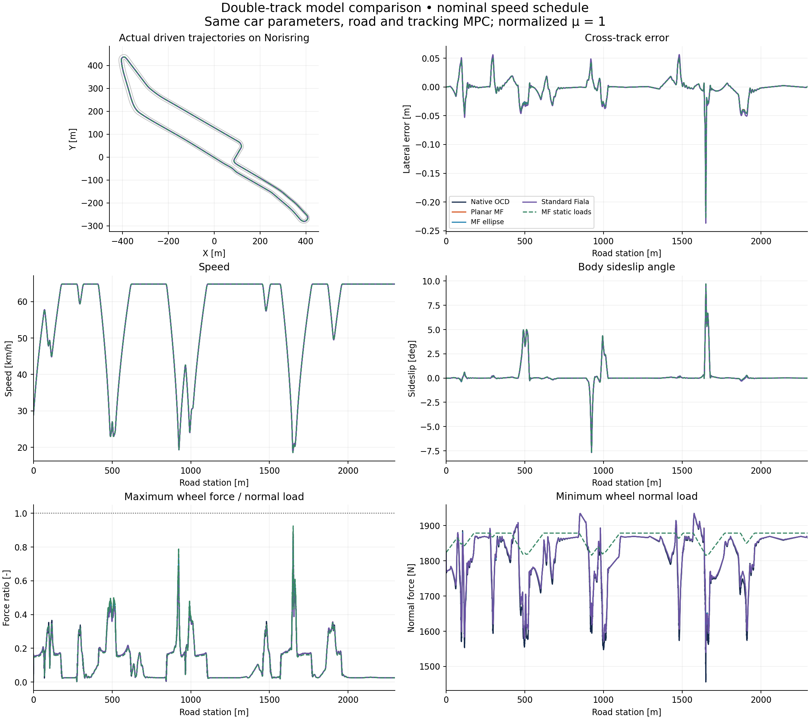
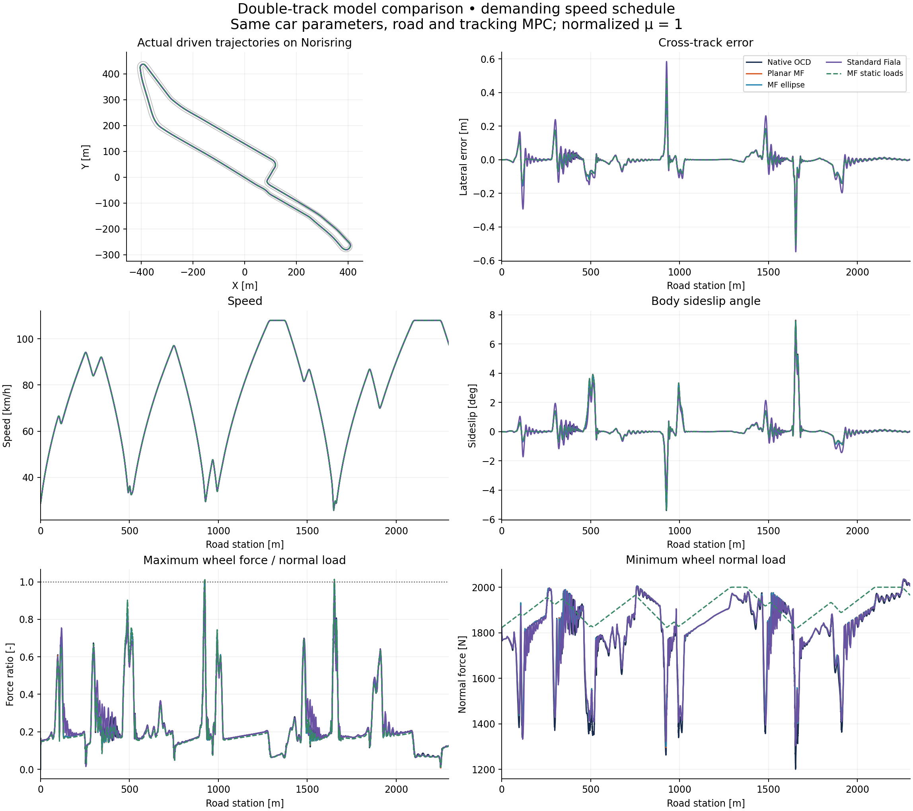

# Recorded Norisring comparison

See [method and equations](../README.md), [literature](../LITERATURE.md), and [source/parameter provenance](experiment_provenance.json).

All values below are measured from the executed normalized plants. Lap times belong to a prescribed speed schedule and common tracking controller; they are not minimum lap times or an accuracy ranking.

## Nominal schedule

| Plant | Lap (s) | RMS offset (m) | Max offset (m) | Max body sideslip (°) | Peak force ratio | Min sampled body margin (m) | MPC failures |
|---|---:|---:|---:|---:|---:|---:|---:|
| Native OCD | 156.332 | 0.0214 | 0.2072 | 9.706 | 0.8841 | 3.586 | 0 |
| Planar MF | 156.327 | 0.0214 | 0.2081 | 9.664 | 0.8912 | 3.587 | 0 |
| MF ellipse | 156.330 | 0.0217 | 0.2107 | 9.669 | 0.8888 | 3.587 | 0 |
| Standard Fiala | 156.354 | 0.0244 | 0.2370 | 9.550 | 0.7923 | 3.590 | 0 |
| MF static loads | 156.333 | 0.0230 | 0.2287 | 9.673 | 0.9252 | 3.587 | 0 |

## Demanding schedule

| Plant | Lap (s) | RMS offset (m) | Max offset (m) | Max body sideslip (°) | Peak force ratio | Min sampled body margin (m) | MPC failures |
|---|---:|---:|---:|---:|---:|---:|---:|
| Native OCD | 120.802 | 0.0658 | 0.4473 | 7.618 | 1.0078 | 3.547 | 0 |
| Planar MF | 120.783 | 0.0651 | 0.4515 | 7.582 | 1.0075 | 3.547 | 0 |
| MF ellipse | 120.795 | 0.0666 | 0.4591 | 7.531 | 0.9995 | 3.546 | 0 |
| Standard Fiala | 121.017 | 0.0899 | 0.5847 | 6.814 | 0.9667 | 3.537 | 0 |
| MF static loads | 120.795 | 0.0742 | 0.5090 | 7.562 | 1.0152 | 3.547 | 0 |

## One-second model predictions under identical inputs

Twelve windows per scenario start from the native body's state, actual wheel speeds and steering, and replay the native commands without reoptimization.

| Reduced plant | Nominal position RMSE (m) | Demanding position RMSE (m) | Demanding maximum error (m) |
|---|---:|---:|---:|
| Planar MF | 0.001912 | 0.002433 | 0.006267 |
| MF ellipse | 0.001981 | 0.003581 | 0.011836 |
| Standard Fiala | 0.011518 | 0.034151 | 0.116917 |
| MF static loads | 0.008476 | 0.014353 | 0.044037 |

All 96 forecast windows and 30 numerical-refinement windows succeeded. Original-step snapshot replays reproduce endpoints within 9.220e-12 m. Halving integration steps changes the selected native one-second endpoints by at most 9.205e-06 m and reduced endpoints by at most 1.412e-08 m. The refinement set includes tight-turn windows centered on each run's strongest yaw rate; these are local checks rather than global error bounds.

## Interpretation

- The circle ratio is sqrt(Fx²+Fy²)/Fz because the experiment normalizes μ to one. Independent MF is not constrained by this circle.
- Body sideslip is atan2(vy,vx). Tight low-speed turns can have appreciable geometric body sideslip while tire slip remains modest.
- Native force-input slips are relaxed dynamic states; reduced force-input slips are instantaneous kinematic values. The raw slip fields must be read with that distinction.
- Containment uses 40 body-perimeter samples every 0.02 s. The separate CSV traces are downsampled to 0.1 s; they are not the complete boundary-check sample set.
- Native C++ and Python integration times depend on implementation and host contention. They do not establish a model-complexity or physical-fidelity ordering.

## Held-input and integration checks

See [validation summary](validation/summary.json) and [one-second prediction errors](validation/window_predictions.csv). These replays do not solve MPC again. Numerical step refinement uses each model's own state and controls; model discrepancy uses common native initial conditions and inputs.

## Interactive replay

Download [replay.html](replay.html) and open it locally. It embeds the recorded trajectories and needs no server or network. Controls switch scenario/plant, play speed, and a follow-camera view.

## Regeneration

The checked-in CSVs contain 10 Hz observations and tire data; metrics were computed from generated 50 Hz raw.npz files. Re-running the documented commands regenerates those full state snapshots and detailed solve logs. Raw arrays and compiled libraries are build outputs rather than repository contents. artifact_hashes.json records the executed raw-array hashes as well as the published CSV hashes.
