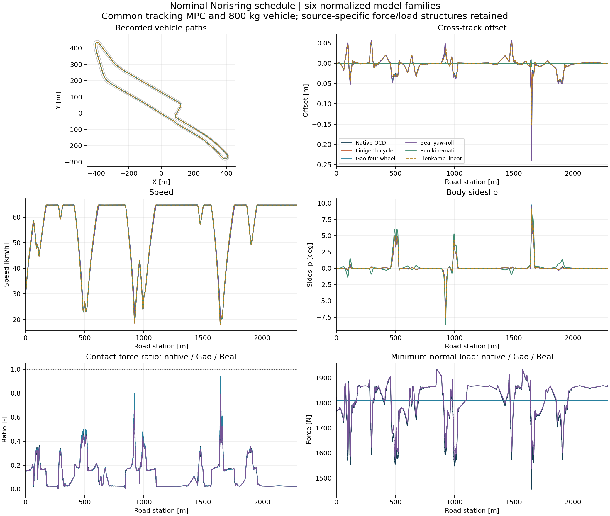
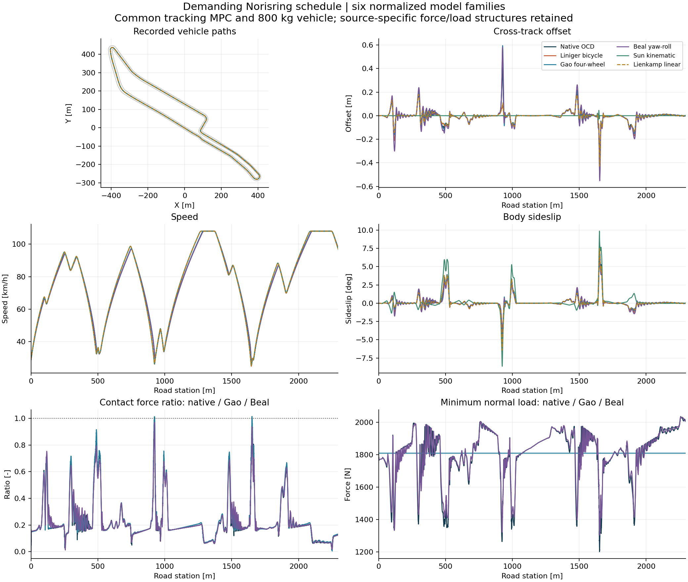

# Recorded six-model Norisring comparison

All entries below come from fresh full laps. These are normalized model-family adapters under one fixed tracking controller and prescribed speed schedule. They are not calibrated reproductions of the theses or an optimal-lap/real-car accuracy ranking. Liu is a structural tire subsystem and has no invented whole-car lap.

The unchanged Norisring CSV has length 2296.312367 m. Initial forward speed is 8 m/s. Native OCD has 33 states; Liniger 7; Gao 11; Beal 13; Sun 5; Lienkamp 7. Steering actuator, torque mapping and other additions are explicit in each metadata file and in the main equation reference.

## Nominal schedule

| Model | Lap (s) | RMS offset (m) | Peak offset (m) | Peak force ratio | Min sampled body margin (m) | MPC failures |
|---|---:|---:|---:|---:|---:|---:|
| Native OCD | 156.332 | 0.0214 | 0.2072 | 0.8841 | 3.586 | 0 |
| Liniger bicycle | 156.815 | 0.0172 | 0.1235 | N/A | 3.590 | 0 |
| Gao four-wheel | 156.246 | 0.0234 | 0.2331 | 0.9431 | 3.588 | 0 |
| Beal yaw-roll | 156.359 | 0.0247 | 0.2389 | 0.7945 | 3.591 | 0 |
| Sun kinematic | 156.748 | 0.0007 | 0.0094 | N/A | 3.549 | 0 |
| Lienkamp linear | 156.654 | 0.0188 | 0.1520 | N/A | 3.591 | 0 |



## Demanding schedule

| Model | Lap (s) | RMS offset (m) | Peak offset (m) | Peak force ratio | Min sampled body margin (m) | MPC failures |
|---|---:|---:|---:|---:|---:|---:|
| Native OCD | 120.802 | 0.0658 | 0.4473 | 1.0078 | 3.547 | 0 |
| Liniger bicycle | 121.291 | 0.0574 | 0.4128 | N/A | 3.541 | 0 |
| Gao four-wheel | 120.568 | 0.0833 | 0.5946 | 1.0138 | 3.544 | 0 |
| Beal yaw-roll | 121.030 | 0.0905 | 0.5812 | 0.9694 | 3.535 | 0 |
| Sun kinematic | 120.938 | 0.0034 | 0.0454 | N/A | 3.549 | 0 |
| Lienkamp linear | 120.957 | 0.0539 | 0.4289 | N/A | 3.539 | 0 |



## One-second forecasts under identical native inputs

Twelve predetermined station windows per scenario replay the native held commands after one initialization. All represented states are copied. Beal converts CG velocities to its source roll-base velocities. Sun cannot represent independent lateral speed/yaw rate, so its initial projection mismatch is recorded explicitly. These errors measure mismatch to the simulated native reference.

| Model | Nominal endpoint position RMSE (m) | Demanding endpoint position RMSE (m) | Demanding worst endpoint (m) |
|---|---:|---:|---:|
| Liniger bicycle | 0.033534 | 0.051566 | 0.061032 |
| Gao four-wheel | 0.009113 | 0.017329 | 0.047456 |
| Beal yaw-roll | 0.011628 | 0.035565 | 0.120858 |
| Sun kinematic | 0.087134 | 0.222911 | 0.572959 |
| Lienkamp linear | 0.094138 | 0.161473 | 0.532203 |

All 120 forecast windows and 36 numerical-refinement windows succeeded. Same-step full-state replays differed by at most 9.342e-12 m. Halving the integration step changed one-second endpoints by at most 9.205e-06 m for native OCD and 5.309e-09 m for the normalized adapters. Refinement includes each model's strongest recorded yaw-rate window. These are local numerical checks, not global error bounds.

## Measured implementation cost

Elapsed plant-step time includes its numerical integration. The controller is identical in every experiment. C++ native versus Python adapter costs must not be read as the computational complexity or MPC solver performance of the original theses.

| Model | Nominal plant ms / simulated s | Demanding plant ms / simulated s | Demanding median common MPC solve (ms) |
|---|---:|---:|---:|
| Native OCD | 9.07 | 8.80 | 9.78 |
| Liniger bicycle | 50.48 | 49.10 | 9.71 |
| Gao four-wheel | 157.52 | 156.39 | 10.35 |
| Beal yaw-roll | 328.33 | 321.62 | 10.43 |
| Sun kinematic | 26.90 | 26.75 | 9.33 |
| Lienkamp linear | 48.60 | 48.21 | 9.77 |

## Interpretation and reproducibility

- Independent MF and Liniger do not mathematically enforce a combined-slip friction circle. Gao here implements only its published pure-slip expressions; its original combined-slip modification is not claimed reproduced.
- Beal's radial brush peak is matched to nominal friction 1 while preserving sliding/static ratio 11/12. Dynamic roll is retained in body equations, but normal loads use a declared quasi-static closure independent of roll states.
- Sun matches the common predictor's kinematic structure closely, so small closed-loop tracking error is expected. It supplies no tire forces, saturation, wheel loads or tire slips. Those metrics are N/A.
- Lienkamp is a scheduled extension of a constant-speed linear lateral model. Its linear force law is unsaturated, and its logged longitudinal force is an allocated body-force surrogate, so force-circle utilization is N/A.
- The contact-force ratio is sqrt(Fx^2+Fy^2)/Fz with common nominal friction 1. Liniger wheel slots contain half axle forces; its rear longitudinal force already subtracts body drag/rolling resistance. Its effective net-axle ratio is retained separately as max_effective_axle_force_ratio and is not reported as a physical contact-force metric.
- Road containment is sampled at 40 perimeter points for a 4.4 m by 1.9 m body every 0.02 s. It is not a continuous-time or swept-volume certificate.
- All adapters use maximum RK4 substep 0.001 s, native upstream DoPri uses 0.0005 s. Adapter post-step wheel-speed and steering projection are extra finite-step safeguards; native only has its component derivative clamps.
- Every CSV is downsampled to 10 Hz from 50 Hz raw arrays. The raw hashes are retained; raw arrays regenerate through the commands below.

### Commands

```bash
python -m pip install -r requirements-driving.txt
python -m tracklab.comparison_native.build_native
python -m unittest discover -s tests -p test_thesis_models.py -v
python -m unittest tracklab.comparison_native.test_native -v
python run_thesis_comparison.py --scenario both
python -m tracklab.model_comparison.thesis_validation
python -m tracklab.model_comparison.thesis_report
```

Download [replay.html](replay.html) and open it locally for the self-contained interactive replay. The model trajectories, scenario selection, timeline and follow view use the recorded data. See [provenance](experiment_provenance.json), [validation](validation/summary.json) and [exact summary CSV](summary.csv).
