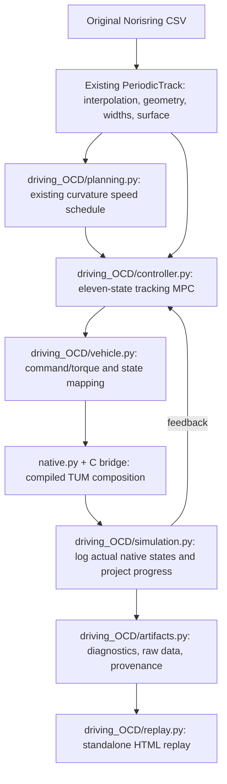

# TUM OCD model reference

[Overview and running](README.md) · [Model](MODEL.md) · [Integration walkthrough](INTEGRATION.md) · [Validation](VALIDATION.md) · [Project guide](../../README.md)

## What runs in native TUM code

The compiled composition is `WHEEL_TORQUE + PT1 + SINGLE_TRACK + LINEAR + DEFAULT`:

| TUM component | Role |
| --- | --- |
| `ocd_vehicle_dynamics_single_track_cpp` | Six planar body states, tire-frame velocities, slip definitions, vertical loads, resulting forces and yaw moment. |
| `ocd_tire_models_cpp::Linear` | Per-wheel longitudinal and lateral linear tire forces. |
| `ocd_drivetrain_wheel_torque_cpp` | Four wheel rotational states, input torques, rolling-resistance loads, and low-speed wheel inertia. |
| `ocd_steering_actuator_pt1_cpp` | First-order steering lag with hard steering-rate and angle limits. |
| `ocd_aerodynamics_models_cpp::DefaultAerodynamicsModel` | Longitudinal/lateral drag, downforce, and aerodynamic pitch moment. |
| `ocd_vehicle_model_cpp` | Compose the components and advance them with the upstream Dormand–Prince step. |

The bridge compiles the upstream implementation files without modifying them.
`native/upstream.json` records the commit, dependency revisions, and LF-normalized
SHA-256 hashes of the selected C++ sources and headers, including the required
helper, type, logging, and parameter-management dependencies. The build verifies
the four repository identities and rejects mismatches in those source hashes.
`native/bridge.cpp` supplies a narrow C interface; `native.py` loads that library
through `ctypes`. The native plant is required. A missing library raises an error
instead of selecting the Python plant in `tracklab.driving`.

At reset, derivative evaluation, and returned-output boundaries, the bridge
calls the upstream step with zero duration to synchronize its cached component
outputs with the eleven-state vector. This changes no physical state. Between
physical substeps the original upstream component evaluation order is retained.

The native state has eleven entries:

```text
[X, Y, yaw, vx, vy, yaw_rate, omega_FL, omega_FR, omega_RL, omega_RR, steering]
```

The single-track assumption co-locates the left/right wheels on each axle when
calculating the body forces. Four wheel rotation states are still part of this
official TUM composition; they do not turn the body into a double-track model.
`OCDVehicle.observe()` returns the seven body/steering entries expected by the
existing replay. The full eleven-state trajectory is retained in the run data.

The controller retains the two-command interface `[steering_target, requested
force_acceleration]`. The second entry is converted outside the native model to
four wheel torques in proportion to static axle load. It is a request for tire
force divided by vehicle mass, not an imposed acceleration: wheel spin, slip,
rolling resistance, aerodynamic forces, and steering determine the resulting
motion in native code.

## Tire equations and parameter choices

The native `Linear` class evaluates per-wheel longitudinal/lateral forces and
zero aligning moment. The single-track component applies the road's
`lambda_mue` multiplier. The [model equations below](#native-model-equations)
give the exact tire force laws, slip definitions, and low-speed guards.
The low-speed guards and slip clipping belong to upstream code. No additional
`tanh` tire saturation or combined-force circle is added. Consequently force
utilization can exceed one; the reported utilization is a diagnostic ratio,
not an enforced grip limit.

The adapter supplies per-axle road multipliers to both wheels on that axle.
Wind and additional external forces/moments are zero in this planar workflow.
The upstream default tire-radius and aero-correction lookup tables are retained.
Set supported parameters through `VehicleConfig` before creating `OCDVehicle`
so the native plant and symbolic predictor receive the same configuration.

The supplied parameters are explicit demonstration choices, not a measured TUM
vehicle calibration. `VehicleConfig.native_parameters()` exposes the complete
mapping to upstream parameter names; saved run configuration records the values.

| Parameter | This package | Pinned upstream declaration | Reason |
| --- | ---: | ---: | --- |
| `C_alpha` | `14` | `-0.1` | Restoring lateral force with the pinned single-track slip convention and a similar small-slip scale to the existing model. |
| `C_sx` | `100` | `3000` | Reduce longitudinal wheel-slip stiffness while preserving the exact linear force equation. |
| Maximum steering | `0.50 rad` | `0.30 rad` | Follow the tight bends in the unchanged supplied road. |
| Steering time constant | `0.06 s` | `0.06 s` | Upstream PT1 value. |
| Maximum steering rate | `0.50 rad/s` | `0.50 rad/s` | Upstream hard rate limit. |
| Native integration interval | `0.0002 s` | `0.0008 s` | Resolve the coupled wheel dynamics. |

Mass `800 kg`, yaw inertia `1000 kg m²`, wheelbase `3.2 m`, and front-axle
distance from the center of gravity `1.724 m` follow the existing demonstration.
Native default aerodynamics remain active: area `1 m²`, drag coefficient `1`,
lift coefficient `-1.5`, and air density `1.225 kg/m³`. Wheel radius is `0.3 m`;
front/rear wheel inertias are `1.15` and `1.35 kg m²`; rolling-resistance
coefficient is `0.025`.

## Native model equations

The actual plant compiles pinned TUM C++ components. The separate CasADi
`symbolic_rhs()` in [vehicle.py](vehicle.py) transcribes
their continuous equations for prediction. See the
[file-by-file integration and source comparisons](INTEGRATION.md)
for the original upstream files and the adapter code.

Use the notation in the [shared driving reference](../../docs/DRIVING.md):
$m$ is vehicle mass, $I_z$ is yaw inertia, $L_v=l_f+l_r$ is wheelbase, and
$l_f,l_r$ are the center-of-gravity distances to the front/rear axles.

The native state is
$z=[X,Y,\psi,v_x,v_y,r,\omega_{FL},\omega_{FR},\omega_{RL},\omega_{RR},\delta_s]$.
Wheel order is front-left, front-right, rear-left, rear-right. Physical wheel
steering is $\delta=\delta_s+\delta_{offset}$. Left and right wheels on an axle
share contact kinematics; four wheel rotations remain in this single-track
body model. Track width does not enter these body equations.

### Torque allocation and tire contact kinematics

Tracklab converts the force request to native wheel torque inputs outside the
TUM model, using static load proportions:

$$
T_{FL}=T_{FR}=\frac{ma_{cmd}R}{2}\frac{l_r}{L_v},\qquad
T_{RL}=T_{RR}=\frac{ma_{cmd}R}{2}\frac{l_f}{L_v}.
$$

For the configured common rolling radius $R$, tire-frame velocities are

$$
\begin{aligned}
v_{xf}^t&=v_x\cos\delta+(v_y+l_fr)\sin\delta,&
v_{yf}^t&=-v_x\sin\delta+(v_y+l_fr)\cos\delta,\\
v_{xr}^t&=v_x,&v_{yr}^t&=v_y-l_rr.
\end{aligned}
$$

The pinned [single-track implementation](https://github.com/TUMFTM/Open-Car-Dynamics/blob/94f8fb187fb0ed22bba1d809bd74f66d1ff75af4/lib/ocd_vehicle_dynamics_single_track_cpp/include/ocd_vehicle_dynamics_single_track_cpp/vehicle_dynamics_equations_impl.hpp)
computes each wheel's slip angle and longitudinal slip $\sigma_j$ as

$$
\alpha_j=-\operatorname{atan2}(v_{yj}^t,\max(1,v_{xj}^t)),\qquad
\sigma_j=\operatorname{clip}\left(
\frac{R\omega_j-v_{xj}^t}{\max(3,v_{xj}^t)},-1,1\right).
$$

The denominators use the upstream hard guards, with velocity thresholds in m/s.
They differ from the smooth denominator in the Python model.

### Linear tires, aerodynamics, and vertical loads

The upstream [linear tire](https://github.com/TUMFTM/Open-Car-Dynamics/blob/94f8fb187fb0ed22bba1d809bd74f66d1ff75af4/lib/ocd_tire_models_cpp/src/linear.cpp),
followed by the body's road scaling, gives per-wheel forces

$$
F_{xj}^t=\lambda_j C_s\sigma_jF_{zj},\qquad
F_{yj}^t=\lambda_j C_\alpha\alpha_jF_{zj},\qquad M_{zj}^{tire}=0.
$$

Both tire forces are set to zero when $v_x^2<0.001$, $v_y^2<0.001$, and
$\omega_j^2<0.001$ for all four wheels. These numerical thresholds are taken
literally from upstream. There is no added force saturation or friction circle;
longitudinal slip clipping does not create a combined-force grip limit.
`nominal_friction` only normalizes OCD utilization diagnostics. The road's
$\lambda_j$ scales both actual native tire forces.

For zero wind, no other external loads, and the retained default lookup-table
corrections, the configured aero model and quasi-static vertical loads are

$$
\begin{gathered}
A_x=-\tfrac12\rho A C_dv_x|v_x|,\quad
A_y=-\tfrac12\rho A C_dv_y|v_y|,\quad
A_z=\tfrac12\rho A C_lv_x^2,\\
W=mg-A_z,\qquad N_f=\frac{Wl_r-A_zd_a}{L_v},\qquad N_r=W-N_f,\\
F_{zFL}=F_{zFR}=\max(0.001,N_f/2),\quad
F_{zRL}=F_{zRR}=\max(0.001,N_r/2).
\end{gathered}
$$

Here $d_a$ is the aerodynamic center offset from the center of gravity.
Negative $C_l$ produces downforce. There is no suspension state or acceleration
load-transfer equation. Summing front and rear tire-frame forces into
$F_{xf}^t,F_{yf}^t,F_{xr}^t,F_{yr}^t$ gives

$$
\begin{aligned}
F_x^b&=\cos\delta F_{xf}^t-\sin\delta F_{yf}^t+F_{xr}^t+A_x,\\
F_y^b&=\sin\delta F_{xf}^t+\cos\delta F_{yf}^t+F_{yr}^t+A_y,\\
M_z&=l_f(\sin\delta F_{xf}^t+\cos\delta F_{yf}^t)-l_rF_{yr}^t.
\end{aligned}
$$

These totals enter the [shared planar body equations](../../docs/DRIVING.md).

### Wheel rotation and hard-limited PT1 steering

The native wheel-torque drivetrain includes the upstream low-speed extra
inertia, rolling resistance, and one-sided wheel-speed derivative guard:

$$
\begin{gathered}
J_{extra}=\max\left(0,15J_r\left(1-\frac{\sum_j\omega_j}{80}\right)\right),\\
q_j=\frac{T_j-(F_{xj}^t+c_{rr}F_{zj})R}{J_{f/r}+J_{extra}},\qquad
\dot\omega_j=\begin{cases}\max(0,q_j),&\omega_j<10^{-5},\\q_j,&\text{otherwise}.\end{cases}
\end{gathered}
$$

$J_f,J_r$ are individual front/rear wheel inertias. The constants and forward
rotation guard are preserved from TUM; this workflow is for forward driving.
For the PT1 actuator,

$$
q_\delta=\operatorname{clip}\left(
\frac{\delta_{cmd}-\delta_s}{T_\delta},-\dot\delta_{max},\dot\delta_{max}\right),\qquad
\dot\delta_s=\begin{cases}
\max(0,q_\delta),&\delta_s\le-\delta_{max},\\
\min(0,q_\delta),&\delta_s\ge\delta_{max},\\
q_\delta,&\text{otherwise}.
\end{cases}
$$

The wheel and steering source comparisons are in the
[integration walkthrough](INTEGRATION.md). The angle guard acts on actuator
position; the configured static offset is applied to the wheel angle afterward.

## Structure and unchanged road components



`data.py`, `interpolation.py`, `geometry.py`, `road.py`, and the supplied track
CSV are unchanged. The road is fitted once and queried by the new simulation.
Projection measures progress and tracking error; it does not reposition the car.
The original geometry-only speed planner is reused. Default references cap speed
at `18 m/s` and plan with a `2 m/s²` lateral-acceleration budget.

The MPC predicts the same eleven component states through a CasADi expression
of the pinned equations and implicit two-stage Radau IIA collocation. Its
derivatives are checked against the compiled native evaluator. The actual car
advances through native `VehicleModel::step()`. The upstream assembly passes
cached wheel speeds between its component evaluations, so its internal
Dormand–Prince stage order is preserved; continuous predictor integration and
native stepping are not asserted to produce bit-identical trajectories.

| Local module | Responsibility |
| --- | --- |
| `config.py` | Validate parameters; map them to exact native parameter names. |
| `build_native.py`, `native/` | Fetch/verify pinned build inputs and compile the bridge. |
| `native.py` | Load and call the compiled plant. |
| `vehicle.py` | Eleven-state and two-command interface; symbolic prediction equations. |
| `planning.py` | Reuse the existing curvature-based speed reference. |
| `controller.py` | Receding-horizon steering/torque-request optimization. |
| `simulation.py` | Native time integration, feedback, progress, and logging. |
| `validation.py`, `artifacts.py` | Native diagnostics, source identity, numerical checks, and saved results. |
| `replay.py`, `plots.py` | Reuse the presentation of the recorded trajectory. |

## Comparison with `tracklab.driving`

| Aspect | Existing `driving` | New `driving_OCD` |
| --- | --- | --- |
| Plant implementation | Local NumPy dynamic bicycle | Compiled, pinned TUM components |
| Integrated states | Seven body/steering states | Eleven, including four wheel speeds |
| Lateral tires | Load-scaled `tanh` saturation with remaining-force cap | Native `Linear` equation; no combined-force cap |
| Longitudinal dynamics | Acceleration request directly sets axle tire forces | Request becomes torques; native wheel speeds generate longitudinal slip and forces |
| Tire-slip definitions | Smooth `sqrt(vx² + 0.2²)` regularization | Upstream hard low-speed denominators and longitudinal-slip clipping |
| Vertical loads | Static axle loads | Quasi-static loads including aerodynamic downforce/pitch moment |
| Resistance | Longitudinal aerodynamic drag | Native longitudinal/lateral drag and rolling resistance |
| Steering | Smooth `tanh` rate limiter; `0.12 s`, `0.9 rad/s` | Native hard limits; `0.06 s`, `0.5 rad/s` |
| Actual integration | Classical RK4 | Upstream Dormand–Prince composition |
| MPC discretization | Explicit integration of seven-state predictor | Implicit collocation of eleven-state predictor |
| Road and speed planner | Shared road and curvature planner | Same road and planner |
| Browser output | Standalone interactive recorded replay | Same replay features, labeled with native model identity |

The two runs are model comparisons, not a measured-vehicle validation or a
lap-time optimization. Different wheel dynamics, aero, steering, and parameter
choices can produce different commands and lap times even with the same road
and tracking objective.
