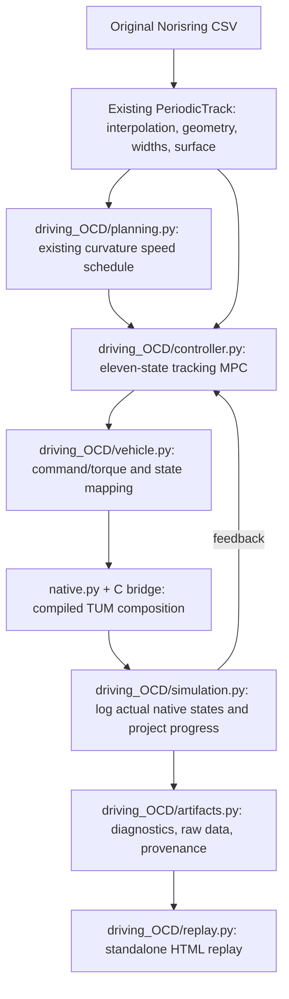

# Driving with TUM Open Car Dynamics

`tracklab.driving_OCD` runs the car through compiled C++ components from
[TUMFTM/Open-Car-Dynamics](https://github.com/TUMFTM/Open-Car-Dynamics), pinned to
commit [`94f8fb187fb0ed22bba1d809bd74f66d1ff75af4`](https://github.com/TUMFTM/Open-Car-Dynamics/tree/94f8fb187fb0ed22bba1d809bd74f66d1ff75af4).
It retains the existing road, curvature speed planning, closed-loop tracking,
diagnostics, plotting, and standalone HTML replay workflow. The existing
`tracklab.driving` package remains available separately.

## What runs in native TUM code

The compiled composition is `WHEEL_TORQUE + PT1 + SINGLE_TRACK + LINEAR + DEFAULT`:

| TUM component | Role |
| --- | --- |
| `ocd_vehicle_dynamics_single_track_cpp` | Six planar body states, tire-frame velocities, slip definitions, vertical loads, resulting forces and yaw moment. |
| `ocd_tire_models_cpp::Linear` | Per-wheel longitudinal and lateral linear tire forces. |
| `ocd_drivetrain_wheel_torque_cpp` | Four wheel rotational states, input torques, rolling-resistance loads, and low-speed wheel inertia. |
| `ocd_steering_actuator_pt1_cpp` | First-order steering lag with hard steering-rate and angle limits. |
| `ocd_aerodynamics_models_cpp::DefaultAerodynamicsModel` | Longitudinal/lateral drag, downforce, and aerodynamic pitch moment. |
| `ocd_vehicle_model_cpp` | Compose the components and advance them with the upstream Dormand–Prince step. |

The bridge compiles the upstream implementation files without modifying them.
`native/upstream.json` records the commit, dependency revisions, and LF-normalized
SHA-256 hashes of the selected C++ sources and headers, including the required
helper, type, logging, and parameter-management dependencies. The build verifies
the four repository identities and rejects mismatches in those source hashes.
`native/bridge.cpp` supplies a narrow C interface; `native.py` loads that library
through `ctypes`. The native plant is required. A missing library raises an error
instead of selecting the Python plant in `tracklab.driving`.

At reset, derivative evaluation, and returned-output boundaries, the bridge
calls the upstream step with zero duration to synchronize its cached component
outputs with the eleven-state vector. This changes no physical state. Between
physical substeps the original upstream component evaluation order is retained.

The native state has eleven entries:

```text
[X, Y, yaw, vx, vy, yaw_rate, omega_FL, omega_FR, omega_RL, omega_RR, steering]
```

The single-track assumption co-locates the left/right wheels on each axle when
calculating the body forces. Four wheel rotation states are still part of this
official TUM composition; they do not turn the body into a double-track model.
`OCDVehicle.observe()` returns the seven body/steering entries expected by the
existing replay. The full eleven-state trajectory is retained in the run data.

The controller retains the two-command interface `[steering_target, requested
force_acceleration]`. The second entry is converted outside the native model to
four wheel torques in proportion to static axle load. It is a request for tire
force divided by vehicle mass, not an imposed acceleration: wheel spin, slip,
rolling resistance, aerodynamic forces, and steering determine the resulting
motion in native code.

## Tire equations and parameter choices

The native `Linear` class evaluates, for each wheel:

```text
Fy = C_alpha * alpha * Fz
Fx = C_sx * kappa * Fz
Mz = 0
```

The single-track component applies the road's `lambda_mue` multiplier to these
forces. It computes `alpha = -atan2(v_tire_y, max(1, v_tire_x))` and
`kappa = clip((radius*omega - v_tire_x)/max(3, v_tire_x), -1, 1)`.
The low-speed guards and slip clipping belong to upstream code. No additional
`tanh` tire saturation or combined-force circle is added. Consequently force
utilization can exceed one; the reported utilization is a diagnostic ratio,
not an enforced grip limit.

The adapter supplies per-axle road multipliers to both wheels on that axle.
Wind and additional external forces/moments are zero in this planar workflow.
The upstream default tire-radius and aero-correction lookup tables are retained.
Set supported parameters through `VehicleConfig` before creating `OCDVehicle`
so the native plant and symbolic predictor receive the same configuration.

The supplied parameters are explicit demonstration choices, not a measured TUM
vehicle calibration. `VehicleConfig.native_parameters()` exposes the complete
mapping to upstream parameter names; saved run configuration records the values.

| Parameter | This package | Pinned upstream declaration | Reason |
| --- | ---: | ---: | --- |
| `C_alpha` | `14` | `-0.1` | Restoring lateral force with the pinned single-track slip convention and a similar small-slip scale to the existing model. |
| `C_sx` | `100` | `3000` | Reduce longitudinal wheel-slip stiffness while preserving the exact linear force equation. |
| Maximum steering | `0.50 rad` | `0.30 rad` | Follow the tight bends in the unchanged supplied road. |
| Steering time constant | `0.06 s` | `0.06 s` | Upstream PT1 value. |
| Maximum steering rate | `0.50 rad/s` | `0.50 rad/s` | Upstream hard rate limit. |
| Native integration interval | `0.0002 s` | `0.0008 s` | Resolve the coupled wheel dynamics. |

Mass `800 kg`, yaw inertia `1000 kg m²`, wheelbase `3.2 m`, and front-axle
distance from the center of gravity `1.724 m` follow the existing demonstration.
Native default aerodynamics remain active: area `1 m²`, drag coefficient `1`,
lift coefficient `-1.5`, and air density `1.225 kg/m³`. Wheel radius is `0.3 m`;
front/rear wheel inertias are `1.15` and `1.35 kg m²`; rolling-resistance
coefficient is `0.025`.

## Structure and unchanged road components



`data.py`, `interpolation.py`, `geometry.py`, `road.py`, and the supplied track
CSV are unchanged. The road is fitted once and queried by the new simulation.
Projection measures progress and tracking error; it does not reposition the car.
The original geometry-only speed planner is reused. Default references cap speed
at `18 m/s` and plan with a `2 m/s²` lateral-acceleration budget.

The MPC predicts the same eleven component states through a CasADi expression
of the pinned equations and implicit two-stage Radau IIA collocation. Its
derivatives are checked against the compiled native evaluator. The actual car
advances through native `VehicleModel::step()`. The upstream assembly passes
cached wheel speeds between its component evaluations, so its internal
Dormand–Prince stage order is preserved; continuous predictor integration and
native stepping are not asserted to produce bit-identical trajectories.

| Local module | Responsibility |
| --- | --- |
| `config.py` | Validate parameters; map them to exact native parameter names. |
| `build_native.py`, `native/` | Fetch/verify pinned build inputs and compile the bridge. |
| `native.py` | Load and call the compiled plant. |
| `vehicle.py` | Eleven-state and two-command interface; symbolic prediction equations. |
| `planning.py` | Reuse the existing curvature-based speed reference. |
| `controller.py` | Receding-horizon steering/torque-request optimization. |
| `simulation.py` | Native time integration, feedback, progress, and logging. |
| `validation.py`, `artifacts.py` | Native diagnostics, source identity, numerical checks, and saved results. |
| `replay.py`, `plots.py` | Reuse the presentation of the recorded trajectory. |

## Comparison with `tracklab.driving`

| Aspect | Existing `driving` | New `driving_OCD` |
| --- | --- | --- |
| Plant implementation | Local NumPy dynamic bicycle | Compiled, pinned TUM components |
| Integrated states | Seven body/steering states | Eleven, including four wheel speeds |
| Lateral tires | Load-scaled `tanh` saturation with remaining-force cap | Native `Linear` equation; no combined-force cap |
| Longitudinal dynamics | Acceleration request directly sets axle tire forces | Request becomes torques; native wheel speeds generate longitudinal slip and forces |
| Tire-slip definitions | Smooth `sqrt(vx² + 0.2²)` regularization | Upstream hard low-speed denominators and longitudinal-slip clipping |
| Vertical loads | Static axle loads | Quasi-static loads including aerodynamic downforce/pitch moment |
| Resistance | Longitudinal aerodynamic drag | Native longitudinal/lateral drag and rolling resistance |
| Steering | Smooth `tanh` rate limiter; `0.12 s`, `0.9 rad/s` | Native hard limits; `0.06 s`, `0.5 rad/s` |
| Actual integration | Classical RK4 | Upstream Dormand–Prince composition |
| MPC discretization | Explicit integration of seven-state predictor | Implicit collocation of eleven-state predictor |
| Road and speed planner | Shared road and curvature planner | Same road and planner |
| Browser output | Standalone interactive recorded replay | Same replay features, labeled with native model identity |

The two runs are model comparisons, not a measured-vehicle validation or a
lap-time optimization. Different wheel dynamics, aero, steering, and parameter
choices can produce different commands and lap times even with the same road
and tracking objective.

## Recorded comparison

Both models completed one lap of the unchanged `2296.312367 m` reference course,
using their default configuration, an `18 m/s` reference-speed cap, and the same
`2 m/s²` planning budget. The original model was rerun into
`drive_comparison_results/current`; the native run is in `drive_OCD_results`.

| Recorded quantity | Existing `driving` | Native `driving_OCD` |
| --- | ---: | ---: |
| Lap crossing time | `167.443237 s` | `167.443495 s` |
| Successful MPC solves | `1675 / 1675` | `1675 / 1675` |
| Maximum cross-track error | `4.576444 mm` | `4.642721 mm` |
| RMS cross-track error | `0.454195 mm` | `0.467911 mm` |
| Maximum actual speed | `18.011896 m/s` | `18.012231 m/s` |
| Maximum absolute steering | `18.681193°` | `18.707782°` |
| Minimum sampled body margin | `3.564080 m` | `3.563817 m` |
| Sampled body points outside the road | `0` | `0` |

These numbers quantify tracking under a common conservative reference schedule.
The native equations are checked separately through source identity, force-law,
state-mapping, and symbolic/native derivative tests. The table records an example
run. Generated metrics are local outputs rather than committed files; rerunning
the models creates `drive_comparison_results/current/metrics.json` and
`drive_OCD_results/metrics.json`.

All **49 tests passed** in the recorded test run (`17.053 s`), including the
geometry/interpolation tests, existing driving tests, and all 18 new native
tests. Run the test command below to print a new test report.
Replaying the native lap's fixed controls with a halved integration interval
(`0.0001 s`) produced a maximum logged endpoint position difference of
`0.000642582 m`. A full native run regenerates the timestep-refinement record at
`drive_OCD_results/independent_integration_check.json`.
That is an open-loop numerical sensitivity check with the recorded commands.

## Run

For a new machine, follow the main README's
[fresh-clone setup](../../README.md#step-by-step-setup-from-a-fresh-clone),
especially **Step 3** for the native build. It includes installing Ubuntu 24.04
under WSL, Git, a C++20 compiler, CMake, Eigen, Linux uv, and Python 3.12. This
component does not need ROS or a separate TUM OCD installation.

Run the commands below from the repository root **inside Ubuntu / WSL**.
They assume Git/C++ prerequisites and Linux uv have been installed as described
in that guide. A Windows `dev312` environment, including one activated in Git
Bash, cannot load the Linux `.so` produced by the documented build.

### First build

If you already created the environment in the main guide, skip `uv venv` and
activate that existing environment before installing or building.

```bash
mkdir -p "$HOME/.venvs"
uv venv --python 3.12 "$HOME/.venvs/tracklab-ocd"
source "$HOME/.venvs/tracklab-ocd/bin/activate"
uv pip install -r requirements-driving.txt
python --version
python -m tracklab.driving_OCD.build_native
python -c "from tracklab.driving_OCD.native import NativeVehicle; v = NativeVehicle(); print(v.library_path); v.close()"
```

The first build fetches the pinned upstream repository and its three required
submodules under `dev/Open-Car-Dynamics`, verifies the pinned inputs, then
creates `native/tracklab_ocd.so`. Neither the downloaded source cache nor a
compiled library is supplied by a fresh clone. Python 3.12 avoids the
`casadi==3.7.2` source-build failure seen with Python 3.15.

The Linux environment is persistent under your Linux home directory. The
original recorded test run used `/tmp/tracklab-ocd-venv`; that temporary path is
not a prerequisite and should not be used for a new installation.

### Smoke test, full lap, and tests

```bash
python run_drive_OCD.py --laps 0.01 --output drive_OCD_smoke
python run_drive_OCD.py --config configs/default_drive_OCD.json --output drive_OCD_results
OPENBLAS_NUM_THREADS=1 OMP_NUM_THREADS=1 MKL_NUM_THREADS=1 \
  python -m unittest discover -s tests -v
```

Open `drive_OCD_smoke/norisring_replay.html` first, then the full-lap output at
`drive_OCD_results/norisring_replay.html`. Each replay embeds its data and works
without a server. In WSL, `explorer.exe .` opens the current project directory in
Windows Explorer. The output also contains all eleven native states, the seven
replay states, trajectory/solver CSVs, the speed schedule, diagnostics,
configuration, provenance, and PNG plots.

`--no-plots` omits PNGs while retaining the HTML. `--no-independent-check` skips
the open-loop native timestep-refinement check. `--config` accepts another JSON
file with the same vehicle/driving schema as `configs/default_drive_OCD.json`.

### Later runs

In a new Ubuntu terminal, using the default clone path from the main guide:

```bash
cd "$HOME/src/racetrack_components"
source "$HOME/.venvs/tracklab-ocd/bin/activate"
python run_drive_OCD.py --output drive_OCD_results
```

From PowerShell after that setup:

```powershell
wsl -d Ubuntu-24.04 -- bash -lc 'cd ~/src/racetrack_components && ~/.venvs/tracklab-ocd/bin/python run_drive_OCD.py'
```

From Git Bash after that setup:

```bash
MSYS_NO_PATHCONV=1 wsl.exe -d Ubuntu-24.04 -- bash -lc \
  'cd ~/src/racetrack_components && ~/.venvs/tracklab-ocd/bin/python run_drive_OCD.py'
```

Substitute your own clone/environment paths if you changed their locations.
`MSYS_NO_PATHCONV=1` prevents Git Bash from rewriting Linux paths. The `wsl`
command must select Linux Python: a Windows Python process requires a Windows
`tracklab_ocd.dll`, which has not been built or tested here. The optional
`build_native --wsl` shortcut builds a Linux library; it does not produce that
Windows DLL or make Windows Python able to load the `.so`.

Simulation outputs and native build products are ignored by Git. For custom
output names, use an ignored parent such as `--output outputs/ocd`. Track CSV
input data, configuration JSON, source code, and the native manifest/bridge
remain part of the project; generated files do not need to be uploaded.

### Rebuild and compare

Once the sources are downloaded, rebuild without network access using:

```bash
python -m tracklab.driving_OCD.build_native --no-fetch
```

`--source` selects an existing checkout that passes the same commit/hash checks;
the documented full test suite expects the default `dev/Open-Car-Dynamics`
source cache. To rerun the existing Python vehicle for comparison in the same
Linux environment:

```bash
python run_drive.py --output drive_comparison_results/current --no-independent-check
```

## Verification and attribution

`tests/test_driving_OCD.py` checks native state mapping; wheel-torque coupling;
the upstream slip definitions; exact linear tire forces and external scaling;
absence of an added force cap; steering limits; stationary guards; symbolic
derivatives against native derivatives; numerical stepping; the unchanged road
speed planner; and a short closed-loop simulation. Missing native dependencies
cause an explicit failure rather than a substituted model.

The downloaded build inputs retain upstream copyright and license notices.
The pinned TUM source and selected dependencies use the Apache License 2.0;
copies are retained as `native/LICENSE-*.txt`. Local bridge/controller code is
separate. Native component use does not make this course, parameter set,
controller, or output an official TUM validation result. Track widths, friction,
elevation, and numerical footprint checks retain the limitations described in
the repository README.
