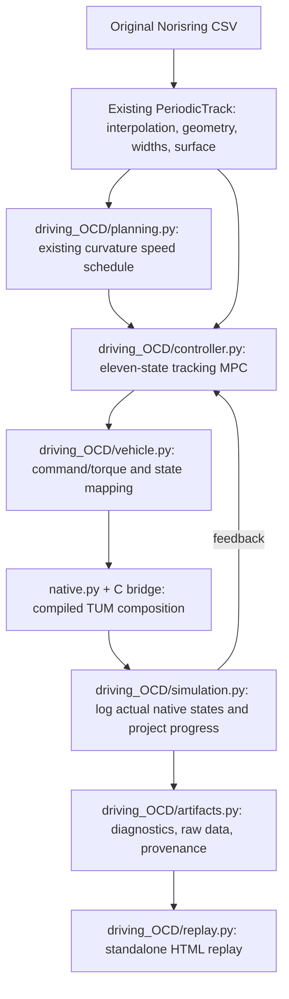

# Driving with TUM Open Car Dynamics

`tracklab.driving_OCD` runs the car through compiled C++ components from
[TUMFTM/Open-Car-Dynamics](https://github.com/TUMFTM/Open-Car-Dynamics), pinned to
commit [`94f8fb187fb0ed22bba1d809bd74f66d1ff75af4`](https://github.com/TUMFTM/Open-Car-Dynamics/tree/94f8fb187fb0ed22bba1d809bd74f66d1ff75af4).
It retains the existing road, curvature speed planning, closed-loop tracking,
diagnostics, plotting, and standalone HTML replay workflow. The existing
`tracklab.driving` package remains available separately.

The integration uses the original C++ source for the **simulated plant** and a
hand-transcribed CasADi version of its continuous equations for the **MPC
predictor**. The C ABI, Python wrappers, build helper, controller, and output
adaptations are local additions. This is the distinction between compiling OCD
code and rewriting equations for optimization. Complete equations for both
driving packages and the shared road interpolation are in
[Mathematical models and interpolation](../../README.md#mathematical-models-and-interpolation).

## What runs in native TUM code

The compiled composition is `WHEEL_TORQUE + PT1 + SINGLE_TRACK + LINEAR + DEFAULT`:

| TUM component | Role |
| --- | --- |
| `ocd_vehicle_dynamics_single_track_cpp` | Six planar body states, tire-frame velocities, slip definitions, vertical loads, resulting forces and yaw moment. |
| `ocd_tire_models_cpp::Linear` | Per-wheel longitudinal and lateral linear tire forces. |
| `ocd_drivetrain_wheel_torque_cpp` | Four wheel rotational states, input torques, rolling-resistance loads, and low-speed wheel inertia. |
| `ocd_steering_actuator_pt1_cpp` | First-order steering lag with hard steering-rate and angle limits. |
| `ocd_aerodynamics_models_cpp::DefaultAerodynamicsModel` | Longitudinal/lateral drag, downforce, and aerodynamic pitch moment. |
| `ocd_vehicle_model_cpp` | Compose the components and advance them with the upstream Dormand–Prince step. |

The bridge compiles the upstream implementation files without modifying them.
`native/upstream.json` records the commit, dependency revisions, and LF-normalized
SHA-256 hashes of the selected C++ sources and headers, including the required
helper, type, logging, and parameter-management dependencies. The build verifies
the four repository identities and rejects mismatches in those source hashes.
`native/bridge.cpp` supplies a narrow C interface; `native.py` loads that library
through `ctypes`. The native plant is required. A missing library raises an error
instead of selecting the Python plant in `tracklab.driving`.

At reset, derivative evaluation, and returned-output boundaries, the bridge
calls the upstream step with zero duration to synchronize its cached component
outputs with the eleven-state vector. This changes no physical state. Between
physical substeps the original upstream component evaluation order is retained.

The native state has eleven entries:

```text
[X, Y, yaw, vx, vy, yaw_rate, omega_FL, omega_FR, omega_RL, omega_RR, steering]
```

The single-track assumption co-locates the left/right wheels on each axle when
calculating the body forces. Four wheel rotation states are still part of this
official TUM composition; they do not turn the body into a double-track model.
`OCDVehicle.observe()` returns the seven body/steering entries expected by the
existing replay. The full eleven-state trajectory is retained in the run data.

The controller retains the two-command interface `[steering_target, requested
force_acceleration]`. The second entry is converted outside the native model to
four wheel torques in proportion to static axle load. It is a request for tire
force divided by vehicle mass, not an imposed acceleration: wheel spin, slip,
rolling resistance, aerodynamic forces, and steering determine the resulting
motion in native code.

## Tire equations and parameter choices

The native `Linear` class evaluates, for each wheel:

```text
Fy = C_alpha * alpha * Fz
Fx = C_sx * kappa * Fz
Mz = 0
```

The single-track component applies the road's `lambda_mue` multiplier to these
forces. It computes `alpha = -atan2(v_tire_y, max(1, v_tire_x))` and
`kappa = clip((radius*omega - v_tire_x)/max(3, v_tire_x), -1, 1)`.
The low-speed guards and slip clipping belong to upstream code. No additional
`tanh` tire saturation or combined-force circle is added. Consequently force
utilization can exceed one; the reported utilization is a diagnostic ratio,
not an enforced grip limit.

The adapter supplies per-axle road multipliers to both wheels on that axle.
Wind and additional external forces/moments are zero in this planar workflow.
The upstream default tire-radius and aero-correction lookup tables are retained.
Set supported parameters through `VehicleConfig` before creating `OCDVehicle`
so the native plant and symbolic predictor receive the same configuration.

The supplied parameters are explicit demonstration choices, not a measured TUM
vehicle calibration. `VehicleConfig.native_parameters()` exposes the complete
mapping to upstream parameter names; saved run configuration records the values.

| Parameter | This package | Pinned upstream declaration | Reason |
| --- | ---: | ---: | --- |
| `C_alpha` | `14` | `-0.1` | Restoring lateral force with the pinned single-track slip convention and a similar small-slip scale to the existing model. |
| `C_sx` | `100` | `3000` | Reduce longitudinal wheel-slip stiffness while preserving the exact linear force equation. |
| Maximum steering | `0.50 rad` | `0.30 rad` | Follow the tight bends in the unchanged supplied road. |
| Steering time constant | `0.06 s` | `0.06 s` | Upstream PT1 value. |
| Maximum steering rate | `0.50 rad/s` | `0.50 rad/s` | Upstream hard rate limit. |
| Native integration interval | `0.0002 s` | `0.0008 s` | Resolve the coupled wheel dynamics. |

Mass `800 kg`, yaw inertia `1000 kg m²`, wheelbase `3.2 m`, and front-axle
distance from the center of gravity `1.724 m` follow the existing demonstration.
Native default aerodynamics remain active: area `1 m²`, drag coefficient `1`,
lift coefficient `-1.5`, and air density `1.225 kg/m³`. Wheel radius is `0.3 m`;
front/rear wheel inertias are `1.15` and `1.35 kg m²`; rolling-resistance
coefficient is `0.025`.

## Structure and unchanged road components



`data.py`, `interpolation.py`, `geometry.py`, `road.py`, and the supplied track
CSV are unchanged. The road is fitted once and queried by the new simulation.
Projection measures progress and tracking error; it does not reposition the car.
The original geometry-only speed planner is reused. Default references cap speed
at `18 m/s` and plan with a `2 m/s²` lateral-acceleration budget.

The MPC predicts the same eleven component states through a CasADi expression
of the pinned equations and implicit two-stage Radau IIA collocation. Its
derivatives are checked against the compiled native evaluator. The actual car
advances through native `VehicleModel::step()`. The upstream assembly passes
cached wheel speeds between its component evaluations, so its internal
Dormand–Prince stage order is preserved; continuous predictor integration and
native stepping are not asserted to produce bit-identical trajectories.

| Local module | Responsibility |
| --- | --- |
| `config.py` | Validate parameters; map them to exact native parameter names. |
| `build_native.py`, `native/` | Fetch/verify pinned build inputs and compile the bridge. |
| `native.py` | Load and call the compiled plant. |
| `vehicle.py` | Eleven-state and two-command interface; symbolic prediction equations. |
| `planning.py` | Reuse the existing curvature-based speed reference. |
| `controller.py` | Receding-horizon steering/torque-request optimization. |
| `simulation.py` | Native time integration, feedback, progress, and logging. |
| `validation.py`, `artifacts.py` | Native diagnostics, source identity, numerical checks, and saved results. |
| `replay.py`, `plots.py` | Reuse the presentation of the recorded trajectory. |

## Comparison with `tracklab.driving`

| Aspect | Existing `driving` | New `driving_OCD` |
| --- | --- | --- |
| Plant implementation | Local NumPy dynamic bicycle | Compiled, pinned TUM components |
| Integrated states | Seven body/steering states | Eleven, including four wheel speeds |
| Lateral tires | Load-scaled `tanh` saturation with remaining-force cap | Native `Linear` equation; no combined-force cap |
| Longitudinal dynamics | Acceleration request directly sets axle tire forces | Request becomes torques; native wheel speeds generate longitudinal slip and forces |
| Tire-slip definitions | Smooth `sqrt(vx² + 0.2²)` regularization | Upstream hard low-speed denominators and longitudinal-slip clipping |
| Vertical loads | Static axle loads | Quasi-static loads including aerodynamic downforce/pitch moment |
| Resistance | Longitudinal aerodynamic drag | Native longitudinal/lateral drag and rolling resistance |
| Steering | Smooth `tanh` rate limiter; `0.12 s`, `0.9 rad/s` | Native hard limits; `0.06 s`, `0.5 rad/s` |
| Actual integration | Classical RK4 | Upstream Dormand–Prince composition |
| MPC discretization | Explicit integration of seven-state predictor | Implicit collocation of eleven-state predictor |
| Road and speed planner | Shared road and curvature planner | Same road and planner |
| Browser output | Standalone interactive recorded replay | Same replay features, labeled with native model identity |

The two runs are model comparisons, not a measured-vehicle validation or a
lap-time optimization. Different wheel dynamics, aero, steering, and parameter
choices can produce different commands and lap times even with the same road
and tracking objective.

## File-by-file integration walkthrough

The directory is named `tracklab/driving_OCD`. The name `drive_OCD` appears in
the runner and output names. No upstream vehicle implementation was pasted into
this directory. The build downloads a separate upstream checkout, compiles its
selected components, and connects them to the existing road and replay APIs.
Only the symbolic prediction equations were translated into Python/CasADi.

### 1. Identify and fetch the exact original code

[`native/upstream.json`](native/upstream.json) is the build-input manifest. It
records the upstream repository, commit
`94f8fb187fb0ed22bba1d809bd74f66d1ff75af4`, three dependency revisions, model
composition, and 111 source/header hashes. These are immutable inputs rather
than a request for the latest upstream release. The dependency revisions are:

| Checkout | Pinned revision |
| --- | --- |
| `submodules/tam__common` | `021e9d07f47865eb48de07382d47ccbd85554dba` |
| `tam__common/submodules/parameter_management` | `66c1481b16d9a86497751f91b0d048ad8d129921` |
| `tam__common/submodules/time_series_logging` | `d91a26211bdba041e3e1d329755f2e5697b1db0a` |

[`build_native.py`](build_native.py) is new build orchestration.
`fetch_source()` clones/checks out that revision into the ignored
`dev/Open-Car-Dynamics` cache and initializes the three required submodules.
`verify_source()` checks their Git revisions and the manifest's LF-normalized
hashes; a different commit or changed compiled source is rejected. For a source
tree on a WSL Windows mount, the helper stages the required directories in a
temporary Linux directory to reduce compilation overhead. It then invokes CMake,
copies the resulting OS-specific library into `native/`, and writes local
`build_info.json` with source, adapter, and library hashes.

The temporary source staging copies upstream files unchanged. It does not
extract/rewrite vehicle equations. There is no ROS installation or upstream
Python package installation in this build. A Linux `.so` must be used by Linux
Python; Windows Python needs a separately compiled `.dll`.

### 2. Select the native components and compile them

[`native/CMakeLists.txt`](native/CMakeLists.txt) is a small local C++20 build.
Its source list points into `${OCD_SOURCE_DIR}`: `linear.cpp`, `default.cpp`,
the direct-wheel-torque drivetrain files, the PT1 steering file, and required
parameter-management sources. The body dynamics and vehicle composition are
templates whose implementations come from upstream headers. Header include
paths cover upstream packages and required common/type/logger dependencies;
adding include paths does not instantiate the unused double-track or other
tire models.

[`native/bridge.cpp`](native/bridge.cpp) selects the actual C++ types:

```cpp
using VD = tam::ocd::vehicle_dynamics::VehicleDynamicsSingleTrackModel<
  tam::ocd::tire_models::Linear, tam::ocd::aerodynamics::DefaultAerodynamicsModel>;
using DT = tam::ocd::drivetrain::DrivetrainWheelTorqueModel;
using SA = tam::ocd::steering_actuator::PT1SteeringActuatorModel;
using Vehicle = tam::ocd::VehicleModel<DT, SA, VD>;
```

These types are defined in the pinned upstream
[single-track model](https://github.com/TUMFTM/Open-Car-Dynamics/blob/94f8fb187fb0ed22bba1d809bd74f66d1ff75af4/lib/ocd_vehicle_dynamics_single_track_cpp/include/ocd_vehicle_dynamics_single_track_cpp/vehicle_dynamics_model.hpp),
[linear tire](https://github.com/TUMFTM/Open-Car-Dynamics/blob/94f8fb187fb0ed22bba1d809bd74f66d1ff75af4/lib/ocd_tire_models_cpp/include/ocd_tire_models_cpp/linear.hpp),
and [vehicle composition](https://github.com/TUMFTM/Open-Car-Dynamics/blob/94f8fb187fb0ed22bba1d809bd74f66d1ff75af4/lib/ocd_vehicle_model_cpp/include/ocd_vehicle_model_cpp/vehicle_model.hpp).
This explicitly selects one supported composition. The upstream
[Python factory](https://github.com/TUMFTM/Open-Car-Dynamics/blob/94f8fb187fb0ed22bba1d809bd74f66d1ff75af4/python3/ocd_vehicle_models_py/ocd_vehicle_models_py/get_vehicle.py#L16-L22)
defaults to FX, PT1, DOUBLE_TRACK, MF52, and DEFAULT at this revision.

The remainder of the bridge is adapter code: allocation/destruction, parameter
get/set, conversion of four-element wheel arrays, initial-state assignment,
state/diagnostic copying, and translation of C++ exceptions into a C error
message. `Handle` owns two upstream vehicles: the evolving plant and a separate
derivative evaluator. Evaluating an MPC/test state therefore does not overwrite
the plant's ongoing state.

### 3. Connect upstream stepping to Python

Upstream [`VehicleModel::step()`](https://github.com/TUMFTM/Open-Car-Dynamics/blob/94f8fb187fb0ed22bba1d809bd74f66d1ff75af4/lib/ocd_vehicle_model_cpp/include/ocd_vehicle_model_cpp/vehicle_model_impl.hpp#L43-L66)
advances its composed state using this original line:

```cpp
x = tam::helpers::numerical::integration_step_DoPri45<state_vector_t>(bound_ode, 0, x, h);
```

The local `ocd_step()` delegates to that method:

```cpp
v.get_param_manager()->set_value("integration_step_size_s", dt / substeps);
inputs(v, torque, steering, friction);
for (int i = 0; i < substeps; ++i) v.step();
synchronize(v);
state(v, out);
```

[`native.py`](native.py) loads `tracklab_ocd.so`, `.dll`, or `.dylib` through
`ctypes.CDLL`, declares C argument/result types, checks the model/commit identity
string, validates NumPy buffers, and owns the C++ handle. `evaluate()` returns
eleven derivatives and per-wheel diagnostic arrays; `step()` returns eleven
states. `TRACKLAB_OCD_LIBRARY` can select another compatible built library.
The runtime identity check is separate from build-time source/hash verification;
it is not an independent proof of a third-party binary's contents.

`synchronize()` is an intentional local adaptation. Upstream's
[`ode()` evaluation order](https://github.com/TUMFTM/Open-Car-Dynamics/blob/94f8fb187fb0ed22bba1d809bd74f66d1ff75af4/lib/ocd_vehicle_model_cpp/include/ocd_vehicle_model_cpp/vehicle_model_impl.hpp#L82-L125)
evaluates the body using cached wheel speeds and updates those speeds later,
after evaluating the drivetrain. Also, `step()` copies public outputs from its
last Runge-Kutta stage rather than reevaluating at the accepted state. The bridge
temporarily sets the interval to zero and calls the same upstream `step()` to
refresh output/caches after reset, derivative evaluation, and a returned step.
No physical state advances in that call. The original cached evaluation order
is preserved between physical native substeps. Consequently, native finite
steps and integration of a memoryless symbolic right-hand side are not claimed
to give identical trajectories, even when their synchronized derivatives agree.

### 4. Map configuration, states, road friction, and commands

[`config.py`](config.py) defines local demonstration parameters and maps them
to upstream names in `VehicleConfig.native_parameters()`. For example:

```python
prefix + "mass_vehicle_kg": self.mass_kg,
prefix + "cog.distance_from_front_axle_m": self.lf_m,
"steering_actuator.T_PT1": self.steering_time_constant_s,
```

The prefix is `vehicle_dynamics_single_track.`. Tire parameters use the exact
upstream `z.tire_model.front_left.` / `front_right.` / `rear_left.` /
`rear_right.` namespaces. The parameter table above identifies deliberate
changes from upstream declarations; changing coefficients is configuration,
not a modification of the force law. Body length/width and visual track width
are for display and sampled road-clearance checks, not lateral load transfer.
`DrivingConfig` inherits the existing driving settings and specializes native
integration/logging and implicit prediction settings.

[`vehicle.py`](vehicle.py) adapts the existing driving interface to those native
states. The order is body `[X,Y,psi,vx,vy,r]`, then four wheel speeds, then
measured actuator position. Effective front-wheel angle is actuator position
plus `steering_static_offset_rad`; rear steering is zero. `observe()` selects
indices `[0,1,2,3,4,5,10]` for existing plots/replay. `initial_state()` initializes
each wheel speed from its axle's forward tire-frame velocity divided by radius,
clamped nonnegative; it does not solve for a steady-state operating point.

`torques()` supplies a local control-allocation rule. With `a_req = command[1]`,
each front wheel receives `m*a_req*R*lr/(2*L)` and each rear wheel receives
`m*a_req*R*lf/(2*L)`. These torques sum to the requested force times radius.
They do not impose `dvx/dt = a_req`: the native drivetrain and tire slip produce
the actual tire forces. `_friction()` repeats front/rear road multipliers in
FL, FR, RL, RR order. `rhs()` and `step()` call the native library; a missing
library produces an error. `step()` divides a requested interval into native
substeps no larger than `integration_step_s`. It first resets the native model
from the supplied state and synchronizes it, so each Python step starts from
that explicit eleven-state vector rather than retaining a previous interval's
cached intermediate values.

### 5. Translate the component equations for the optimizer

`vehicle.py::symbolic_rhs()` is the part that was rewritten: a manual CasADi
transcription of the selected continuous component laws, used by the controller
so it can differentiate its prediction constraints. It is not called to advance
the actual vehicle. Small paired excerpts show which operations correspond.

Upstream [`Linear::evaluate()`](https://github.com/TUMFTM/Open-Car-Dynamics/blob/94f8fb187fb0ed22bba1d809bd74f66d1ff75af4/lib/ocd_tire_models_cpp/src/linear.cpp#L6-L13):

```cpp
out.lateral_force_N = p_.C_alpha * input.slip_angle_rad * input.F_z_N;
out.longitudinal_force_N = p_.C_sx * input.longitudinal_slip * input.F_z_N;
```

Local predictor, including the road multiplier and upstream rest guard:

```python
fx.append(ca.if_else(at_rest, 0., scale*p.longitudinal_slip_coefficient*slip*loads[j]))
fy.append(ca.if_else(at_rest, 0., scale*p.cornering_coefficient_per_rad*alpha*loads[j]))
```

The rest guard, tire-frame rotation, low-speed slip denominators, slip clipping,
per-wheel load floor, aero terms, and wheel constraints are also transcribed.
In the original `driving/vehicle.py`, by comparison, `SaturatingAxleTire.lateral()`
uses `cap*tanh(C_alpha*Fz*alpha/cap)` and longitudinal force is allocated directly;
neither is used by the OCD plant or predictor.

Upstream [body/yaw derivatives](https://github.com/TUMFTM/Open-Car-Dynamics/blob/94f8fb187fb0ed22bba1d809bd74f66d1ff75af4/lib/ocd_vehicle_dynamics_single_track_cpp/include/ocd_vehicle_dynamics_single_track_cpp/vehicle_dynamics_equations_impl.hpp#L353-L370):

```cpp
x_dot_vec_[x::psi_dot_radps] = imr_.resulting_torque_Nm.z / p_.I_z;
```

Local predictor's corresponding six body derivatives:

```python
rhs = [vx*cp-vy*sp, vx*sp+vy*cp, r,
       body_fx/p.mass_kg+r*vy, body_fy/p.mass_kg-r*vx, yaw_moment/p.yaw_inertia_kgm2]
```

The force sum and yaw moment use the front tire forces rotated into the body
frame and the rear forces at zero steering. The single-track model has no roll,
pitch, suspension, lateral load transfer, or tire relaxation states. Its
vertical loads include aero downforce and aero pitch moment quasi-statically.

Upstream [low-speed wheel inertia](https://github.com/TUMFTM/Open-Car-Dynamics/blob/94f8fb187fb0ed22bba1d809bd74f66d1ff75af4/lib/ocd_drivetrain_wheel_torque_cpp/src/drivetrain_direct_torque_eqns.cpp#L6-L36):

```cpp
I_wheel_low_speed_kgm2 = std::max(0.0, 15 * p.I_wheel_rear_kgm2 * (1 - omega_mean_radps / 20));
```

Local predictor:

```python
extra_inertia = ca.fmax(0., 15*p.wheel_inertia_rear_kgm2*(1.-ca.sum1(z[6:10])/80.))
```

`sum(omega)/80` equals `mean(omega)/20`. The following local loop also translates
the upstream input-minus-load torque equation, front/rear wheel inertias,
rolling-resistance load, and nonnegative derivative guard below `1e-5 rad/s`.
The control-allocation rule described above supplies the input torque.

Upstream [PT1 steering](https://github.com/TUMFTM/Open-Car-Dynamics/blob/94f8fb187fb0ed22bba1d809bd74f66d1ff75af4/lib/ocd_steering_actuator_pt1_cpp/src/steering_actuator_pt1_model.cpp#L11-L24):

```cpp
double x_dot = (requested_steering_angle_rad_ - x_vec_[x::position_rad]) / p_.T_PT1;
x_dot = std::clamp(x_dot, -max_rate, max_rate);
```

Local predictor:

```python
steering_rate = ca.fmin(p.steering_rate_limit_radps, ca.fmax(-p.steering_rate_limit_radps,
                    (u[0]-z[10])/p.steering_time_constant_s))
```

The following two `if_else` expressions translate the upstream one-sided angle
bounds. Unlike the original package's smooth `tanh` actuator, this is a clipped
PT1 derivative. The offset affects effective wheel angle, not measured position.

The predictor matches the configuration exposed by `VehicleConfig`: no wind or
additional external loads, equal radius per axle, default constant tire-radius
scaling, zero lift-coefficient lookup correction, and zero pitch-dependent aero
center translation. Native low-level parameter setters expose more settings;
changing those directly does not automatically update the symbolic predictor.
Use the supported configuration mapping to keep the two consistent.

### 6. Reuse the road workflow and adapt prediction/control

| File | What it contributes and where it comes from |
| --- | --- |
| [`__init__.py`](__init__.py) | Local public exports for configuration, vehicle, and speed planner; no dynamics equations. |
| [`planning.py`](planning.py) | Imports the existing `driving.planning.CurvatureSpeedPlan` directly. Curvature envelopes, speed limits, and acceleration/braking passes are shared. |
| [`controller.py`](controller.py) | Local eleven-state CasADi/IPOPT tracking MPC. It replaces the original seven-state explicit prediction with two-stage Radau IIA collocation for stiff wheel-slip dynamics, while retaining road-width constraints, tracking objectives, warm starts, and two-command control. |
| [`simulation.py`](simulation.py) | Local closed-loop orchestration: sample road friction at axle positions, solve the MPC, hold a command while advancing the native plant, log full and observed states, and project position to measure progress. Projection never replaces the integrated XY position. |
| [`validation.py`](validation.py) | Reuses original road-projection and footprint helpers; obtains force/slip diagnostics from the native evaluator. Replays recorded controls at half the native interval to measure timestep sensitivity; this is not another controller run or real-vehicle validation. |
| [`artifacts.py`](artifacts.py) | Reuses the CSV writer and saves eleven-state raw data, seven-state display data, diagnostics, solver/prediction logs, configurations, native parameters, source manifest, library hash, metrics, and the timestep check. |
| [`replay.py`](replay.py) | Reuses `driving/replay_template.html`, inserts recorded data and predictions, changes model descriptions, and adds the static offset to the drawn steering angle. The browser displays results; it does not simulate vehicle dynamics. |
| [`plots.py`](plots.py) | Adapts the existing plotting workflow to native results, labels, and effective steering. Generates trajectory, speed, steering/sideslip, and error PNGs. |
| [`../../run_drive_OCD.py`](../../run_drive_OCD.py) | Local CLI entry: read config, construct the existing `PeriodicTrack`, simulate, save results, create plots, and optionally open the HTML. |
| [`../../configs/default_drive_OCD.json`](../../configs/default_drive_OCD.json) | Reproducible demonstration parameters for this package; changing it does not edit the native source. |
| [`../../requirements-driving.txt`](../../requirements-driving.txt) | Shared Python dependencies, including CasADi for MPC. C++ build prerequisites are separate. |

The predictor uses Radau IIA stage equations
`Z1 = z + h*(5*f1/12 - f2/12)` and
`z_next = z + h*(3*f1/4 + f2/4)`. Its larger prediction interval is distinct from
the native plant's small Dormand-Prince substep. The full model equations,
including the original package's tire and steering formulas, are documented in
the [main mathematical reference](../../README.md#mathematical-models-and-interpolation).

`data.py`, `interpolation.py`, `geometry.py`, `road.py`, the surface model, and
the input CSV are shared through the existing APIs. The OCD integration does
not substitute a TUM road, coordinate system, spline, or projection algorithm.

### 7. Verify identity/equations and retain attribution

[`../../tests/test_driving_OCD.py`](../../tests/test_driving_OCD.py) checks source
hashes and manifest identity, library identity, exact parameter mapping, separate evaluator
state, state round trips, kinematics, torque-to-wheel coupling, slip guards,
linear forces and road scaling, lack of a force cap, PT1 limits, stationary
behavior, symbolic/native derivatives including parameter overrides, numerical
refinement, shared planning, and short closed-loop output generation. Derivative
agreement is tested at sample states; it does not establish bitwise equivalence
of the native integrator's cached stages and the predictor's collocation.

[`native/NOTICE.txt`](native/NOTICE.txt) distinguishes upstream implementations
from local adapter/controller/predictor additions. License copies are
[`LICENSE-Open-Car-Dynamics.txt`](native/LICENSE-Open-Car-Dynamics.txt),
[`LICENSE-tam-common.txt`](native/LICENSE-tam-common.txt),
[`LICENSE-parameter-management.txt`](native/LICENSE-parameter-management.txt),
and [`LICENSE-time-series-logging.txt`](native/LICENSE-time-series-logging.txt).
The downloaded source retains its original notices. This README explains the
integration and setup; it is not an upstream specification.

[`native/.gitignore`](native/.gitignore) and the [root ignore file](../../.gitignore)
exclude compiled libraries, compiler output, local build metadata, downloaded
source cache, and generated simulation results. `upstream.json`, the bridge,
CMake file, notices, licenses, Python code, and input/configuration files are
source artifacts retained in Git. `build_info.json` describes a local build;
`provenance.json` describes a generated run.

## Recorded comparison

Both models completed one lap of the unchanged `2296.312367 m` reference course,
using their default configuration, an `18 m/s` reference-speed cap, and the same
`2 m/s²` planning budget. The original model was rerun into
`drive_comparison_results/current`; the native run was written to
`drive_OCD_results`. Those generated folders were subsequently cleared from
the working tree; the historical files were moved to the ignored local
`dev/result_archive/`. Rerun the commands below to create current reports.

| Recorded quantity | Existing `driving` | Native `driving_OCD` |
| --- | ---: | ---: |
| Lap crossing time | `167.443237 s` | `167.443495 s` |
| Successful MPC solves | `1675 / 1675` | `1675 / 1675` |
| Maximum cross-track error | `4.576444 mm` | `4.642721 mm` |
| RMS cross-track error | `0.454195 mm` | `0.467911 mm` |
| Maximum actual speed | `18.011896 m/s` | `18.012231 m/s` |
| Maximum absolute steering | `18.681193°` | `18.707782°` |
| Minimum sampled body margin | `3.564080 m` | `3.563817 m` |
| Sampled body points outside the road | `0` | `0` |

These numbers quantify tracking under a common conservative reference schedule.
The native equations are checked separately through source identity, force-law,
state-mapping, and symbolic/native derivative tests. The table records an example
run. Generated metrics are local outputs rather than committed files; rerunning
the models creates `drive_comparison_results/current/metrics.json` and
`drive_OCD_results/metrics.json`.

All **49 tests passed** in the recorded test run (`17.053 s`), including the
geometry/interpolation tests, existing driving tests, and all 18 new native
tests. Run the test command below to print a new test report.
Replaying the native lap's fixed controls with a halved integration interval
(`0.0001 s`) produced a maximum logged endpoint position difference of
`0.000642582 m`. A full native run regenerates the timestep-refinement record at
`drive_OCD_results/independent_integration_check.json`.
That is an open-loop numerical sensitivity check with the recorded commands.

## Run

For a new machine, follow the main README's
[fresh-clone setup](../../README.md#step-by-step-setup-from-a-fresh-clone),
especially **Step 3** for the native build. It includes installing Ubuntu 24.04
under WSL, Git, a C++20 compiler, CMake, Eigen, Linux uv, and Python 3.12. This
component does not need ROS or a separate TUM OCD installation.

Run the commands below from the repository root **inside Ubuntu / WSL**.
They assume Git/C++ prerequisites and Linux uv have been installed as described
in that guide. A Windows `dev312` environment, including one activated in Git
Bash, cannot load the Linux `.so` produced by the documented build.

### First build

If you already created the environment in the main guide, skip `uv venv` and
activate that existing environment before installing or building.

```bash
mkdir -p "$HOME/.venvs"
uv venv --python 3.12 "$HOME/.venvs/tracklab-ocd"
source "$HOME/.venvs/tracklab-ocd/bin/activate"
uv pip install -r requirements-driving.txt
python --version
python -m tracklab.driving_OCD.build_native
python -c "from tracklab.driving_OCD.native import NativeVehicle; v = NativeVehicle(); print(v.library_path); v.close()"
```

The first build fetches the pinned upstream repository and its three required
submodules under `dev/Open-Car-Dynamics`, verifies the pinned inputs, then
creates `native/tracklab_ocd.so`. Neither the downloaded source cache nor a
compiled library is supplied by a fresh clone. Python 3.12 avoids the
`casadi==3.7.2` source-build failure seen with Python 3.15.

The Linux environment is persistent under your Linux home directory. The
original recorded test run used `/tmp/tracklab-ocd-venv`; that temporary path is
not a prerequisite and should not be used for a new installation.

### Smoke test, full lap, and tests

```bash
python run_drive_OCD.py --laps 0.01 --output drive_OCD_smoke
python run_drive_OCD.py --config configs/default_drive_OCD.json --output drive_OCD_results
OPENBLAS_NUM_THREADS=1 OMP_NUM_THREADS=1 MKL_NUM_THREADS=1 \
  python -m unittest discover -s tests -v
```

Open `drive_OCD_smoke/norisring_replay.html` first, then the full-lap output at
`drive_OCD_results/norisring_replay.html`. Each replay embeds its data and works
without a server. In WSL, `explorer.exe .` opens the current project directory in
Windows Explorer. The output also contains all eleven native states, the seven
replay states, trajectory/solver CSVs, the speed schedule, diagnostics,
configuration, provenance, and PNG plots.

`--no-plots` omits PNGs while retaining the HTML. `--no-independent-check` skips
the open-loop native timestep-refinement check. `--config` accepts another JSON
file with the same vehicle/driving schema as `configs/default_drive_OCD.json`.

### Later runs

In a new Ubuntu terminal, using the default clone path from the main guide:

```bash
cd "$HOME/src/racetrack_components"
source "$HOME/.venvs/tracklab-ocd/bin/activate"
python run_drive_OCD.py --output drive_OCD_results
```

From PowerShell after that setup:

```powershell
wsl -d Ubuntu-24.04 -- bash -lc 'cd ~/src/racetrack_components && ~/.venvs/tracklab-ocd/bin/python run_drive_OCD.py'
```

From Git Bash after that setup:

```bash
MSYS_NO_PATHCONV=1 wsl.exe -d Ubuntu-24.04 -- bash -lc \
  'cd ~/src/racetrack_components && ~/.venvs/tracklab-ocd/bin/python run_drive_OCD.py'
```

Substitute your own clone/environment paths if you changed their locations.
`MSYS_NO_PATHCONV=1` prevents Git Bash from rewriting Linux paths. The `wsl`
command must select Linux Python: a Windows Python process requires a Windows
`tracklab_ocd.dll`, which has not been built or tested here. The optional
`build_native --wsl` shortcut builds a Linux library; it does not produce that
Windows DLL or make Windows Python able to load the `.so`.

Simulation outputs and native build products are ignored by Git. For custom
output names, use an ignored parent such as `--output outputs/ocd`. Track CSV
input data, configuration JSON, source code, and the native manifest/bridge
remain part of the project; generated files do not need to be uploaded.

### Rebuild and compare

Once the sources are downloaded, rebuild without network access using:

```bash
python -m tracklab.driving_OCD.build_native --no-fetch
```

`--source` selects an existing checkout that passes the same commit/hash checks;
the documented full test suite expects the default `dev/Open-Car-Dynamics`
source cache. To rerun the existing Python vehicle for comparison in the same
Linux environment:

```bash
python run_drive.py --output drive_comparison_results/current --no-independent-check
```

## Verification and attribution

`tests/test_driving_OCD.py` checks native state mapping; wheel-torque coupling;
the upstream slip definitions; exact linear tire forces and external scaling;
absence of an added force cap; steering limits; stationary guards; symbolic
derivatives against native derivatives; numerical stepping; the unchanged road
speed planner; and a short closed-loop simulation. Missing native dependencies
cause an explicit failure rather than a substituted model.

The downloaded build inputs retain upstream copyright and license notices.
The pinned TUM source and selected dependencies use the Apache License 2.0;
copies are retained as `native/LICENSE-*.txt`. Local bridge/controller code is
separate. Native component use does not make this course, parameter set,
controller, or output an official TUM validation result. Track widths, friction,
elevation, and numerical footprint checks retain the limitations described in
the repository README.
